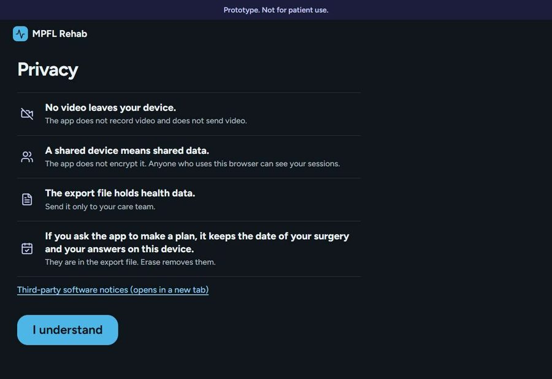
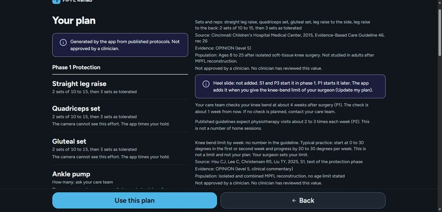
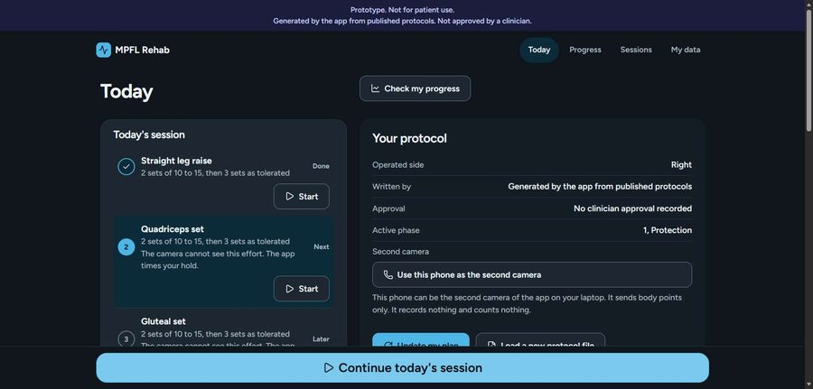
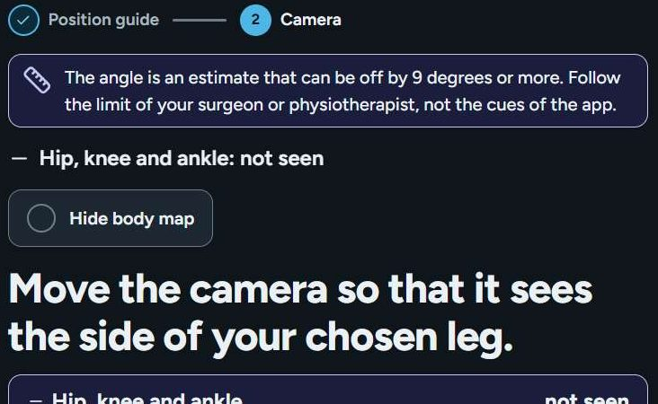
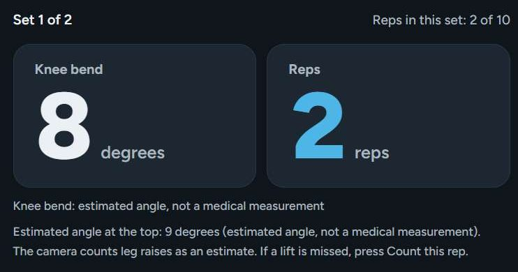

# MPFL rehabilitation app (prototype)

This app is a research and evaluation prototype that counts reps and estimates the knee angle from a webcam during knee exercises. All of this runs in the browser, on the device.

**This is a prototype. It is not a medical device. It is not for patient use.** No video leaves the device, and the app stores no video. No clinician has reviewed any clinical value in it.

## Who is this for

- A person after MPFL reconstruction. Use it only as a test, together with your care team. It does not replace your care team or your physiotherapy plan.
- A clinician who wants to review the app and give a plan file to a person. Start with [docs/clinician-first-review.md](docs/clinician-first-review.md) and [docs/clinician-template.md](docs/clinician-template.md).
- A developer who wants to build on the app, run the tests or check the claims.

## Quick start

1. Open a terminal in the `app` folder.
2. Run `npm ci`.
3. Run `npm run dev`. To test a build, run `npm run build` and then `npm run preview`.
4. Open the address that the command prints.
5. Read the Privacy screen and select "I understand".
6. Allow the camera when the browser asks. The app does not record or send the picture.
7. Load a plan file from your care team, or answer the questions so that the app makes a phase 1 plan.

## Safety and limits

- The app shows an estimate of the knee angle. The error of the estimate is not measured. The app uses a start value of 9 degrees. It is UNVERIFIED. Follow the limit of your surgeon or physiotherapist, not the cues of the app.
- The app gives no score and no praise. It shows a measured number against a limit that the care team set.
- At a pain of 7 or more, or with swelling "more than before", the app stops the session. The button "Knee gave way or hurts" ends the session at any time.
- A clinician must review every clinical value before a patient uses the app. The register is in [docs/clinical-limits.md](docs/clinical-limits.md). The first values to review are in [docs/clinician-first-review.md](docs/clinician-first-review.md).
- A supervised session needs a clinician in the room. Read [docs/live-session-checklist.md](docs/live-session-checklist.md) first.
- The regulatory class of the app is open. An expert must decide it.

## What it looks like

These screens come from the first live test on a real person, on 2026-11-22. The pictures show the app screens only. The camera picture is not part of them.

| Privacy, the first screen | The plan that the app made |
|---|---|
|  |  |

| Today | Before the camera starts |
|---|---|
|  |  |

During an exercise, the app shows the measured number and the rep count. It shows no verdict, no score and no colour of praise or blame.

## What it does

- It loads a plan file from the care team, or it makes a phase 1 plan from published protocols and the answers of the person. The plan names the source and the evidence level of each value.
- It runs the exercise live with the webcam. A body map draws the leg over the camera picture. The app counts reps and shows the angle as an estimate.
- It compares the measured number with the limit of the plan. It never gives a verdict. A rep in range shows nothing and plays no sound.
- It asks about pain between sets. At a pain of 7 or more, the next set does not start.
- The button "Knee gave way or hurts" ends the session at any time.
- It keeps the sessions on the device. The person can export them as JSON or CSV and erase everything.

## Rules that the app keeps

| Rule | How it is held |
|---|---|
| No video leaves the device or is stored, when the app is served with the headers of `app/public/_headers` | The page sends each camera frame to a Web Worker in the same browser. Only the worker returns numbers. The frame stays in the browser and the app never sends it over the network. The second camera sends numbers only (see Second camera). The MediaPipe library tries one metrics request. The fetch guard of the app blocks it ([docs/threat-model.md](docs/threat-model.md), T9). A test records all network traffic of a full session. `scripts/claims-check.sh` bans the video APIs |
| The active phase never changes without a person | `src/lib/protocol/accept.ts` is the only save path of a generated plan. The flag `VITE_SELF_PROGRESSION` is off by default. With the flag off, a generated plan of phase 2 or more is refused |
| No verdict, score or praise | A test of the words and a check of the colours. The screens show numbers against a limit |
| The prototype banner is on every screen | The banner text comes from `src/lib/mode.ts` |
| A clinician must review every clinical value | The register in [docs/clinical-limits.md](docs/clinical-limits.md) lists 57 values with empty review columns |

## Status

The table shows the results of one full check, on the date and commit stated. These are not live results. Date: 2026-11-22. Commit: 408b99b. The one change after it is the wording of the setup notice (commit 4af120c), which the honesty audit and the setup accessibility specs ran again.

| Check | Result |
|---|---|
| Unit tests (`npm test`) | 4,515 tests in 254 files, passed, as `npm test` counts them |
| Browser tests (`npm run e2e`) | 319 passed, 11 skipped, 0 failed (the webkit project ran again alone after one load timeout). 7 skips need a webcam clip that is not in the repository (see [app/audit/README.md](app/audit/README.md)). 4 skips only write screenshots |
| Accessibility audit | 0 run errors on 28 screens, no sideways scroll at 200% text |
| Hostile input audit | 72 of 72 cases passed, 0 foreign requests |
| Honesty audit | 0 failures, 470 checks passed. Two items need a person to read them |
| First load | 195,263 bytes gzip. The limit is 200,000 |

The first live test used a real webcam in Edge, with the GPU delegate. Six exercises ran and the app counted every set. No console error and no request to another host showed in the log.

## What is not done

- No clinician has reviewed any value, cue text, red flag, pain floor or generated plan.
- The error of the estimate is not measured. The app uses a start value of 9 degrees. It is UNVERIFIED for the `lite` model. No goniometer data exists.
- No real phone has run the app, and the second camera has no real-phone test.
- The regulatory class is open. An expert must decide it.
- Patient mode is off. Nobody can turn it on before a clinician review and a decision on the class.
- The skeleton and the rep count have run on one person only. iOS Safari camera use is UNVERIFIED.
- Data on the device is not encrypted.
- After "Erase", a plan of phase 1 can be made from the answers of the person. Phase 2 or more needs the flag or a plan file.

## Install, run, build and test

Run all commands in the `app` folder. The file `app/.npmrc` sets `ignore-scripts=true`, so no package runs an install script ([docs/dependency-vetting.md](docs/dependency-vetting.md), condition C1). Playwright needs its browsers: `npx playwright install chromium webkit`.

| Task | Command |
|---|---|
| Install | `npm ci` |
| Run the dev server | `npm run dev` |
| Build | `npm run build` |
| Preview the build | `npm run preview` |
| Type check | `npm run typecheck` |
| Lint | `npm run lint` |
| Unit tests | `npm test` |
| Browser tests | `npm run e2e` |
| Pairing browser tests | `npm run e2e:pairing` |
| Fast local checks | `npm run precheck` |
| Full gate: selftests, precheck, build, size, e2e, accessibility, hostile input, honesty, source checks | `npm run gate` |

The full gate takes about 40 minutes, and its e2e step takes most of that. The audit scripts are in `app/audit`. Read [app/audit/README.md](app/audit/README.md) for the steps and the manual tests.

## Checks in `npm run precheck`

- `npm run typecheck`: the TypeScript compiler finds no type error.
- `npm run lint`: ESLint finds no error in `src` and `tests`.
- `npm test`: all unit tests run.
- `scripts/model-hash-check.sh`: the model and WASM files match `public/models/SHA256SUMS`.
- `scripts/deps-check.sh`: each dependency is in `scripts/allowed-deps.txt` and has an exact version.
- `scripts/claims-check.sh`: no line of the code matches the banned words, the praise words, the video APIs, the canvas code or the inline colours.
- `scripts/phase-check.sh`: no line of the code writes the active phase outside `src/lib/protocol/`.
- `scripts/secrets-check.sh`: no tracked file holds a secret, a private key, a personal email address, a private IP address, a local user path or a forbidden file. A test value can carry the marker `secrets-check:allow <reason>`.

The pattern checks cannot prove that no other banned text exists. `tests/importGraph.test.ts` reads the imports with the TypeScript parser and covers the save functions.

## Flags

| Variable | Effect | Default |
|---|---|---|
| `VITE_PATIENT_USE_APPROVED` | Only the text `true` turns on patient mode. The app then refuses the example plan, a plan with no `approvedOn` and a plan that the app made without approval | off (demo mode) |
| `VITE_SELF_PROGRESSION` | Only `true` or `1` lets a person confirm a move to a later phase. The Confirm click stays | off |
| `VITE_GENERATOR_EXTENDED` | `false` or `0` removes the mini squat and the seated hold from generated plans | on in demo mode |

Do not turn on patient mode. It needs a clinician review and a decision on the regulatory class. The field `approvedOn` is a claim in an unsigned file. The app cannot check it.

## Tests with real clips

Two tools run a video clip through the real app code. Both need `ffmpeg`. The details are in [docs/clip-analysis.md](docs/clip-analysis.md).

- `node scripts/analyze-clip.mjs <video> --leg right --exercise heel-slide` reads a clip frame by frame and writes numbers only. The output goes to `app/.clip-out/`, which Git ignores.
- `bash scripts/clip-to-webcam.sh <clip>` converts a clip to a file that Chromium plays as the fake webcam.

A clip never enters the repository. One clip is a smoke test and not a validation. The test fixtures hold landmark numbers derived from public CC BY clips, with attribution in [docs/accuracy.md](docs/accuracy.md), and no video.

## Second camera

A phone can send body points of the front view to the laptop. The phone runs the pose model and sends numbers only, over a WebRTC data channel with no server. The steps are in [docs/pairing-wiring.md](docs/pairing-wiring.md). The real-phone test is UNPROVEN.

## Hosting

Serve the built app only from a host that sends the headers of `app/public/_headers`, for example Netlify or Cloudflare Pages. GitHub Pages ignores this file. The CSP tag in `index.html` covers the page but not the pose worker, and it cannot set `frame-ancestors`. Without the headers, another site can frame the app, and the pose worker runs with no CSP. See [docs/threat-model.md](docs/threat-model.md), T9 and T10.

## Dependencies

Runtime: `react`, `react-dom`, `zod`, `dexie`, `recharts`, `@mediapipe/tasks-vision`, `uqr` and `jsqr`. Each package is vetted in [docs/dependency-vetting.md](docs/dependency-vetting.md).

## Folder map

| Folder | Content |
|---|---|
| `app/src/lib` | Pure logic: angle, filter, counters, margin, cues, exercises, sets, red flags, safety floor, setup rules, guides, figure geometry, progress, views, plan view, onboarding, flow, mode |
| `app/src/lib/protocol` | Schema, loader, store, `accept.ts` (the only save path of a generated plan) |
| `app/src/lib/protocolGen` | Pure plan generator: inputs, rules, sources. It never saves |
| `app/src/lib/storage` | Database, export and import, small local values |
| `app/src/pose` | Camera access, pose model wrapper, frame bridge to the worker, frame loop |
| `app/src/pairing` and `app/src/lib/pairing` | Second camera: QR codes, WebRTC link, messages |
| `app/src/ui` | Screens, the v3 shell parts, body map, sound, styles |
| `app/tests` | Unit tests |
| `app/e2e` | Browser tests (Playwright), including the simulated-pose tests |
| `app/audit` | Accessibility, hostile input and honesty audits, and the gate script |
| `app/scripts` | Check scripts, clip tools |
| `docs` | Project documents. `docs/img` holds the pictures of this file |

## Documents

- [Clinical limits](docs/clinical-limits.md): what the app does not do, and the register of values for a clinician.
- [First review for the clinician](docs/clinician-first-review.md), [clinician template](docs/clinician-template.md) and [live session checklist](docs/live-session-checklist.md).
- [Threat model](docs/threat-model.md) and [security review](docs/security-review.md).
- [Architecture](docs/architecture.md), [accuracy record](docs/accuracy.md), [accuracy study protocol](docs/accuracy-study-protocol.md) and [model files](docs/model.md).
- [Citation audit](docs/citation-audit.md) and [rehab rules with sources](docs/rehab-rules.md): the sources behind the plan generator.
- [Clip analysis](docs/clip-analysis.md) and [second camera wiring](docs/pairing-wiring.md).
- [Dependency vetting](docs/dependency-vetting.md), [UI package vetting](docs/dependency-vetting-ui.md) and [yt-dlp vetting](docs/dependency-vetting-ytdlp.md).

## Security

Report a security problem: see [SECURITY.md](SECURITY.md).

## Contributing

- Run `npm run precheck` in the `app` folder before you change the code or push a change.
- Keep the rules table above true. A change must not break a rule. Never weaken a safety or privacy test.
- Add a dependency only with a line in `app/scripts/allowed-deps.txt`, an exact version and a vetting note in `docs/`.
- Do not add a video, a photo of a person or a clip to the repository.

## License

The code of this app is under the Apache License 2.0. Read the file [LICENSE](LICENSE).

- You can use, copy, change and share the code, also in your own work.
- The license has a patent grant and says that the software comes with no warranty and no liability.
- This does not change the safety limits above: the app is a prototype and not a medical device.
- The packages and the model files that the app uses have their own licenses. They are listed in `app/public/THIRD_PARTY_NOTICES.txt` and in [docs/model.md](docs/model.md).
