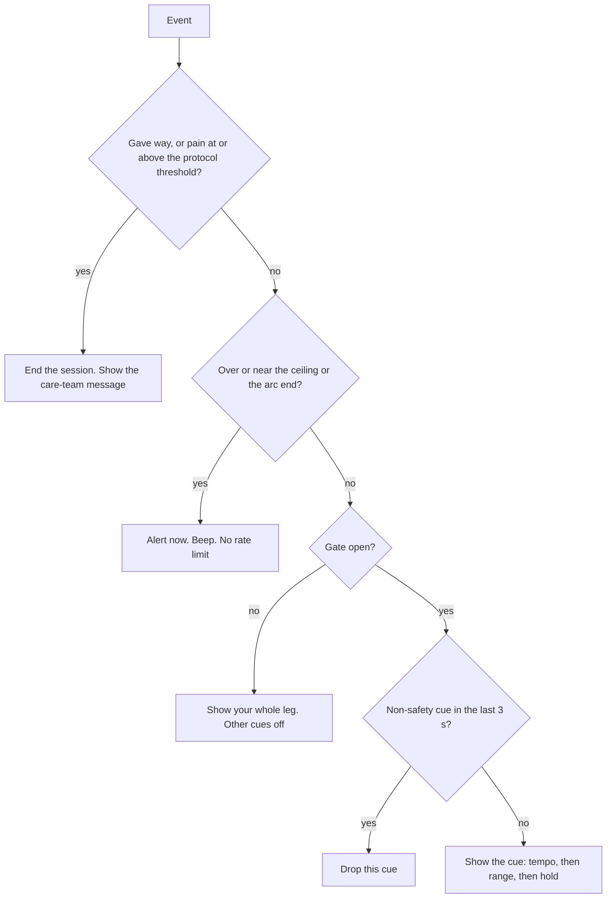
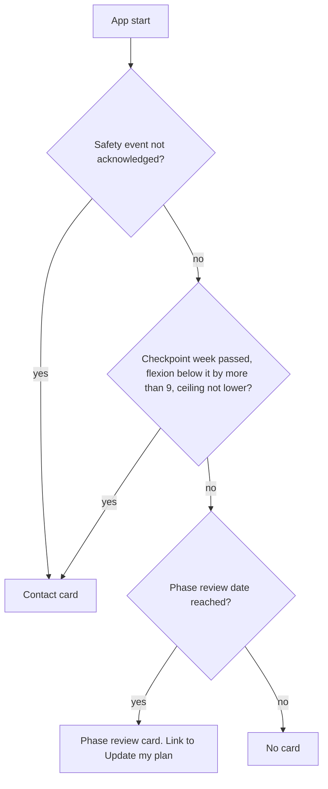

# Live form checks and plan adjustment: design

Date: 2026-11-08. Status: design only. No code, test, script or plan file changed. No clinician and no regulatory expert approved anything here.

Marks: V (read in the source), INFERRED (my reasoning, or my replay of saved data), UNVERIFIED (not opened, or a search summary only). PROPOSAL marks an engineering value only (rule E).

Method: the knowledge agent and skill (`.claude/agents/mpfl-rehab-knowledge.md`, `.claude/skills/mpfl-rehab-knowledge/SKILL.md`), the guardrail skill, `research/INDEX.md` and the files it names. Skills loaded with the Skill tool: `simple-english:simple-english`, `owasp-security`, `anti-slop-code:anti-slop-code`, `mermaid-diagrams`, `adr-skill`.

Changed 2026-11-08 after the knowledge base audit: this design is now compared with `research/rehab-rules.md`, `research/form-evidence.md` and `research/source-audit.md` (read through `research/INDEX-v2.md`). The change list, the honest maximum table and the combined build list are in `docs/design-reconciliation.md`. Quoted source text stays exact, so a style hit inside a quote is allowed.

## 0. Evidence rules of this design (user order, 2026-11-08)

- C1. Every clinical rule and number cites a named source from the source list (section 12). A web claim never counts as validated for MPFL surgery.
- C2. A clinical rule with no source is not built. It becomes DO NOT BUILD, a clinician-only logged number, or a clinician decision.
- C3. Where sources disagree, the design takes the more conservative value or builds nothing, and shows both sources.
- C4. Each rule has a grade: CONSENSUS, REVIEW, STUDY, OPINION, NONE. Changed 2026-11-08 after the knowledge base audit: GUIDELINE is renamed as in `research/rehab-rules.md`. That file marks P2 (Cincinnati) and P3 (Lothian) CONSENSUS (low). `research/citation-audit.md` section 3 grades them OPINION in substance: level 5, weak form "It is recommended", P2 from 2015. This design takes the more conservative grade, OPINION, for P1, P2, P3 and S1.
- C6. Changed 2026-11-08 after the knowledge base audit, from `research/citation-audit.md` section 6: every clinical number is a clinician-set protocol field. The app never compares a passive-range value with an active camera angle. It never acts on a difference smaller than the error of its own model.
- C5. A live check is refused when the 2D webcam error is as large as the effect that it must detect.
- E. PROPOSAL is allowed only for an engineering value, for example a rate limit or a detection gate. Each one says why it is not clinical.

## 1. Short answer

- Live, the app can check five things against a clinician value, with a stated error. They are the side-view knee bend ceiling and target, the arc end of the seated hold, rep time, hold time and leg visibility. Changed 2026-11-08 after the knowledge base audit: the arc end is new (`form-evidence.md` check 6).
- The straight leg raise lag cannot be a live cue. The consensus limit is "less than or equal to 10 degrees of extensor lag" (P2). Changed 2026-11-08 after the knowledge base audit: the 9 degree error is a best case from still photos of healthy adults (C13). Video error is 9.3 to 21.9 degrees (F3). The error is as large as the effect or larger (C5).
- Valgus, trunk lean, hip drop, steadiness and hip rise are not live cues. Frontal 2D angles are not valid (M2, REVIEW). A meta-analysis found 2D and 3D frontal knee angles not correlated, "r = 0.127" (X3, via citation-audit M7). A guideline advises against visual biofeedback on lower-limb alignment (SRC-WILLY, BORROWED).
- During a session, the only changes with a source are safety stops. They are the "knee gave way or hurts" button and a pain answer at the clinician threshold. No source supports a live change of reps, sets or targets. So the app makes none.
- Between sessions, the app shows a "contact your care team" card after any safety event (P2 rec 4, OPINION, safe as a referral). It shows a ROM card only for a checkpoint that a clinician set as an active camera angle (C6). A phase review card appears on the review date. The app never decides that a phase is complete.
- No source gives a deload amount or a trend window after MPFL surgery. P2 rec 26 Note 2 leaves a dose change "per clinical judgment". Fewer reps, lower targets and automatic trend rules are not built.
- Changed 2026-11-08 after the knowledge base audit: the seated extension hold must never ask for full extension by default. P2 rec 29 and P1 agree against terminal open-chain extension in phase 1 (section 7.3).

## 2. The evidence limit and the replay

Changed 2026-11-08 after the knowledge base audit: rows corrected with `source-audit.md` C13, C14, C15 and the measurement rows of `rehab-rules.md` section 9.

| Fact | Source | Grade |
|---|---|---|
| "no validated rehabilitation protocols are established following MPFL reconstruction" | S1 | OPINION (LoE 5) |
| No validated threshold for valgus, trunk lean or pelvic drop after MPFL surgery | SRC-FORMOPUS section 1, `form-evidence.md` gaps | NONE for a threshold |
| Side-view knee angle, bias "3.23" and "−0.14", LoA "±8.73" and "±8.80" degrees. Two static test positions, still photos at 4032 x 3024 pixels, MediaPipe highest complexity, 20 healthy adults | F1 (Okuno) | STUDY. Best-case lower bound, not a webcam video value (C13) |
| 2D knee flexion in exercise video, MAE "9.3-21.9°" across 11 models | F3 (Rode) | STUDY, 25 healthy |
| Knee extension exercise, MediaPipe full model, individual ICC "0.005-0.68" | M7 | STUDY, 14 healthy staff |
| Sagittal hip and knee "most valid and reliable". Frontal and transverse "lack valid and accurate measurement outcomes" | M2 | REVIEW (meta-analysis, gait) |
| Raw webcam squat angle: bias -10.6, RMSE 10.9 degrees | F2 (Iizuka) | STUDY, healthy |
| Absolute 2D valgus bias -19.28 degrees. Test-retest ICC of the change 0.14 to 0.70 | F4 (Asaeda) | STUDY, 15 healthy men |
| Goniometer active extension LoA "-7.3 – 9.0" degrees after knee replacement. 8.2 is the half-width | F9 (Lenssen) | STUDY, BORROWED |
| No goniometer data and no measured margin exist for this app. No study of the `lite` model exists | SRC-ACCURACY, `search-log.md` E1, E2 | Own record |
| Some sagittal systems show smaller errors: LoA within ±10° in 15 knee OA patients, RMSE "2.8°" in 12 healthy | X1, X4 (citation-audit M8, abstracts) | STUDY. The error depends on the system, so the app must measure its own (T13) |
| No study compares criteria-based with time-based progression after MPFLR | S6, S10, S1 | NONE for outcome |
| Sword Health used "inertial motion trackers" and non-random allocation | T1 (C15) | STUDY, BORROWED, not a camera |

My replay of the saved landmark series (8 public clips, healthy people, no goniometer). Script: `/tmp/claude-1000/-home-luis-projects/c0df9405-b52e-4b2f-b357-194865342f04/scratchpad/alf/metrics.mjs`. Each row is SRC-REPLAY (INFERRED). It shows noise, not accuracy.

| # | Finding | Use in the design |
|---|---|---|
| R1 | Clip 01, left heel slide: 4 reps, rep time 5.0 to 5.7 s, peak spread (SD) 4.4 degrees | Rep time is stable on a clean clip |
| R2 | Clip 02 (camera cuts): peak SD 32.6 degrees, one peak 176.5 degrees | Rep-to-rep spread measures framing |
| R3 | Hip vertical range over thigh length: 0.05 (clip 01), 1.47 (clip 02) | "Hip rise" measures framing |
| R4 | Clip 03, left straight leg raise: 21 lifts, top angle 2.5 to 31.4 degrees, SD 6.6. Stored session value 34.4, median about 9 | One lift is noisy. The stored highest value follows outliers |
| R5 | Clip 04 (leg raise on a table): top angles 38 to 87 degrees | The model confuses some setups |
| R6 | Still windows: angle SD 0.9 degrees (clip 06), 2.1 degrees (clip 07) | Steadiness of a few degrees is noise |
| R7 | Clip 07 front view: knee-inward change -45.7 degrees (right leg), -7.7 (left) in one rep | The front-view change is not plausible yet |
| R8 | `peakFlexion` is the highest filtered angle of the session (`app/src/lib/exercises.ts` line 182) | Trends need the median of counted rep peaks |

## 3. Part A: live form checks

Error column: F1 gives about 9 degrees for a side-view angle as a best case. F3 gives 9.3 to 21.9 degrees in video. No value exists for `lite`. "Effect" is the size of the change that the check must see. The verdicts match `form-evidence.md`. Changed 2026-11-08 after the knowledge base audit: grades renamed, seated hold rows rebuilt.

| Exercise | Check | Quantity | Sensor | Error against effect | Source and grade | Verdict |
|---|---|---|---|---|---|---|
| All | Leg not visible | Hip, knee or ankle visibility below 0.5 | Side | Not clinical | Engineering (FR7) | BUILD NOW (exists) |
| All | Detection gate | Leg visible in at least half of the last 5 s | Side | Not clinical | Engineering, PROPOSAL (E) | BUILD NOW (new) |
| All | "Knee gave way or hurts" | Button | None | None | FR11. P2 rec 4 "Catching, locking", OPINION, safe as a referral | BUILD NOW (exists) |
| All | Pain between sets | Patient answer 0 to 10, compared with the protocol `painPauseThreshold` | None | Self-report | P2 rec 4 "Unchanging or increased irritability", OPINION. No MPFLR stop value (NONE). P2 "≤ 2" is a walking goal, not a stop rule (citation-audit 4.4). PM1 5 of 10 and SRC-SANDAL, BORROWED | BUILD NOW only with a protocol threshold. Without it, log only |
| Heel slide, mini squat | Over or near the ceiling | Flexion against `maxFlexion` plus or minus 9 | Side | 9 degrees best case. A ceiling is a large, slow movement | P1 "Avoid KF ROM beyond surgeon guidelines", OPINION. Load rises with flexion (S15, BORROWED) | BUILD NOW (exists). CUE (check 1) |
| Heel slide, mini squat | Below the target | Rep peak below `targetFlexion` - 9 | Side | Fires only when the shortfall is more than 9 | Clinician target, set for the camera (active). Never a P2 passive value (C6) | BUILD NOW (exists, fact text only). CUE (check 2) |
| Heel slide, mini squat | Rep too fast | Rep time below `minRepSeconds` | Side | One frame (33 to 67 ms) against a limit of at least 0.5 s | Clinician number only. Tempo NONE. P2 rec 30 cues "as needed", OPINION (by a therapist) | BUILD NOW (exists, adds "Slow down."). CUE (check 3) |
| Heel slide, mini squat | No rep ended, other leg moves | Return to baseline, leg ranges | Side | Not clinical | Engineering (`docs/leg-and-baseline-design.md`) | BUILD NOW (already designed) |
| Seated hold | Arc end: knee straighter than the clinician limit | Flexion against the new field `minFlexion` plus or minus 9 | Side | Arc ends of 30 to 45 degrees sit well above the 9 degree margin | P2 rec 29 "knee extension from 30° to 0°" avoided. P1 "Do not perform AROM open chain KE" in weeks 0 to 6, and in weeks 7 to 11 "unless cleared by surgeon". Both OPINION. Against: P3 from 2 weeks, N3 | NEW. CUE (check 6), only with a clinician `minFlexion`. Changed 2026-11-08 after the knowledge base audit |
| Seated hold | Hold time at the hold angle | Time with flexion between `minFlexion` - 9 and `targetFlexion` + 9 | Side | 9 degrees | Hold time NONE (clinician value). Hold angle from the clinician, no default | BUILD NOW, changed: no hold without both angles. Old default of 0 degrees removed |
| Seated hold | Timer restart text | Knee leaves the hold band | Side | 9 degrees | Same | BUILD NOW (states what the timer did) |
| Straight leg raise | Top angle as a number | Smallest flexion while raised, per lift | Side | 9 degrees best case, R4 SD 6.6 | FR9, user decision | Keep the number. Store the median of lifts. LOG (check 5) |
| Straight leg raise | Lag cue | Top angle above a lag limit | Side | Best case 9, video 9.3 to 21.9, against the effect "less than or equal to 10 degrees" (P2). Goniometer about 8 (F9) | P2 10 degrees and S1 "without extension lag", OPINION. P1 uses "SLR without a lag" to unlock the brace, so a false reading has a cost (citation-audit 4.2) | CLINICIAN-ONLY number (C5). LOG only, never a progression gate. The generator never sets `maxTopFlexion` |
| Heel slide, mini squat | Up time, down time | Rise start to peak, peak to rep end | Side | Depends on thresholds | NONE | CLINICIAN-ONLY number |
| Mini squat | Knee moves inward | Change from rep start (`views.ts`) | Front | 7.4 to 8.8 degrees (F7) against a group difference of about 8. R7 | S1 "closely monitored", OPINION. NONE for a threshold. Against live alignment biofeedback (SRC-WILLY, BORROWED) | LOG for the clinician after T13 (FR24). Never live (check 7) |
| Mini squat | Trunk forward lean | Trunk line against vertical | Side | Not measured for `lite` | NONE | LOG after T13 (check 8) |
| Heel slide, mini squat | Movement symmetry | Peak of the operated knee against the other knee | Side | Each side carries about 9 degrees | P2 "75% of uninvolved limb" and S1 "95%" are goniometer values | LOG as "movement symmetry" (check 10), future FR19. Never "LSI" |
| Heel slide | Hip rise | Hip range over thigh length | Side | R3: framing | NONE | DO NOT BUILD |
| Heel slide, mini squat | Peak spread | SD of rep peaks | Side | R2: framing | NONE | DO NOT BUILD |
| Seated hold | Steadiness | SD of the hold angle | Side | R6: noise 0.9 to 2.1 | NONE | DO NOT BUILD |
| Straight leg raise | Lift height, hip angle | Hip flexion | Side | Not measured | NONE | DO NOT BUILD |
| Mini squat | Absolute valgus, FPPA cut-off | Frontal angle | Front | Bias -19.28 (F4). Frontal 2D not valid (M2). 2D against 3D "r = 0.127" (X3) | NONE for MPFLR | DO NOT BUILD |
| Mini squat | Lateral trunk lean, pelvic drop, load shift | Frontal angles | Front | Human hip ICC .396 (SRC-FORMOPUS 2.2) | NONE for MPFLR | DO NOT BUILD |
| Heel slide, mini squat | "Bend further" instruction | None | Side | A reading 9 degrees low pushes past the target | NONE for an in-session push | DO NOT BUILD |

## 4. Live adjustment design

### 4.1 Cue texts

Each cue is an instruction or a fact in neutral words, from the fixed list in `app/src/lib/cues.ts`. An in-range rep shows nothing (FR23, user decision). Section 10, decision 3, shows a source that bears on this decision.

| Event | Text | Change from today |
|---|---|---|
| over-limit | "Stop at your limit, do not push." | Also used for the arc end of the seated hold |
| near-limit | "Close to your limit, stop." | Also used for the arc end of the seated hold |
| paused, gate closed | "Show your whole leg." | Also used by the gate |
| too-fast | "Slow down. Rep time 1.2 s. Your care team set at least 2.0 s." | Adds "Slow down." |
| shallow | "Depth below your target." | None. No push instruction (section 3) |
| hold restart | "The knee left the hold angle. The hold timer starts again." | New. Changed 2026-11-08 after the knowledge base audit: the old draft "Keep the knee straight." asked for full extension |
| hold not set | "Ask your surgeon how far you can straighten your knee in this exercise." | New, when `minFlexion` or `targetFlexion` is missing. Source: P1 "unless cleared by surgeon" |
| no rep ended | "No rep ended yet. Your care team sets how far the knee must come back." | From the leg design |

### 4.2 Priority, timing and clearing

- Order: safety stop, ceiling or arc end, leg not visible, tempo, range, hold, notes. The safety side warns first (FR8, user decision).
- Safety cues fire on the first event. The over-limit alert stays while the knee stays past the limit by more than 9 (as `Session.tsx` does today).
- Engineering values (E): at most one non-safety cue each 3 s, on screen 4 s. The same text does not come again within 10 s. The gate window is 5 s. They are not clinical, because they set how often text appears and when a measurement exists. The 3 s and 10 s values are PROPOSAL in `ux-flow.md` sections 6.2 and 12. One meta-analysis found no reliable effect of feedback frequency on motor learning (SRC-MCKAY, UNVERIFIED).
- A cue clears when its time ends, when a higher cue replaces it, or when the leg returns.

### 4.3 What a live adjustment can change

| # | Trigger | Change | Undo | Source and grade |
|---|---|---|---|---|
| L1 | Gave-way press | End the session, show the care-team message | No | FR11. P2 rec 4, OPINION, safe as a referral |
| L2 | Pain between sets at or above the protocol `painPauseThreshold` | End the session, show "Pause and contact your care team." | No | P2 rec 4 ("Unchanging or increased irritability in the knee"), OPINION. The number comes from the clinician |
| L3 | Gate closed | Form cues off, "Show your whole leg." | Clears by itself | Engineering (E) |

Not built, because no source gives the trigger or the change (C2):
- a pause after a number of over-limit events, or the end of a set after shallow reps,
- fewer reps or sets during the session, or any target change during the session.

The counts of these events go to the clinician (they exist as `nearLimit`, `overLimit`, `tooFast`).

- L2 uses only the clinician threshold. The FR12 floor of 7 has no source (FR12 says so). It stays as the existing end-of-session rule (user decision) and is not extended. Changed 2026-11-08 after the knowledge base audit: P2 gives pain "≤ 2out of 10" as a phase goal, not a stop rule. PM1 gives 5 of 10 for tendinopathy (BORROWED). No MPFLR source gives a stop value (NONE).
- Never: raise a target, a ceiling, a rep count or a set count. Never add a set.
- Nothing in section 4 touches the protocol, the active phase or a stored limit. The record keeps L1 to L3 as fixed ids for the clinician.

### 4.4 Accessibility (FR10)

- Non-safety cues use the polite live region (`role="status"`). L1, L2, near-limit and over-limit use `role="alert"`.
- Sound: only near-limit and over-limit beep, as today.
- The pain question between sets is an 11-pill control with 48 px targets (`docs/ui-design.md` section 4.3). Skip is allowed and logs "no answer".
- The set-complete notice uses the `info` icon, not the `check` icon. A check mark reads as approval.

## 5. Part B: plan adjustment between sessions

### 5.1 Principle

- The default is no change. The app shows data and asks for contact. The surgeon decides each new phase (KB item 6). P2 rec 18 asks for "a functional-based goal progression model" rather than a time-based one (OPINION).
- No change is silent. No change edits the protocol file. The phase changes only through `app/src/lib/protocol/` (FR4).

### 5.2 Data

| Signal | In the record today (`app/src/lib/storage/db.ts`) | Missing |
|---|---|---|
| Peak knee bend | `peakFlexion` (session maximum, R8) | `repPeakMedian` of counted reps |
| SLR top | `topFlexion` (highest lift, R4) | `liftTopMedian`, `liftCount` |
| Reps against prescription | `repsPerSet`, `repsPrescribed`, `setsPrescribed` | None |
| Tempo | `tooFast` | `repMsMedian`. Clinician-only: `upMsMedian`, `downMsMedian` |
| Limit events | `nearLimit`, `overLimit` | Arc-end events of the seated hold count here |
| Pain, swelling | `pain`, `swelling` | `setPain` array |
| Safety events | `gaveWayPresses`, `redFlagBlocks` | `endReason` (stop, gave-way, pain-stop, all-sets) |
| Detection | None | `detectionRate` (0 to 1) |
| Leg | `legTracked`, `cameraSide` | None |
| Weeks since surgery | None | The surgery date of the generator answers (5.6) |
| Card history | None | New table `planCards` (5.5) |

All new fields are optional, fixed types and no free text, as in T16 and T17.

### 5.3 Valid session

- A camera value counts only from a valid session: `detectionRate` at least 0.8, at least 5 counted reps, and `legTracked` equal to the protocol side. These are engineering values (E). The 5 reps follow `MIN_COUNTED_REPS` (`progression.md` section 5.2).
- A session that fails shows "Not enough camera data". It is never read as low performance.
- Pain and swelling count in every session.

### 5.4 Rules

| Id | Trigger | Card | Source and grade | Status |
|---|---|---|---|---|
| B1 | Any FR11 gave-way press, FR12 pause, or swelling "more than before" | "Contact your care team" at each start until the person presses "I contacted them" | P2 rec 4 "Unchanging or increased irritability", "Persistent or recurrent effusion", "Catching, locking", OPINION with two 1b items (VERIFIED by me). Safe as a referral (citation-audit 4.6). One event, not a count (C3) | BUILD |
| B2 | Weeks since surgery reach a `romCheckpoints` week that a clinician set. The median rep peak of the last valid heel slide session is below it by more than 9 | "Contact your care team about your knee bend." with the measured number only | Pattern: P1 "Contact surgeon if ROM not trending towards 90° by 4 weeks", P2 rec 4 "Unexpected loss or minimal progression of ROM", OPINION. P2 values "≥ 90°" and "≥ 120º" are passive (PROM) and are reference values for the clinician only | BUILD only with a clinician checkpoint stated as an active camera angle. Changed 2026-11-08 after the knowledge base audit: no P2 default (C6), suppression rule added |
| B3 | The `reviewDate` of the active phase arrives | Phase review card: numbers, "not measured" list, and a link to "Update my plan" | S1 phase weeks, OPINION. P2 rec 18 criteria, OPINION. Surgeon decides (KB item 6) | BUILD the card. Applying the phase step stays behind a flag (5.5) |
| X1 | Reps below prescription over several sessions | Fewer reps | P2 rec 26 Note 2: intensity "can be modified per clinical judgment". NONE for an app trigger or amount | DO NOT BUILD. Clinician sees it |
| X2 | Peak trend falls or stays flat over a window | Contact card | P2 names the sign. NONE for a window | DO NOT BUILD as a rule. Trend in FR22a |
| X3 | Lower a ROM target, a ceiling or `returnWithinDeg` | Any | Too little motion links to stiffness (N22, STUDY). Ceiling is a surgeon decision (KB item 7) | NEVER |
| X4 | Move from 2 sets to 3 sets | More sets | P2 rec 26 "progression to 3 sets of each exercise as tolerated". "As tolerated" needs a care-team judgment | DO NOT BUILD. Changed 2026-11-08 after the knowledge base audit: new row |

- B2 suppression: B2 does not fire when the protocol `maxFlexion` of the heel slide is below the checkpoint. The surgeon limit then governs. The card and the stop cue conflict otherwise. Changed 2026-11-08 after the knowledge base audit.
- B2 card text shows the measured number and the week only. It does not show the guideline number, because a number to reach reads as a goal (guardrail skill). Changed 2026-11-08 after the knowledge base audit.
- B2 never compares the camera angle with a passive value (C6, citation-audit M3). The clinician sets each checkpoint knowing that the camera sees active motion. The generator sets none (generator G13).
- B2 runs only with the checkpoints of the protocol that the patient follows (C3).
- B3 is time-based because the measured numbers alone cannot decide. The app measures only knee flexion. Full extension, gait, walking without crutches and quadriceps strength need the clinician.
- B3 shows the flexion number with the FR22a state for a clinician criterion. A criterion of 120 degrees reads "Above the limit by more than the margin" only from a median above 129 degrees.
- If `surgeon.concurrentProcedures` is set, B3 offers no phase step. P1: "Follow most conservative guideline" for concomitant procedures.

### 5.5 Keeping the safety property of FR4

- B1 and B2 change nothing in the plan. They write a row to `planCards`.
- B3 with a clinician protocol (`approvedOn` set): the card offers "Export for my care team" only.
- B3 with a generated protocol: the card opens "Update my plan" of the generator design (section 6). That flow asks the clearance question, blocks an upward change after any B1 event, and runs `generateProtocol(inputs, today, { phase })`. Only `acceptProposal` with a `PersonConfirmation` saves. So one write path exists.
- The phase-check script gets the generator patterns (generator design section 6). The generated version carries the `generated` field and the banner "Generated by the app from published protocols. Not approved by a clinician."
- The flag `VITE_SELF_PROGRESSION` is off by default. It stays off until the regulatory expert rules (7.2).
  Superseded 2026-11-13: the flag is on by default (MPFL_APP_PLAN.md FR31).
  Superseded 2026-11-22: the flag is off by default. Only the text `true` or `1` turns it on (see [clinical-limits](clinical-limits.md)).
- `planCards` row: `id`, `createdAt`, `kind` (contact, rom-checkpoint, phase-review), `ruleId`, `sourceId`, data numbers (fixed fields), `acknowledgedAt`, `clearanceAnswer`, `protocolId`. No free text.

### 5.6 Alignment with the protocol generator

Changed 2026-11-08 after the knowledge base audit: the generator removes its range cap (old G6). It generates no dose (G10) and no numeric criterion or checkpoint (G13).
- The generator supplies the `generated` field, no `approvedOn`, and the surgery date. It refuses combined surgery (R2), adolescents (R3) and repeat surgery (R5).
- G13 supplies the phase 1 clinician checks with no number and the `reviewDate` (surgery plus 6 weeks). So B2 never fires for a generated plan.
- G3 allows phase 2 from week 7 with a Yes to the clearance question. G8 and G9 do not generate the mini squat or the seated hold in weeks 0 to 11. P2 rec 29 is a second source for G9.
- G10 gives no dose. In option B the person enters it. X1 and X4 never change it.
- Numbering: B5 of an earlier generator draft is B2 here, B6 is B3, and B4 is X2.

### 5.7 Clinician view (FR15, FR22a)

- A block after the events block: the card history. Columns: date, card, rule id, source id, data, acknowledged, clearance answer.
- Clinician-only numbers appear with the margin and the angle label. They are the SLR lift median, up and down time, trunk lean, knee inward change, extension in the hold and movement symmetry.
- No total, no colour and no "met", as in FR22a.

## 6. UI

| Place | Content |
|---|---|
| Session cue area | The existing status and alert lines. The pain question in the set-complete notice when the protocol sets a threshold |
| Summary, card "What I noticed" | "Reps counted: 18 of 30." "Peak knee bend, median of counted reps: 72 degrees (estimated angle, not a medical measurement)." "Reps faster than 2.0 s: 4." "Close to your limit: 2. Past your limit: 0." "The camera saw your leg in 91 percent of the session." At most one instruction, for example "Next time, take at least 2.0 s for each rep." |
| Home, contact card | Strong notice: "Contact your care team. On 8 November you pressed Knee gave way or hurts." Buttons "I contacted them" and "Remind me next time" |
| Home, ROM card (B2, clinician checkpoint only) | Changed 2026-11-08 after the knowledge base audit: "Contact your care team about your knee bend. Week 6 after surgery. Median knee bend in the heel slide: 98 degrees (estimated angle, not a medical measurement)." No guideline number |
| Home, phase review card | "Your plan has a review for phase 1 on 20 December." Rows with FR22a states. "Not measured by the app: full extension, gait, walking without crutches, quadriceps strength." Button "Update my plan" (generated plan) or "Export for my care team" (care-team plan). Footer "Not approved by a clinician." |
| My data, "Plan cards" | The card history |

Not shown anywhere: a score, a streak, a badge, a grade, a percentage of plan done, a trend arrow, "improved", "on track", green or red.

## 7. Safety, regulation and clinician review

### 7.1 What can go wrong

| Risk | Limit in the design | Residual risk |
|---|---|---|
| A false shallow cue makes a person push into pain | Fact text only, no push instruction. The cue fires only when more than 9 below | A person can still push |
| A missed ceiling or arc-end cue | Warns from the limit by the margin. The gate never hides the alert while the leg is visible | Video error above 9 is likely (F3) until T13 |
| A seated hold to full extension in phase 1 | No hold without a clinician `minFlexion`. The generator never adds it in weeks 0 to 11 | A clinician file can set `minFlexion` to 0 |
| A wrong phase step for a patient with a complication | Time trigger, surgeon clearance, no step with combined surgery, flag off | A person can answer "Yes" without a clearance |
| Cue storm | 3 s rate, 10 s repeat rule, priority | Values are engineering PROPOSALs |
| Model confuses the legs | Leg choice and soft note. Valid session needs the protocol side | A swap within a frame is UNVERIFIED |
| Low detection read as low performance | Gate and valid-session rule | None known |
| Stiffness hidden by a deload | No deload exists. ROM targets never drop. B2 refers on a clinician checkpoint | A generated plan has no checkpoint. A low surgeon limit suppresses B2 |
| A tampered file or row | Zod on every read, no free text (OWASP A08). The file is unsigned (plan section 1.4) | A person can edit their own data |

### 7.2 Regulatory note

- MDCG 2019-11 rev.1 lists software that recommends "personalised rehabilitation exercises" from ROM data as medical device software (SRC-MDCG).
- In MDCG 2019-11, software that adapts therapy by itself is the class III example (Rule 22). A specialist decision gives class IIa (SRC-MDCG).
- FDA: recommendations to patients are device functions (SRC-FDACDS).
- B1 and B2 are referral prompts. B3 with the flag on changes the plan after a patient answer. The class is not settled (plan sections 1.5 and 11).
- UNVERIFIED by me: all four facts above, and whether a change that the patient confirms counts as the closed loop of Rule 22. An expert must decide before the flag turns on.

### 7.3 A clinician must review before any patient use

- Every cue text in 4.1, the pain question between sets, and the `painPauseThreshold` value.
- Changed 2026-11-08 after the knowledge base audit: the seated extension hold. P2 rec 29 avoids "knee extension from 30° to 0°" in the initial phase "to minimize stress to the reconstructed medial patellofemoral ligament". P1 says "Do not perform AROM open chain KE" in phase 1 and "unless cleared by surgeon" in phase 2. Later arcs: P2 "90°-30°" sits in a note, not in the recommendation, and the note is worded as an option (citation-audit V46). P1 "(90-40 degrees)" is a phase 2 item under "Follow surgeon preference and patient tolerance" (V47). Contrary: P3 and N3. The design therefore requires a clinician `minFlexion` and `targetFlexion` and gives no default. The example protocol uses 40, marked as an example clinician value with the P1 source.
- B2 checkpoints, B3 review dates, and whether adolescents use the same rules (P2 covers ages 8 to 25).

## 8. Adversarial review

| Role | Strongest objection | Answer or residual risk |
|---|---|---|
| Physiotherapist | Guideline 46 asks for feedback cues "as needed". Silence for good reps loses adherence (Sluijs 1993 in P2) | A sourced point. Section 10, decision 3 asks the user |
| Physiotherapist | "An isometric hold at 60 degrees is not a long arc exercise." | Possible. P1 forbids all AROM open chain KE in phase 1. To reach 60 from a seated 90, the knee extends against gravity. The design keeps it out of phase 1 |
| Surgeon | Self-reported clearance is not clearance | The phase step stays behind a flag. With a clinician protocol the app never steps |
| Regulator | Patient-facing referral and phase cards are device functions. "Science based" needs outcome evidence | No outcome claim. Level 5 consensus is stated. Expert ruling before patient use |
| Biomechanist | 2D angles hide hip and trunk compensation. R7 is not plausible | Live cues use only side-view angles with the margin and timestamps |
| Patient with stiffness | A deload makes me bend less | No deload exists. B2 refers on a clinician checkpoint. The red flag "Unexpected loss or minimal progression of ROM" stays in the check |

Strongest objection overall: the user asked for live adjustment and plan adaptation, and this design builds almost none. My answer: under C1 and C2 no source gives a live volume change, a deload amount or a trend window after MPFL surgery. The honest maximum is in `docs/design-reconciliation.md` section 4.

## 9. Build list (tests first, pure functions)

Changed 2026-11-08 after the knowledge base audit: the combined, ordered list is `docs/design-reconciliation.md` section 6. The seated hold fix comes first. The items of this design, in that order:
1. Shared `app/src/lib/evidence/sources.ts` and `rules.ts` (one table for both designs). Test: every source id has an entry. A clinical rule with PROPOSAL fails. An engineering PROPOSAL without `whyNotClinical` fails.
2. `app/src/lib/liveCues.ts`: `liveCues(window, exercise, protocol)` returns `{ cue, stop, gate }`. The type has no field for a target or a limit. Tests: priority, 3 s rate, 10 s repeat, gate, L1 to L3, arc end.
3. `app/src/lib/cues.ts`: "Slow down.", the hold restart text and the hold-not-set text. Update `tests/cues.test.ts` and `allCueTexts()`.
4. `app/src/lib/exercises.ts`: per-rep peaks, per-lift tops, rep times, detection count.
5. `app/src/lib/storage/db.ts`: fields of 5.2 and `planCards` in the one Dexie version 3. Tests: old files read, unknown keys fail.
6. `app/src/lib/adapt/propose.ts`: `proposeAdjustment(sessions, protocol, cards, today)` returns cards only. Tests: B1 on one event. B2 only with a checkpoint rule id, and suppressed under a lower ceiling. B3 on the date. X1 to X4 never.
7. No phase writer in this design. B3 opens the generator flow. Tests: the card links to that flow, and never for a protocol with `approvedOn`.
8. UI: `Session.tsx`, `Summary.tsx`, `Home.tsx`, `DataScreen.tsx`, `ClinicianView.tsx`. Run `claims-check.sh`.
9. `app/scripts/claims-check.sh`: add `met`, `passed`, `streak`, `badge`, `improved`, `worse`, `on track` to the patient-text words.

Property tests (no new package, a seeded generator in `tests/helpers`):
- `liveCues` never returns a changed target, ceiling, rep count or set count.
- A missing clinician value (`painPauseThreshold`, `minRepSeconds`, `minFlexion`, a checkpoint) never gets a default and never fires a rule.
- `proposeAdjustment` never returns a plan change, only cards.

Replay tests on the saved clips (read-only, `rca/replay.mjs` pattern):
- Can prove: the rate limit holds on noisy series. The gate closes in the cuts of clips 02 and 05. No lag cue exists on clips 03 and 04.
- Cannot prove: angle accuracy, the `lite` error, clinical meaning, patient behavior or outcome.

Mutation ideas: remove the margin from the ceiling, the arc end, the gate or the rate limit. Restore the hold default of 0. Let B3 fire for a protocol with `approvedOn`. Let B2 fire with a checkpoint that has no rule id. Each must fail a named test.

E2E (scripted source, `docs/ui-design.md` section 9 step 8): pain at the threshold between sets ends the session. A seeded gave-way session shows the contact card until acknowledged. The flag off hides the clearance buttons.

Existing tests that change: `tests/cues.test.ts`, `tests/ui/session.test.tsx`, `tests/ui/noVerdict.test.tsx`, the FR10 sound tests (no new beep), `tests/reviewSummary.test.ts`, `tests/scripts.test.ts`, `tests/exercises.test.ts`, the guide and figure tests.

## 10. Open decisions, ranked

| # | Decision | Who | Recommendation |
|---|---|---|---|
| 1 | Seated extension hold out of phase 1, with clinician `minFlexion` and no default | Clinician | Changed 2026-11-08 after the knowledge base audit: P1 and P2 agree, so the design enforces it. The clinician confirms the arc end |
| 2 | Accept that live adjustment is limited to safety stops (C2) | User | Yes, until a source exists |
| 3 | Silence for in-range reps. P2 cites Sluijs 1993: "regular positive feedback from a physical therapist" goes with adherence | User | Keep silence. The source is about a therapist and adherence, not an app and outcome |
| 4 | B3 phase step with the flag, against plan section 1.5 revision 1 | User, regulatory expert | Build the card. Keep the flag off |
| 5 | `painPauseThreshold` value. No MPFLR stop value exists | Clinician | Clinician sets it |
| 6 | B2 checkpoints as active camera angles, with the suppression rule | Clinician | The clinician sets them. The P2 and P1 passive values are reference only |
| 7 | Store the median of SLR lifts in place of the highest | User | Store both |

## 11. ADR: limit live and plan adaptation to sourced safety rules

- Status: proposed. The user has not confirmed the intent summary that the adr-skill requires. The questions are in section 10.
- Context: the user asked for live form evaluation and plan adjustment from session data, science based. Sources support clinician limits, referral on red flags and surgeon phase decisions. No source supports automatic changes (`progression.md` section 1).
- Decision: live cues only for margin-gated side-view angles, the arc end of the seated hold, rep time, hold time and visibility. Live changes are safety stops. Between sessions, referral cards and a time-based phase review card. A phase step only through the generator flow, after a reported clearance, behind a flag.
- Options rejected: (a) live volume changes and deloads, no source. (b) automatic changes (T4), rejected in `progression.md`. (c) live frontal cues, M2, SRC-WILLY and R7. (d) editing the protocol file in place, breaks FR4. (e) a default hold angle, P1 and P2.
- Non-goals: no form score, no new clinical number, no ROM target change, no new npm package.
- Consequences: one storage version 3, one shared sources table with a test, two pure modules and a flag. Also a new schema field `minFlexion`, more banned words and a regulatory question.
- Implementation plan: `docs/design-reconciliation.md` section 6. Paths: `app/src/lib/liveCues.ts`, `app/src/lib/adapt/`, `app/src/lib/evidence/`, `app/src/lib/storage/db.ts`, `app/src/ui/`.
- Verification:
  - [ ] The sources test fails for a rule without a table entry.
  - [ ] The `liveCues` property test passes 1000 seeded runs.
  - [ ] `phase-check.sh` and `claims-check.sh` pass.
  - [ ] With the flag off, no code path changes `activePhase`.
  - [ ] No seated hold runs without `minFlexion` and `targetFlexion`.
- Revisit when: T13 gives a `lite` margin, the expert rules on the class, or G1 (BASK) is read.

## 12. Source list

Changed 2026-11-08 after the knowledge base audit: VERIFIED now means that I, the author of this revision, read the text on 2026-11-08. I read P1, P2 and P3 as PDF text and S1 as PMC full text. Every other source is UNVERIFIED by me, with its audit verdict. Code uses the KB id where one exists.

| Id (KB id) | Reference | Claim and quote used | My access | Audit verdict |
|---|---|---|---|---|
| SRC-CCHMC (P2) | Cincinnati Children's Hospital Medical Center. Evidence-Based Care Guideline 46, ages 8 to 25, January 2015. URL in `research/clinical-update.md` 3.1 | Rec. 4 red flags. Rec. 18 functional progression. Rec. 26 dose, Note 2 "per clinical judgment". Rec. 29 terminal 30 to 0. Rec. 30 cues "as needed". Rec. 39 note "90°-30°". Table 2 "≥ 90°" by 4 weeks, "≥ 120º by 6 weeks", lag "less than or equal to 10 degrees". Most items "LocalConcensus 2014 [5]" | VERIFIED | VERIFIED-FULL |
| SRC-HSS (P1) | Hospital for Special Surgery. MPFL reconstruction post-operative guideline, 2020 to 2024 | "Do not perform AROM open chain KE". "unless cleared by surgeon". "limited arc of motion (90-40 degrees)". "Avoid KF ROM beyond surgeon guidelines". "Contact surgeon if ROM not trending towards 90° by 4 weeks". "Follow most conservative guideline" | VERIFIED | VERIFIED-FULL |
| P3 | NHS Lothian. MPFL reconstruction guidelines, May 2022 | "timescales are approximate". "OKC quadriceps exercises should be progressed as able" (phase 2) | VERIFIED | VERIFIED-FULL |
| SRC-HSU (S1) | Hsu et al. 2025, IJSPT 20(7):1074-1090, PMC12222034 | "no validated rehabilitation protocols are established following MPFL reconstruction". Table 1 "0 to 6 weeks", "Knee flexion greater than 110°". "Closed-chain exercises should be closely monitored" | VERIFIED | DIFFERS in part (C1, C2, C3, C11) |
| SRC-WILLY | Willy RW et al. 2019, JOSPT 49(9):CPG1-CPG95 | Grade B against visual biofeedback on lower extremity alignment. BORROWED | UNVERIFIED (the first author of this design read it) | Not re-read, HTTP 403 |
| SRC-SANDAL | Knee osteoarthritis secondary analysis, PMC12213136, citing Sandal 2016 | Pain "> 5 as high-risk". BORROWED | UNVERIFIED | Not audited |
| PM1 | Sprague AL et al. Pilot Feasibility Stud 2021;7(1):58 | Pain "should not exceed a 5/10" (Thomeé model). BORROWED | UNVERIFIED | VERIFIED (full text) |
| SRC-OKUNO (F1) | Okuno 2026, Sensors 26(18):5890 | LoA "±8.73" and "±8.80". Still photos, healthy | UNVERIFIED | VERIFIED-FULL, context narrower (C13) |
| F3 | Rode D et al. Sci Rep 2025;15(1):38767 | MAE "9.3-21.9°" | UNVERIFIED | VERIFIED-FULL (C14) |
| M2 | Scataglini S et al. Sensors 2024;24(11):3686 | Frontal planes "lack valid and accurate measurement outcomes" | UNVERIFIED | VERIFIED (abstract) |
| M7 | Das UC et al. Sci Rep 2026 | ICC "0.005-0.68" | UNVERIFIED | VERIFIED (abstract) |
| X3 | J Orthop Sports Phys Ther 2018;48(10):812-822, meta-analysis | 2D against 3D frontal knee angle "r = 0.127, P = .094" | UNVERIFIED | Abstract read by `research/citation-audit.md` (M7) |
| X1, X4 | Physiotherapy 2026 (knee OA), Knee 2025 (healthy) | LoA within ±10°, RMSE "2.8°" | UNVERIFIED | Abstracts read by `research/citation-audit.md` (M8) |
| N3 | Hysing-Dahl T, Inderhaug E. J Exp Orthop 2024;11(3):e12062 | Open chain restricted only after bony procedures. Disagreeing source | UNVERIFIED | Read in full by `research/citation-audit.md` (M1) |
| CA | `research/citation-audit.md`, 2026-11-08 | Grade in substance, rule verdicts 4.1 to 4.7, fitness conditions, V46, V47 | Project file, read | Not applicable |
| SRC-IIZUKA (F2) | Iizuka 2026 | Bias -10.6, RMSE 10.9 | UNVERIFIED | EXISTS, not rechecked |
| SRC-ASAEDA (F4) | Asaeda 2024, Heliyon | Bias -19.28 degrees | UNVERIFIED | EXISTS, fetch failed |
| SRC-JANISCH (F7) | Janisch 2026, BMC Musculoskelet Disord | LoA -8.76 to 7.42 | UNVERIFIED | EXISTS, not rechecked |
| SRC-LENSSEN (F9) | Lenssen 2007, BMC Musculoskelet Disord 8:83 | LoA "-7.3 – 9.0" | UNVERIFIED | VERIFIED-FULL |
| T1 | Correia FD et al. 2018 (Sword Health, TKA) | "inertial motion trackers", non-random | UNVERIFIED | VERIFIED-FULL (C15) |
| N22 | Marquez-Lara A et al. 2024 | ROM at 6 weeks predicted manipulation | UNVERIFIED | VERIFIED-ABSTRACT |
| SRC-KANG (S6) | Kang 2026 | "only 14% to 40% of patients met all study-specific RTS criteria" | UNVERIFIED | VERIFIED-ABSTRACT |
| SRC-VIDRA (S10) | Vidra M et al. 2026 | Delphi "full ROM should be achieved by 6 weeks" | UNVERIFIED | DIFFERS in part (C4, C5) |
| SRC-FORMOPUS | `research/form-opus.md` sections 1, 2.2, 3 | Criteria, FPPA group difference, hip FPPA ICC .396 | Project file, read | C13, C14 apply |
| SRC-CLIN9 (KB9) | `research/clinical.md` section 9 | Items 6 and 7 | Project file, read | Not applicable |
| SRC-MDCG | MDCG 2019-11 rev.1, June 2025 | Rule 11, Rule 22, rehabilitation example | UNVERIFIED | Not audited |
| SRC-FDACDS | FDA CDS guidance, January 2026 | Patient recommendations are device functions | UNVERIFIED | Not audited |
| SRC-MCKAY | McKay et al. 2022 | No reliable effect of feedback frequency | UNVERIFIED (search summary only) | Not audited |
| SRC-ACCURACY | `docs/accuracy.md` | No goniometer data | Project file, read | Not applicable |
| SRC-REPLAY | My replay, script path in section 2 | R1 to R8 | Own measurement, INFERRED | Not applicable |

## 13. Update 2026-11-09: live facts, text guide and clinician template

User decision: "C+A". The reading of C is C-prime: a neutral fact that compares what the camera measured with the sourced description, with the camera error stated. It has no verdict word, no score and no verdict colour. Sources: `research/technique-sources.md`, `research/form-evidence.md`.

### 13.1 What I built

- One live fact. After a straight leg raise, the screen shows the top angle (it existed). Under it, the screen can add a note. The note shows when the angle is more than 9 degrees and the camera can read it. The note text is: "The sources describe a straight knee. The camera error is about 9 degrees or more (estimated angle, not a medical measurement)." Code: `topAngleNote` in `app/src/lib/cues.ts`, shown in `app/src/ui/Session.tsx`. The note shows after a lift, never during it. It has no colour and no sound.
- The text guide. The Setup guide step has a closed `details` element, "How the sources describe this exercise". Each line shows its sources by short name and a BORROWED mark when no source is about MPFL surgery. Code: `app/src/lib/technique.ts`, `app/src/ui/Setup.tsx`.
- The leg raise text "about the height of your other knee" is gone. The guide now says "Ask your care team how high to lift your leg." Reason: only general sources (T16, T17) name that height. The sources give 5 cm to 40 cm.
- The clinician template: `docs/clinician-template.json` and `docs/clinician-template.md`.

### 13.2 Why the live fact has this rule

- Check 5 of `form-evidence.md`: the 10 degree extension limit of P2 sits inside the camera error. So a smaller angle says nothing, and the app does not say "lag".
- The guardrails say that an in-range rep shows nothing, because a message reads as an approval. So the note shows only above 9 degrees. It never says that a small angle is fine.
- The note states a fact about the sources and a fact about the camera. It does not say that the person did a movement wrongly. It does not name the 10 degree limit, because P2 gives it as a goal for a therapist and not as a camera limit.
- An angle above 30 degrees is already shown as unreadable (`SLR_PEAK_PLAUSIBLE_MAX_DEG`, ENGINEERING). The note stays hidden for it.
- The clinician log keeps the number. Nothing new is stored.

### 13.3 What I refused to build

| Item | Verdict in the evidence | Reason |
|---|---|---|
| Steadiness during a hold | NO BUILD (check 4) | No source. Base noise is 0.9 to 2.1 degrees. The error is larger |
| Hip rise | NO BUILD (check 9) | No source, and the framing dominates |
| Knee inward (valgus) in a front view | NO BUILD (check 7, M4) | The frontal 2D bias is about 19 degrees. No MPFLR threshold exists |
| Trunk lean | LOG only (check 8) | No source limit. It needs the own error test (T13) |
| Tempo without a clinician value | LOG (check 3) | No source gives seconds. The existing cue uses `minRepSeconds` |
| Lift height and hold time of the leg raise as a fact | LOG (S4, S8) | The sources disagree (5 to 40 cm, 2 to 10 s). None is an MPFLR value |
| Any "knee straight" or "knee bent" label, any score | Guardrails | It is a verdict. The error is as large as the effect |

The knee bend against the clinician limit (checks 1, 2 and 6) stays as it is.

### 13.4 Text guide rules

- Only points that `technique-sources.md` lists as text guide lines. The WEAK points (one source) stay out.
- No number in a line. Where sources disagree (lift height, hold time), the line says "ask your care team".
- The lines are paraphrases in simple English. The source file marks some quotes (f). They were cut to 125 characters and are not verified. The app shows none of them as a quote.
- The seated hold never asks for a straight knee. It shows no toe position, because sources differ.
- The guide start text of the leg raise still says "Bend your other knee and put that foot flat". Sources split on this (S5). It stays a PROPOSAL and a clinician must review it.

### 13.5 Unproven

- No clinician reviewed any line. A clinician must review every line before patient use.
- The 9 degree margin is a start value, UNVERIFIED for the `lite` model (`margin.ts`).
- No user test shows how a person reads the note.
