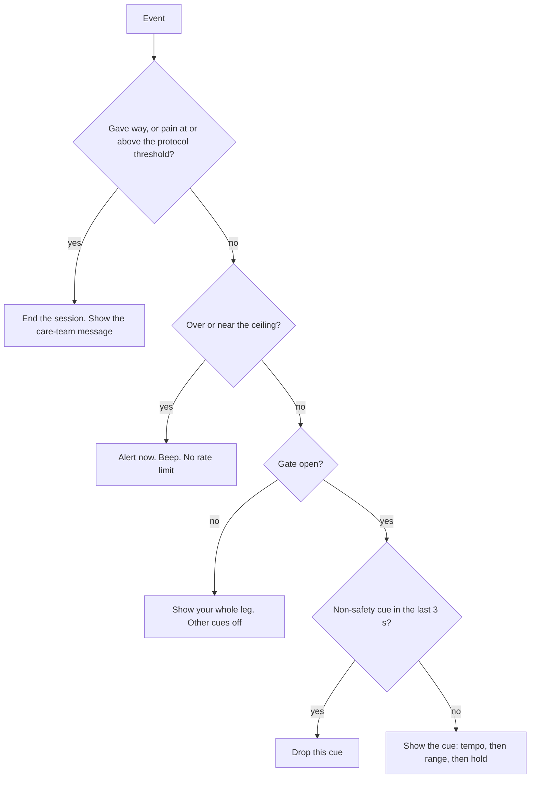
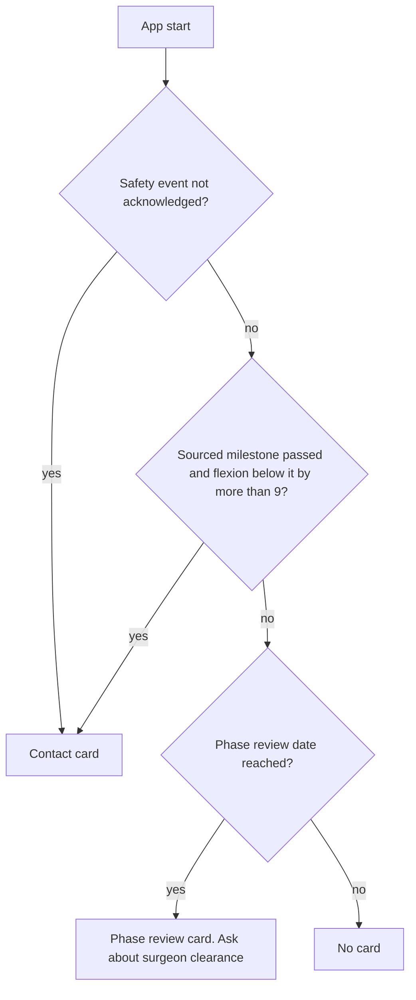

# Live form checks and plan adjustment: design

Date: 2026-11-08. Status: design only. No code, test, script or plan file changed. No clinician and no regulatory expert approved anything here.

Marks: V (read in the source), INFERRED (my reasoning, or my replay of saved data), UNVERIFIED (not opened, or a search summary only). PROPOSAL marks an engineering value only (rule E).

Method: the knowledge agent and skill (`.claude/agents/mpfl-rehab-knowledge.md`, `.claude/skills/mpfl-rehab-knowledge/SKILL.md`), the guardrail skill, `research/INDEX.md` and the files it names. Skills loaded with the Skill tool: `simple-english:simple-english`, `owasp-security`, `anti-slop-code:anti-slop-code`, `mermaid-diagrams`, `adr-skill`.

Files that did not exist when this file was finished: `docs/protocol-generator-design.md`, `research/rehab-rules.md`, `research/form-evidence.md`, `research/source-audit.md`. This design uses the current schema (`app/src/lib/protocol/schema.ts`). Section 5.6 lists what the generator must supply. When the new research files land, a reviewer must compare section 3 and 5.4 with them.

## 0. Evidence rules of this design (user order, 2026-11-08)

- C1. Every clinical rule and number cites a named source from the source list (section 12). A web claim never counts as validated for MPFL surgery.
- C2. A clinical rule with no source is not built. It becomes DO NOT BUILD, a clinician-only logged number, or a clinician decision.
- C3. Where sources disagree, the design takes the more conservative value or builds nothing, and shows both sources.
- C4. Each rule has a grade: GUIDELINE (consensus or guideline), REVIEW (systematic review), STUDY (cohort, case series or trial), OPINION (expert opinion), NONE.
- C5. A live check is refused when the 2D webcam error is as large as the effect that it must detect.
- E. PROPOSAL is allowed only for an engineering value, for example a rate limit or a detection gate. Each one says why it is not clinical.

## 1. Short answer

- Live, the app can check four things with a stated error. They are the side-view knee angle against a clinician limit, rep time, hold time and leg visibility. These cues stay. One new instruction ("Slow down.") is added.
- The straight leg raise lag cannot be a live cue. The consensus limit is "less than or equal to 10 degrees of extensor lag" [SRC-CCHMC]. The camera error is about plus or minus 9 degrees [SRC-OKUNO]. The error equals the effect (C5).
- Valgus, trunk lean, hip drop, steadiness and hip rise are not live cues. A guideline says not to give visual biofeedback on lower-limb alignment [SRC-WILLY].
- During a session, the only changes with a source are safety stops. They are the "knee gave way or hurts" button and a pain answer at the clinician threshold. No source supports a live change of reps, sets or targets. So the app makes none.
- Between sessions, the app shows a "contact your care team" card after any safety event [SRC-CCHMC, recommendation 4]. It shows a ROM card only when the protocol carries a sourced milestone [SRC-HSS]. A phase review card appears on a sourced time point and asks about the surgeon clearance [SRC-HSU, SRC-CLIN9]. The app never decides that a phase is complete.
- No source gives a deload amount or a trend window after MPFL surgery. Fewer reps, lower targets and automatic trend rules are not built. The clinician sees the data (FR22a).
- New finding: in its initial phase, the consensus guideline avoids knee extension exercise in the terminal range from 30 to 0 degrees [SRC-CCHMC, rec. 29]. The seated extension hold must stay out of the first phase (section 7.3).

## 2. The evidence limit and the replay

| Fact | Source | Grade |
|---|---|---|
| "no validated rehabilitation protocols are established following MPFL reconstruction" | SRC-HSU | OPINION (LoE 5) |
| No validated threshold for valgus, trunk lean or pelvic drop after MPFL surgery | SRC-FORMOPUS section 1 | REVIEW of the literature by the project, NONE for a threshold |
| Side-view knee angle, limits of agreement "plus or minus 8.73 and 8.80" degrees, heavy model, still photos, 20 healthy adults | SRC-OKUNO | STUDY. UNVERIFIED for `lite` |
| Raw webcam squat angle: bias -10.6, RMSE 10.9 degrees | SRC-IIZUKA | STUDY, healthy |
| Absolute 2D valgus bias -19.28 degrees. Test-retest ICC of the change 0.14 to 0.70 | SRC-ASAEDA | STUDY, 15 healthy men |
| Goniometer detectable difference 8.2 degrees for active extension after knee surgery | SRC-LENSSEN | STUDY, knee replacement, BORROWED |
| No goniometer data and no measured margin exist for this app | SRC-ACCURACY | Own record |
| Experts prefer criteria-based progression. No study compares it with time-based progression after MPFLR | SRC-KANG, SRC-VIDRA, SRC-HSU | REVIEW, NONE for outcome |

My replay of the saved landmark series (8 public clips, healthy people, no goniometer). Script: `/tmp/claude-1000/-home-luis-projects/c0df9405-b52e-4b2f-b357-194865342f04/scratchpad/alf/metrics.mjs`. Each row is SRC-REPLAY (INFERRED). It shows noise, not accuracy.

| # | Finding | Use in the design |
|---|---|---|
| R1 | Clip 01, left heel slide: 4 reps, rep time 5.0 to 5.7 s, peak spread (SD) 4.4 degrees | Rep time is stable on a clean clip |
| R2 | Clip 02 (camera cuts): peak SD 32.6 degrees, one peak 176.5 degrees | Rep-to-rep spread measures framing |
| R3 | Hip vertical range over thigh length: 0.05 (clip 01), 1.47 (clip 02) | "Hip rise" measures framing |
| R4 | Clip 03, left straight leg raise: 21 lifts, top angle 2.5 to 31.4 degrees, SD 6.6. Stored session value 34.4, median about 9 | One lift is noisy. The stored highest value follows outliers |
| R5 | Clip 04 (leg raise on a table): top angles 38 to 87 degrees | The model confuses some setups |
| R6 | Still windows: angle SD 0.9 degrees (clip 06), 2.1 degrees (clip 07) | Steadiness of a few degrees is noise |
| R7 | Clip 07 front view: knee-inward change -45.7 degrees (right leg), -7.7 (left) in one rep | The front-view change is not plausible yet |
| R8 | `peakFlexion` is the highest filtered angle of the session (`app/src/lib/exercises.ts` line 182) | Trends need the median of counted rep peaks |

## 3. Part A: live form checks

Error column: SRC-OKUNO gives about 9 degrees for a side-view angle. SRC-ACCURACY has no measured value for `lite`. "Effect" is the size of the change that the check must see.

| Exercise | Check | Quantity | Sensor | Error against effect | Source and grade | Verdict |
|---|---|---|---|---|---|---|
| All | Leg not visible | Hip, knee or ankle visibility below 0.5 | Side | Not clinical | Engineering (FR7) | BUILD NOW (exists) |
| All | Detection gate | Leg visible in at least half of the last 5 s | Side | Not clinical | Engineering, PROPOSAL (E) | BUILD NOW (new) |
| All | "Knee gave way or hurts" | Button | None | None | FR11. Referral sign "Catching, locking" [SRC-CCHMC rec. 4], GUIDELINE | BUILD NOW (exists) |
| All | Pain between sets | Patient answer 0 to 10, compared with the protocol `painPauseThreshold` | None | Self-report | "Unchanging or increased irritability" [SRC-CCHMC rec. 4], GUIDELINE. Zones "> 5 as high-risk" [SRC-SANDAL], BORROWED | BUILD NOW only with a protocol threshold. Without it, log only |
| Heel slide, mini squat | Over or near the ceiling | Flexion against `maxFlexion` plus or minus 9 | Side | 9 degrees. The schema forces the ceiling more than 9 above the target | "Avoid KF ROM beyond surgeon guidelines" [SRC-HSS], GUIDELINE. Load data [SRC-CLIN4], BORROWED | BUILD NOW (exists) |
| Heel slide, mini squat | Below the target | Rep peak below `targetFlexion` - 9 | Side | 9 degrees. Fires only when the shortfall is more than 9 | ROM milestones [SRC-HSU, SRC-HSS], OPINION and GUIDELINE | BUILD NOW (exists, fact text only) |
| Heel slide, mini squat | Rep too fast | Rep time below `minRepSeconds` | Side | One frame (33 to 67 ms) against a limit of at least 0.5 s | Number from the clinician. Cues "as needed to ensure optimal performance" [SRC-CCHMC rec. 30], GUIDELINE. NONE for a tempo number | BUILD NOW (exists, adds "Slow down.") |
| Heel slide, mini squat | No rep ended, other leg moves | Return to baseline, leg ranges | Side | Not clinical | Engineering (`docs/leg-and-baseline-design.md`) | BUILD NOW (already designed) |
| Seated hold | Hold time in band | Time with flexion at most target + 9 | Side | 9 degrees | Isometric knee extension is a phase 1 exercise [SRC-HSU]. Hold time from the clinician | BUILD NOW (exists). Phase limit in 7.3 |
| Seated hold | Timer restart text | Knee leaves the band | Side | 9 degrees | Same | BUILD NOW (states what the timer did) |
| Straight leg raise | Top angle as a number | Smallest flexion while raised, per lift | Side | 9 degrees, R4 SD 6.6 | FR9, user decision | Keep the number (exists). Store the median of lifts |
| Straight leg raise | Lag cue | Top angle above a lag limit | Side | Error 9 against the effect "less than or equal to 10 degrees" [SRC-CCHMC]. Goniometer 8.2 [SRC-LENSSEN] | "without extension lag" [SRC-HSU], "without quadriceps lag" [SRC-HSS] | CLINICIAN-ONLY number (C5) |
| Heel slide, mini squat | Up time, down time | Rise start to peak, peak to rep end | Side | Depends on thresholds | NONE | CLINICIAN-ONLY number |
| Mini squat | Knee moves inward | Change from rep start (`views.ts`) | Front | 7.4 to 8.8 degrees [SRC-JANISCH] against a group difference of about 8 [SRC-FORMOPUS 2.2]. R7 | Monitor valgus [SRC-HSU], OPINION. Against live alignment biofeedback [SRC-WILLY], GUIDELINE (BORROWED) | CLINICIAN-ONLY after T13 (FR24). Never live |
| Mini squat | Trunk forward lean | Trunk line against vertical | Side | Not measured for `lite` | NONE for a limit (C7 in SRC-FORMOPUS) | CLINICIAN-ONLY after T13 |
| Seated hold | Extension reached | Smallest flexion in the hold | Side | 9 degrees against a small deficit | Full extension milestone [SRC-HSU] | CLINICIAN-ONLY number |
| Heel slide | Hip rise | Hip range over thigh length | Side | R3: framing | NONE | DO NOT BUILD |
| Heel slide, mini squat | Peak spread | SD of rep peaks | Side | R2: framing | NONE | DO NOT BUILD |
| Seated hold | Steadiness | SD of the hold angle | Side | R6: noise 0.9 to 2.1 | NONE | DO NOT BUILD |
| Straight leg raise | Lift height, hip angle | Hip flexion | Side | Not measured | NONE (`clinical.md` section 4: PROPOSAL) | DO NOT BUILD |
| Mini squat | Absolute valgus, FPPA cut-off | Frontal angle | Front | Bias -19.28 [SRC-ASAEDA] | One small study each, BORROWED | DO NOT BUILD |
| Mini squat | Lateral trunk lean, pelvic drop, load shift | Frontal angles | Front | Human hip ICC .396 [SRC-FORMOPUS 2.2] | NONE for MPFLR | DO NOT BUILD |
| Heel slide, mini squat | "Bend further" instruction | None | Side | A reading 9 degrees low pushes past the target | NONE for an in-session push | DO NOT BUILD |

## 4. Live adjustment design

### 4.1 Cue texts

Each cue is an instruction or a fact in neutral words, from the fixed list in `app/src/lib/cues.ts`. An in-range rep shows nothing (FR23, user decision). Section 10, decision 3, shows a source that bears on this decision.

| Event | Text | Change from today |
|---|---|---|
| over-limit | "Stop at your limit, do not push." | None |
| near-limit | "Close to your limit, stop." | None |
| paused, gate closed | "Show your whole leg." | Also used by the gate |
| too-fast | "Slow down. Rep time 1.2 s. Your care team set at least 2.0 s." | Adds "Slow down." |
| shallow | "Depth below your target." | None. No push instruction (section 3) |
| hold restart | "Keep the knee straight. The hold timer starts again." | New. The words follow `ux-flow.md` section 7.4 |
| no rep ended | "No rep ended yet. Your care team sets how far the knee must come back." | From the leg design |

### 4.2 Priority, timing and clearing

- Order: safety stop, ceiling, leg not visible, tempo, range, hold, notes. The safety side warns first (FR8, user decision).
- Safety cues fire on the first event. The over-limit alert stays while the knee stays above the limit plus 9 (as `Session.tsx` does today).
- Engineering values (E): at most one non-safety cue each 3 s, on screen 4 s. The same text does not come again within 10 s. The gate window is 5 s. They are not clinical, because they set how often text appears and when a measurement exists, not what the knee does. The 3 s value is from `ux-flow.md` section 6.2. The 10 s value is from section 12. Both are PROPOSAL there. One meta-analysis found no reliable effect of feedback frequency on motor learning [SRC-MCKAY, UNVERIFIED].
- A cue clears when its time ends, when a higher cue replaces it, or when the leg returns.

### 4.3 What a live adjustment can change

| # | Trigger | Change | Undo | Source and grade |
|---|---|---|---|---|
| L1 | Gave-way press | End the session, show the care-team message | No | FR11. SRC-CCHMC rec. 4, GUIDELINE |
| L2 | Pain between sets at or above the protocol `painPauseThreshold` | End the session, show "Pause and contact your care team." | No | SRC-CCHMC rec. 4. "Modify or minimize strengthening exercises ... that increase pain and/or edema" [SRC-HSS], GUIDELINE |
| L3 | Gate closed | Form cues off, "Show your whole leg." | Clears by itself | Engineering (E) |

Not built, because no source gives the trigger or the change (C2):
- a pause after a number of over-limit events, or the end of a set after shallow reps,
- fewer reps or sets during the session, or any target change during the session.

The counts of these events go to the clinician (they exist as `nearLimit`, `overLimit`, `tooFast`).

- L2 uses only the clinician threshold. The FR12 floor of 7 has no source (FR12 says so). It stays as the existing end-of-session rule (user decision) and is not extended. SRC-SANDAL calls pain above 5 "high-risk" in knee osteoarthritis, which is lower than 7 (C3). The clinician must set the threshold.
- Never: raise a target, a ceiling, a rep count or a set count. Never add a set.
- Nothing in section 4 touches the protocol, the active phase or a stored limit. The record keeps L1 to L3 as fixed ids for the clinician.

### 4.4 Accessibility (FR10)

- Non-safety cues use the polite live region (`role="status"`). L1, L2 and over-limit use `role="alert"`.
- Sound: only near-limit and over-limit beep, as today.
- The pain question between sets is an 11-pill control with 48 px targets (`docs/ui-design.md` section 4.3). Skip is allowed and logs "no answer".
- The set-complete notice uses the `check` icon. A check mark reads as approval. Use the `info` icon.

## 5. Part B: plan adjustment between sessions

### 5.1 Principle

- The default is no change. The app shows data and asks for contact. The surgeon decides each new phase [SRC-CLIN9, item 6].
- No change is silent. No change edits the protocol file. The phase changes only through `app/src/lib/protocol/` (FR4).

### 5.2 Data

| Signal | In the record today (`app/src/lib/storage/db.ts`) | Missing |
|---|---|---|
| Peak knee bend | `peakFlexion` (session maximum, R8) | `repPeakMedian` of counted reps |
| SLR top | `topFlexion` (highest lift, R4) | `liftTopMedian`, `liftCount` |
| Reps against prescription | `repsPerSet`, `repsPrescribed`, `setsPrescribed` | None |
| Tempo | `tooFast` | `repMsMedian`. Clinician-only: `upMsMedian`, `downMsMedian` |
| Limit events | `nearLimit`, `overLimit` | None |
| Pain, swelling | `pain`, `swelling` | `setPain` array |
| Safety events | `gaveWayPresses`, `redFlagBlocks` | `endReason` (stop, gave-way, pain-stop, all-sets) |
| Detection | None | `detectionRate` (0 to 1) |
| Leg | `legTracked`, `cameraSide` | None |
| Weeks since surgery | None | A surgery date from the generator (5.6) |
| Card history | None | New table `planCards` (5.5) |

All new fields are optional, fixed types and no free text, as in T16 and T17.

### 5.3 Valid session

- A camera value counts only from a valid session: `detectionRate` at least 0.8, at least 5 counted reps, and `legTracked` equal to the protocol side. These are engineering values (E): they decide whether a measurement exists, not a clinical limit. The 5 reps follow `MIN_COUNTED_REPS` (`progression.md` section 5.2).
- A session that fails shows "Not enough camera data". It is never read as low performance.
- Pain and swelling count in every session.

### 5.4 Rules

| Id | Trigger | Card | Source and grade | Status |
|---|---|---|---|---|
| B1 | Any FR11 gave-way press, FR12 pause, or swelling "more than before" | "Contact your care team" at each start until the person presses "I contacted them" | "Unchanging or increased irritability", "Persistent or recurrent effusion", "Catching, locking" [SRC-CCHMC rec. 4], GUIDELINE. One event, not a count (C3) | BUILD |
| B2 | Weeks since surgery reach the milestone week of the protocol, and the median rep peak of the last valid heel slide session is below the milestone by more than 9 | Same card, with both numbers | "Contact surgeon if ROM not trending towards 90° by 4 weeks" [SRC-HSS], GUIDELINE. "Unexpected loss or minimal progression of ROM" [SRC-CCHMC] | BUILD only when the protocol milestone carries a source id |
| B3 | The phase review date arrives | Phase review card: numbers, "not measured" list, clearance question | Phase weeks "0 to 6 weeks", milestones "Knee flexion greater than 110°" [SRC-HSU], OPINION. Surgeon decides [SRC-CLIN9]. "Clearance by surgeon to begin running" [SRC-HSS] | BUILD the card. Applying the phase step stays behind a flag (5.5) |
| X1 | Reps below prescription over several sessions | Fewer reps | NONE for a trigger or an amount | DO NOT BUILD. Clinician sees it |
| X2 | Peak trend falls or stays flat over a window | Contact card | SRC-CCHMC names the sign. NONE for a window | DO NOT BUILD as a rule. Trend in FR22a |
| X3 | Lower a ROM target, a ceiling or `returnWithinDeg` | Any | Too little motion links to stiffness (`clinical-update.md` gap 3). Ceiling is a surgeon decision [SRC-CLIN9 item 7] | NEVER |

- B2 milestones disagree between protocols. SRC-HSS gives 90 degrees by 4 weeks. P6 gives 90 by week 2 and 130 by week 4 (`clinical-update.md` section 3.1, not re-read). The direction of "conservative" is unclear for ROM (more motion against less load). So B2 runs only with the milestone of the protocol that the patient follows (C3: build nothing otherwise).
- B3 is time-based because the measured numbers alone cannot decide. The app measures only knee flexion. Full extension, gait, walking without crutches and quadriceps strength need the clinician.
- B3 shows the flexion number with the FR22a state. "Greater than 110 degrees" reads "Above the limit by more than the margin" only from a median above 119 degrees.
- If `surgeon.concurrentProcedures` is set, B3 offers no phase step. The HSS text says "STOP: Follow more conservative guideline" for concomitant procedures [SRC-HSS].

### 5.5 Keeping the safety property of FR4

- B1 and B2 change nothing in the plan. They write a row to `planCards`.
- B3 with a clinician protocol (`approvedOn` set): the card offers "Export for my care team" only.
- B3 with a generated protocol (no `approvedOn`): "Yes, my surgeon cleared me" calls one pure function in `app/src/lib/protocol/advance.ts`. It returns a new protocol version with `activePhase` plus one, never a skip. The phase-check script stays as it is and passes.
- The new version carries `generated: true`, the clearance answer with its date, and the banner "Not approved by a clinician". The old version stays.
- The flag `VITE_SELF_PROGRESSION` is off by default. It stays off until the regulatory expert rules (7.2).
- `planCards` row: `id`, `createdAt`, `kind` (contact, rom-milestone, phase-review), `ruleId`, `sourceId`, data numbers (fixed fields), `acknowledgedAt`, `clearanceAnswer`, `protocolId`. No free text.

### 5.6 What the protocol generator must supply

- A generated marker and no `approvedOn`. A surgery date, or weeks since surgery.
- For each phase: a review date from a sourced time window, and a source id for each criterion.
- ROM milestones only from one named protocol, with its source id (for B2).
- No seated extension hold in the first phase (7.3). A refusal or a flag for combined surgery.

### 5.7 Clinician view (FR15, FR22a)

- A block after the events block: the card history. Columns: date, card, rule id, source id, data, acknowledged, clearance answer.
- Clinician-only numbers appear with the margin and the angle label. They are the SLR lift median, up and down time, trunk lean, knee inward change and extension in the hold.
- No total, no colour and no "met", as in FR22a.

## 6. UI

| Place | Content |
|---|---|
| Session cue area | The existing status and alert lines. The pain question in the set-complete notice when the protocol sets a threshold |
| Summary, card "What I noticed" | "Reps counted: 18 of 30." "Peak knee bend, median of counted reps: 72 degrees (estimated angle, not a medical measurement)." "Reps faster than 2.0 s: 4." "Close to your limit: 2. Past your limit: 0." "The camera saw your leg in 91 percent of the session." At most one instruction, for example "Next time, take at least 2.0 s for each rep." |
| Home, contact card | Strong notice: "Contact your care team. On 8 November you pressed Knee gave way or hurts." Buttons "I contacted them" and "Remind me next time" |
| Home, phase review card | "Your plan has a review for phase 1 on 20 December." Rows with FR22a states. "Not measured by the app: full extension, gait, walking without crutches, quadriceps strength." Question: "Did your surgeon or physiotherapist clear you to start phase 2?" Footer "Not approved by a clinician." |
| My data, "Plan cards" | The card history |

Not shown anywhere: a score, a streak, a badge, a grade, a percentage of plan done, a trend arrow, "improved", "on track", green or red.

## 7. Safety, regulation and clinician review

### 7.1 What can go wrong

| Risk | Limit in the design | Residual risk |
|---|---|---|
| A false shallow cue makes a person push into pain | Fact text only, no push instruction. The cue fires only when more than 9 below | A person can still push |
| A missed ceiling cue | Warns from the limit minus 9. The gate never hides the over-limit alert while the leg is visible | Error above 9 is possible until T13 |
| A wrong phase step for a patient with a complication | Time trigger, surgeon clearance, no step with combined surgery, flag off | A person can answer "Yes" without a clearance |
| Cue storm | 3 s rate, 10 s repeat rule, priority | Values are engineering PROPOSALs |
| Model confuses the legs | Leg choice and soft note. Valid session needs the protocol side | A swap within a frame is UNVERIFIED |
| Low detection read as low performance | Gate and valid-session rule | None known |
| Stiffness hidden by a deload | No deload exists. ROM targets never drop. B2 refers | Needs a sourced milestone |
| A tampered file or row | Zod on every read, no free text (OWASP A08). The file is unsigned (plan section 1.4) | A person can edit their own data |

### 7.2 Regulatory note

- MDCG 2019-11 rev.1 lists software that recommends "personalised rehabilitation exercises" from ROM data as medical device software [SRC-MDCG].
- In MDCG 2019-11, software that adapts therapy by itself is the class III example (Rule 22). A specialist decision gives class IIa [SRC-MDCG].
- FDA: recommendations to patients are device functions [SRC-FDACDS].
- B1 and B2 are referral prompts. B3 with the flag on changes the plan after a patient answer. The plan says the class is not settled (plan sections 1.5 and 11).
- UNVERIFIED: whether a change that the patient confirms counts as the closed loop of Rule 22. An expert must decide before the flag turns on.
- Plan section 1.5 says the app "never recommends a phase change". B3 with the flag on contradicts it. The user must decide.

### 7.3 A clinician must review before any patient use

- Every cue text in 4.1, the pain question between sets, and the `painPauseThreshold` value.
- The seated extension hold. SRC-CCHMC recommendation 29 avoids short arc and long arc quadriceps exercise in the terminal range from 30 to 0 degrees. The reason it gives is stress on the reconstructed MPFL. The exact quote is in section 12. The recommendation is in its initial phase. The example protocol puts the hold in phase 2. The generator must not put it in phase 1.
- B2 milestones, B3 review dates, and whether adolescents use the same rules (SRC-CCHMC covers ages 8 to 25).

## 8. Adversarial review

| Role | Strongest objection | Answer or residual risk |
|---|---|---|
| Physiotherapist | Guideline 46 asks for feedback cues "as needed". Silence for good reps loses adherence (Sluijs 1993 in SRC-CCHMC) | A sourced point. Section 10, decision 3 asks the user |
| Surgeon | Self-reported clearance is not clearance | The phase step stays behind a flag. With a clinician protocol the app never steps |
| Regulator | Patient-facing referral and phase cards are device functions. "Science based" needs outcome evidence | No outcome claim. Expert ruling before patient use |
| Biomechanist | 2D angles hide hip and trunk compensation. R7 is not plausible | Live cues use only side-view angles with the margin and timestamps |
| Patient with stiffness | A deload makes me bend less | No deload exists. B2 refers on a sourced milestone |

Strongest objection overall: the user asked for live adjustment and plan adaptation, and this design builds almost none. My answer: under C1 and C2 no source gives a live volume change, a deload amount or a trend window after MPFL surgery. The honest maximum is safety stops live, referral cards on consensus red flags, and a time-based review card with the surgeon decision.

## 9. Build list (tests first, pure functions)

1. `app/src/lib/adapt/sources.ts`: a table with id, full reference, claim, exact quote, numbers, `checkedOn`, access (VERIFIED or UNVERIFIED). `app/src/lib/adapt/rules.ts`: each rule has an id, a kind (clinical or engineering), a grade, and source ids. Test: every source id has a table entry. A clinical rule with PROPOSAL fails. An engineering PROPOSAL without `whyNotClinical` fails.
2. `app/src/lib/liveCues.ts`: `liveCues(window, exercise, protocol)` returns `{ cue, stop, gate }`. The type has no field for a target or a limit. Tests: priority, 3 s rate, 10 s repeat, gate, L1 to L3.
3. `app/src/lib/cues.ts`: the two text changes. Update `tests/cues.test.ts` and `allCueTexts()`.
4. `app/src/lib/exercises.ts`: per-rep peaks, per-lift tops, rep times, detection count.
5. `app/src/lib/storage/db.ts`: fields of 5.2, Dexie version 3 with `planCards`. Export schema follows. Tests: old files read, unknown keys fail.
6. `app/src/lib/adapt/propose.ts`: `proposeAdjustment(sessions, protocol, cards, today)` returns cards only. Tests: B1 on one event, B2 only with a sourced milestone, B3 on the date, X1 to X3 never.
7. `app/src/lib/protocol/advance.ts` behind the flag. Tests: plus one only, never with `approvedOn`, never without clearance, never with `concurrentProcedures`.
8. UI: `Session.tsx`, `Summary.tsx`, `Home.tsx`, `DataScreen.tsx`, `ClinicianView.tsx`. Run `claims-check.sh`.
9. `app/scripts/claims-check.sh`: add `met`, `passed`, `streak`, `badge`, `improved`, `worse`, `on track` to the patient-text words.

Property tests (no new package, a seeded generator in `tests/helpers`):
- `liveCues` never returns a changed target, ceiling, rep count or set count.
- A missing clinician value (`painPauseThreshold`, `minRepSeconds`, a milestone) never gets a default and never fires a rule.
- `proposeAdjustment` never returns a plan change. `advance` never runs with `approvedOn`.

Replay tests on the saved clips (read-only, `rca/replay.mjs` pattern):
- Can prove: the rate limit holds on noisy series. The gate closes in the cuts of clips 02 and 05. No lag cue exists on clips 03 and 04.
- Cannot prove: angle accuracy, the `lite` error, clinical meaning, patient behavior or outcome.

Mutation ideas: remove the margin from the ceiling, the gate or the rate limit. Let `advance` add 2. Drop the clearance check. Accept a rule with no source id. Each must fail a named test.

E2E (scripted source, `docs/ui-design.md` section 9 step 8): pain at the threshold between sets ends the session. A seeded gave-way session shows the contact card until acknowledged. The flag off hides the clearance buttons.

Existing tests that change: `tests/cues.test.ts`, `tests/ui/session.test.tsx`, `tests/ui/noVerdict.test.tsx`, the FR10 sound tests (no new beep), `tests/reviewSummary.test.ts`, `tests/scripts.test.ts`.

## 10. Open decisions, ranked

| # | Decision | Who | Recommendation |
|---|---|---|---|
| 1 | Seated extension hold out of phase 1 (SRC-CCHMC rec. 29) | Clinician | Yes |
| 2 | Accept that live adjustment is limited to safety stops (C2) | User | Yes, until a source exists |
| 3 | Silence for in-range reps. SRC-CCHMC cites Sluijs 1993: "regular positive feedback from a physical therapist" goes with adherence | User | Keep silence. The source is about a therapist, not an app, and about adherence, not outcome |
| 4 | B3 phase step with the flag, against plan section 1.5 | User, regulatory expert | Build the card. Keep the flag off |
| 5 | `painPauseThreshold` value. Borrowed zones call more than 5 "high-risk" | Clinician | Clinician sets it |
| 6 | B2 milestone source for each protocol | Clinician, generator | One named protocol only |
| 7 | Store the median of SLR lifts in place of the highest | User | Store both |

## 11. ADR: limit live and plan adaptation to sourced safety rules

- Status: proposed. The user has not confirmed the intent summary that the adr-skill requires. The questions are in section 10.
- Context: the user asked for live form evaluation and plan adjustment from session data, science based. Sources support clinician limits, referral on red flags and surgeon phase decisions. No source supports automatic changes (`progression.md` section 1).
- Decision: live cues only for margin-gated side-view angles, rep time, hold time and visibility. Live changes are safety stops. Between sessions, referral cards and a time-based phase review card. A phase step only for a generated protocol, after a reported clearance, behind a flag.
- Options rejected: (a) live volume changes and deloads, no source. (b) automatic changes (T4), rejected in `progression.md`. (c) live frontal cues, SRC-WILLY and R7. (d) editing the protocol file in place, breaks FR4.
- Non-goals: no form score, no new clinical number, no ROM target change, no new npm package.
- Consequences: storage version 3, a sources table with a test, two pure modules, a flag, more banned words, a regulatory question.
- Implementation plan: section 9. Paths: `app/src/lib/liveCues.ts`, `app/src/lib/adapt/`, `app/src/lib/protocol/advance.ts`, `app/src/lib/storage/db.ts`, `app/src/ui/`.
- Verification:
  - [ ] The sources test fails for a rule without a table entry.
  - [ ] The `liveCues` property test passes 1000 seeded runs.
  - [ ] `phase-check.sh` and `claims-check.sh` pass.
  - [ ] With the flag off, no code path changes `activePhase`.
- Revisit when: T13 gives a `lite` margin, the expert rules on the class, or the new research files land.

## 12. Source list

VERIFIED means that I read the text of the source in this session and the quote is exact. UNVERIFIED means that I did not read it myself. Then the knowledge base file says what it held. Checked on 2026-11-08.

| Id | Reference | Claim and quote used | Access |
|---|---|---|---|
| SRC-CCHMC | Cincinnati Children's Hospital Medical Center. Evidence-Based Care Guideline 46, Post-Operative Management of Lateral Patellar Dislocations and Instability, ages 8 to 25. January 2015. URL in `research/clinical-update.md` section 3.1 (P2) | Rec. 4: notify the physician for "Signs of deep vein thrombosis (DVT)", "Unchanging or increased irritability in the knee", "Persistent or recurrent effusion", "Unexpected loss or minimal progression of ROM", "Catching, locking, or persistent pathological end feel with passive ROM". Rec. 29: "It is recommended that short arc quadriceps exercises (knee extension from 30° to 0°) and long arc quadriceps exercises in the terminal range of 30° to 0° are avoided to minimize stress to the reconstructed medial patellofemoral ligament". Rec. 30: "visual, tactile and verbal feedback cues are provided as needed to ensure optimal performance". Note: "Individuals who receive regular positive feedback from a physical therapist are more likely to be adherent" (Sluijs 1993). Initial phase goal: "a straight leg raise with less than or equal to 10 degrees of extensor lag". Most items cite LocalConsensus 2014, level 5 | VERIFIED (PDF text, my extraction) |
| SRC-HSS | Hospital for Special Surgery. Knee MPFL Reconstruction Post-Operative Guideline, 2020 to 2024. URL in `clinical-update.md` section 3.1 (P1) | "Contact surgeon if ROM not trending towards 90° by 4 weeks". "KF ROM > 90° by 4 weeks and progressing to 120 by 6 weeks". "Able to SLR pain-free without quadriceps lag". "Avoid KF ROM beyond surgeon guidelines". "STOP: Follow more conservative guideline". "Modify or minimize strengthening exercises and activities of daily living (ADLs) that increase pain and/or edema". "Clearance by surgeon to begin running and plyometrics" | VERIFIED (PDF text, my extraction) |
| SRC-HSU | Hsu et al. 2025, IJSPT 20(7):1074-1090, https://pmc.ncbi.nlm.nih.gov/articles/PMC12222034/ | "The milestones of the protection phase are knee flexion greater than 110°, full knee extension, straight leg raise without extension lag, and walking without crutches." Table 1: "0 to 6 weeks", "6-12 weeks". "Closed-chain exercises should be closely monitored to prevent femoral internal rotation coupled with dynamic knee valgus". "no validated rehabilitation protocols are established following MPFL reconstruction" | VERIFIED (HTML text) |
| SRC-WILLY | Willy RW et al. 2019, JOSPT 49(9):CPG1-CPG95, PDF at https://ifspt.org/wp-content/uploads/2025/05/Patellofemoral-Pain.pdf | Grade B: "Clinicians should not use visual biofeedback on lower extremity alignment during hip- and knee-targeted exercises for the treatment of patients with PFP." Basis: "A single high-quality RCT". BORROWED (patellofemoral pain) | VERIFIED (PDF text, my extraction) |
| SRC-SANDAL | Secondary analysis in knee osteoarthritis, 68 participants, https://pmc.ncbi.nlm.nih.gov/articles/PMC12213136/, citing Sandal et al. 2016 | "pain was 'accepted during exercise' with pain (as measured by a 0–10 NRS) between 0–2 being considered safe, 3–5 as acceptable, and > 5 as high-risk". BORROWED | VERIFIED for the page. Sandal 2016 itself UNVERIFIED |
| SRC-OKUNO | Okuno 2026, https://doi.org/10.3390/s26185890 | LoA plus or minus 8.73 and 8.80 degrees (`research/form-opus.md` section 2.3) | UNVERIFIED by me (MDPI refused access). V in form-opus.md |
| SRC-IIZUKA | Iizuka 2026, https://doi.org/10.3389/fspor.2026.1831625 | Raw bias -10.6, RMSE 10.9 degrees (`form-opus.md` 2.3) | UNVERIFIED by me. V-abstract there |
| SRC-ASAEDA | Asaeda 2024, Heliyon, https://doi.org/10.1016/j.heliyon.2024.e36338 | Absolute bias -19.28 degrees, change test-retest ICC 0.14 to 0.70 (`form-opus.md` 2.3) | UNVERIFIED by me. V there |
| SRC-JANISCH | Janisch 2026, https://doi.org/10.1186/s12891-026-09958-9 | BlazePose LoA -8.76 to 7.42 degrees against manual 2D (`form-opus.md` 2.3) | UNVERIFIED by me. V-abstract there |
| SRC-LENSSEN | Lenssen 2007, https://doi.org/10.1186/1471-2474-8-83 | Detectable difference 8.2 degrees for active extension (`form-opus.md` 2.3) | UNVERIFIED by me (PMC asked for a captcha). V there |
| SRC-FORMOPUS | `research/form-opus.md` sections 1, 2.2, 3 | Criteria C1 to C15, FPPA group difference, hip FPPA ICC .396 | Project file, read |
| SRC-CLIN4 | `research/clinical.md` section 4 (S14 to S18) | Patellofemoral stress rises with flexion in healthy people | Project file, read. Primary studies UNVERIFIED by me |
| SRC-CLIN9 | `research/clinical.md` section 9 | Item 6 "Permission to start each new phase", item 7 depth limit | Project file, read |
| SRC-KANG | Kang 2026, https://pmc.ncbi.nlm.nih.gov/articles/PMC13662563/ | No analysis linked criteria to outcome after MPFLR (`progression.md` 2.1) | UNVERIFIED by me. V there |
| SRC-VIDRA | Vidra 2026, https://pmc.ncbi.nlm.nih.gov/articles/PMC13247021/ | Protocol counts for criteria (`progression.md` 2.1) | UNVERIFIED by me. V there |
| SRC-MDCG | MDCG 2019-11 rev.1, June 2025 (URL in `progression.md` 2.4) | Rule 11, rehabilitation example, Annex IV class III example | UNVERIFIED by me. V there |
| SRC-FDACDS | FDA Clinical Decision Support Software guidance, January 2026 (URL in `progression.md` 2.4) | Patient-facing recommendations are device functions | UNVERIFIED by me. V there |
| SRC-MCKAY | McKay et al. 2022, Psychology of Sport and Exercise, reduced feedback frequency meta-analysis | No reliable effect on motor learning | UNVERIFIED (search summary only) |
| SRC-ACCURACY | `docs/accuracy.md` | No goniometer data, clip smoke results | Project file, read |
| SRC-REPLAY | My replay, script path in section 2 | R1 to R8 | Own measurement, INFERRED |
