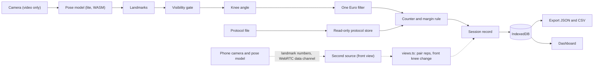
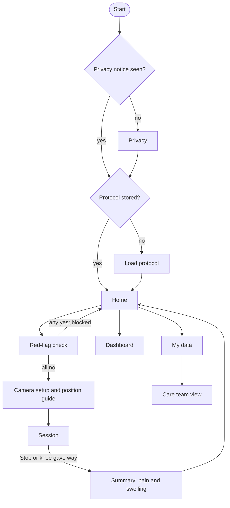

# Architecture

The app is a static single-page app. All code runs in the browser. The app has no backend and no account. The app reads landmark numbers from each camera frame and keeps no frame. Full detail is in [MPFL_APP_PLAN.md](../MPFL_APP_PLAN.md) section 3. The app is a prototype and not a medical device.

## Data flow

The diagram shows the path of the data on one device, and the optional second view. The pairing code is built and tested in a browser. No screen uses it yet ([pairing-wiring.md](pairing-wiring.md)). The dashed lines show this unwired part.

The protocol file goes through a schema check into a read-only store. The screens read it from there. The clinician view reads an exported JSON file into memory only, and shows it with the same dashboard code.

## Screen flow

Navigation is by state in `app/src/ui/appState.ts`. The app has no URL routes. A request for a screen goes through `resolve()`. A start without a cleared red-flag check goes to the check. A start without a protocol goes to Load protocol.

## Module map

Paths are under `app/src`.

| Folder or file | Content |
|---|---|
| `lib/angle.ts` | Knee angle and flexion from three landmarks |
| `lib/oneEuro.ts` | One Euro filter |
| `lib/counters.ts` | Rep, hold and top-angle counters |
| `lib/margin.ts` | Margin constant, and the comparison against a limit |
| `lib/cues.ts` | Fixed cue texts |
| `lib/exercises.ts` | Exercise definitions and the landmark-to-counter pipeline |
| `lib/redflags.ts` | Red-flag list as data |
| `lib/safety.ts` | The pause floor of FR12 |
| `lib/setupRules.ts` | Camera setup rules and the timing of their messages |
| `lib/guides.ts` | Position guide text for each exercise |
| `lib/figure.ts` | Stick-figure geometry for the guide drawings |
| `lib/views.ts` | Rep pairing of two views and front knee change. No screen uses it yet |
| `lib/mode.ts` | Demo or patient mode, and the banners |
| `lib/flow.ts` | Screen list and first screen |
| `lib/progress.ts` | Dashboard series and table rows |
| `lib/reviewSummary.ts` | Clinician review summary data |
| `lib/protocol/` | Schema, loader, read-only store, example protocol |
| `lib/storage/` | Database, export and import, small local values |
| `lib/pairing/` | Pure pairing core: payload, messages, one-time secrets, state machine |
| `zodConfig.ts` | Zod setting that avoids `new Function` under the CSP |
| `pose/camera.ts` | Camera access and stop rules |
| `pose/landmarker.ts` | Pose model wrapper |
| `pose/loop.ts` | Frame loop |
| `pose/source.ts` | Landmark source interface, with the tag `side` or `front` |
| `pairing/` | QR draw (`qrCode.tsx`) and read (`qrReader.ts`), WebRTC link (`rtcLink.ts`), frame messages, `usePairing` hook. No screen uses it yet |
| `ui/App.tsx`, `ui/appState.ts` | App shell and navigation state (pure reducer) |
| `ui/Privacy.tsx`, `LoadProtocol.tsx`, `Home.tsx`, `RedFlag.tsx` | Entry and check screens |
| `ui/Setup.tsx`, `setupView.ts`, `GuideFigure.tsx` | Camera setup screen, its rule rows and the guide drawings |
| `ui/Session.tsx`, `Summary.tsx`, `sound.ts` | Session screen, pain and save, sound cues |
| `ui/Dashboard.tsx`, `DataScreen.tsx`, `ClinicianView.tsx` | Charts with tables, export and erase, care team view |
| `ui/PairHost.tsx`, `PairCompanion.tsx` | Pairing screens for the laptop and the phone. No route reaches them yet |
| `ui/askSurgeon.ts`, `labels.ts`, `Banners.tsx` | Open surgeon decisions, exercise names, banners |
| `main.tsx` | Starts the app. It imports `zodConfig.ts` first |

## Content Security Policy

The policy is in `app/public/_headers` and in a meta tag of `app/index.html` (without `frame-ancestors`). The text is in [plan section 3.2](../MPFL_APP_PLAN.md). In short, `connect-src 'self'` allows no third-party host, `script-src` allows only own scripts and `wasm-unsafe-eval` for MediaPipe, and `object-src`, `base-uri` and `form-action` are closed. The headers also set `Permissions-Policy: camera=(self), microphone=()`, `Referrer-Policy: no-referrer` and `X-Content-Type-Options: nosniff`. The WebRTC link of the pairing is not covered by the network test yet (UNVERIFIED).

## Privacy boundary

These items never leave the device:

- Video and every frame. The code has no `MediaRecorder`, `toBlob`, `toDataURL` or `ImageCapture`. The check `claims-check.sh` finds these.
- Landmark numbers of the main camera.
- Sessions, the protocol and the pseudonymous id. They stay in IndexedDB and localStorage until the patient exports a file or erases the data.

The patient can export a JSON or CSV file. It holds health data, it is unsigned, and the app cannot control where it goes. With the second view, only landmark numbers cross from the phone to the laptop over a WebRTC data channel with no third-party server. This part is built but not wired, and a real-phone test does not exist yet. The one place that reads frame pixels is the QR reader of the pairing (`getImageData`). It decodes in memory and drops the frame.

## Build, test and checks

| Script | Content |
|---|---|
| `npm run build` | Model hash check, type check, `vite build` |
| `npm test` | Vitest with jsdom, two workers |
| `npm run e2e` | Playwright on Chromium: harness page and the real build in `dist` |
| `e2e/pairing/playwright.config.ts` | Pairing browser tests. Not in `npm run e2e` |
| `npm run precheck` | Type check, lint, unit tests, and the five check scripts in `app/scripts` |

`app/.npmrc` sets `ignore-scripts=true`. Install with `npm ci`.

## Main decisions

| Decision | Source |
|---|---|
| Local-first, no backend | [Plan 1.4](../MPFL_APP_PLAN.md) |
| Margin rule for limits | [Plan FR8](../MPFL_APP_PLAN.md), [research/form-opus.md section 4.3](../research/form-opus.md) |
| The protocol is a file that a clinician sets | [Plan 1.5](../MPFL_APP_PLAN.md), FR1 and FR2 |
| The clinician view reads an exported file into memory | [Plan 1.4](../MPFL_APP_PLAN.md), FR15 |
| No video stored or sent | [Plan FR6](../MPFL_APP_PLAN.md), NFR9 |
| No component library. Plain CSS | [Plan section 11](../MPFL_APP_PLAN.md), `research/ui-decisions.md` |
| Second view over a serverless WebRTC link | [Plan FR25](../MPFL_APP_PLAN.md) |
