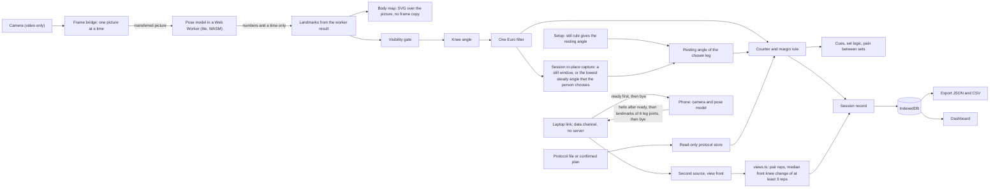
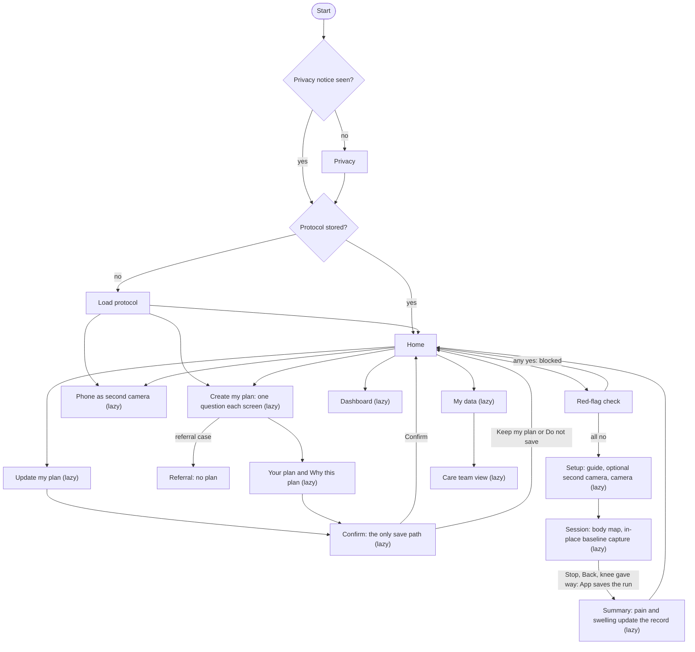

# Architecture

The app is a static single-page app. All code runs in the browser. The app has no backend and no account. The app reads landmark numbers from each camera frame and keeps no frame. Full detail is in [MPFL_APP_PLAN.md](../MPFL_APP_PLAN.md) section 3. The app is a prototype and not a medical device.

Updated on 2026-11-09 for commit 939d096. The second camera is now wired into Home and Setup. A real phone has not run it (UNPROVEN).

Updated on 2026-11-09 (task T42). The pose model runs in a Web Worker. The section "Pose worker" below gives the design. [docs/pose-worker.md](pose-worker.md) gives the measurements.

Updated on 2026-11-09 for commit 903d2c9. The changes since are the in-app Back handling (`ui/useBackButton.ts`), the CSP, the field `repsBy` and the hand-count marker. They are described below. The tests of these changes are unit tests and browser tests. No live re-test exists.

## Data flow

The diagram shows the path of the data on one device, and the second camera. The frame callback gives the landmarks to the counter path and to the body map. The map writes SVG attributes and keeps no pixel.

The protocol file goes through a schema check into a read-only store. The screens read it from there. The clinician view reads an exported JSON file into memory only, and shows it with the same dashboard code.

The laptop sends `ready` when its end of the data channel opens. The phone sends `hello` only after it. The time limits of the link use `performance.now()`, a clock that never steps. The phone sends at most 15 messages each second.

## Plan generator path

The generator in `src/lib/protocolGen/` is pure and never saves. A plan reaches the database by one path only: the Confirm button in `src/ui/ConfirmPlan.tsx`. The button handler calls `confirmByPerson`, which accepts only a trusted click. Then `acceptProposal` in `src/lib/protocol/accept.ts` checks the confirmation (real, unused, younger than 10 seconds by `performance.now()`) and saves. The diagram is in the screen flow below.

## Screen flow

Navigation is by state in `app/src/ui/appState.ts`. The app has no URL routes. A request for a screen goes through `resolve()`. A start without a cleared red-flag check goes to the check. A start without a protocol goes to Load protocol. Screens with the note "lazy" load their code when the person opens them. A chunk that does not load shows the screen of `LoadError.tsx` with "Try again" and "Back to Home". "Try again" reloads the page, because a tab that stays open after a rebuild asks for old chunk names that answer 404. Saved data stays in IndexedDB. Unsaved answers are lost.

Back handling (commit ab171d3). The hook `ui/useBackButton.ts` keeps one history entry. A press of Back runs `backStep` in `ui/appState.ts`, and the app moves inside itself. `backStep` never returns an `open` action for Setup, Session or the red-flag screen. The Summary stays. A Back press in Session stops the camera. At a root screen, Back can still leave the app (recorded limit, audit 3 L12). Audit 3 read the code and found no path from the history that skips the red-flag check. The live check of round 2 failed before this change and has no re-run.

## Module map

Paths are under `app/src`.

| Folder or file | Content |
|---|---|
| `lib/angle.ts` | Knee angle and flexion from three landmarks |
| `lib/oneEuro.ts` | One Euro filter |
| `lib/counters.ts` | Rep, hold and top-angle counters. The hold has an arc end |
| `lib/margin.ts` | Margin constant, and the comparison against a limit |
| `lib/cues.ts` | Fixed cue texts, the cue gate (rate and repeat limits) |
| `lib/exercises.ts` | Exercise definitions and the landmark-to-counter pipeline |
| `lib/sets.ts` | Set logic: sets, reps, "Start next set" |
| `lib/redflags.ts` | Red-flag list as data |
| `lib/safety.ts` | The pause floor of FR12 (pain alone or swelling alone is enough) |
| `lib/contactCard.ts` | The "Contact your care team" card from the last saved session |
| `lib/setupRules.ts` | Camera setup rules, the size rule along the leg, the lying-person texts |
| `lib/still.ts` | The hold-still rule that Setup, the resting angle and the capture share |
| `lib/baseline.ts` | Resting angle from Setup, and the in-place capture of Session |
| `lib/legIdentity.ts` | Moving-leg check, a soft hint |
| `lib/guides.ts`, `lib/figure.ts` | Position guide text and stick-figure geometry |
| `lib/views.ts` | Rep pairing of two views and the median front knee change |
| `lib/mode.ts`, `lib/flow.ts` | Demo or patient mode, screen list and first screen |
| `lib/progress.ts`, `lib/reviewSummary.ts` | Dashboard series and clinician review data |
| `lib/onboarding.ts`, `lib/planView.ts` | Questions of "Create my plan", and the plan screen helpers |
| `lib/protocol/` | Schema, loader, read-only store, `accept.ts`, `trustedClick.ts`, example protocol |
| `lib/protocolGen/` | Pure generator: inputs, rules, sources table |
| `lib/storage/` | Database (version 3), export and import, small local values. A session has an optional `repsBy` (`camera` or `hand`) and the export has the column `reps_by`. The CSV and JSON export write the margin source id (`lite-start-v1` or `lite-start-v0`) in `marginSource`, not the sentence. An export from this version does not import in an older app version. |
| `lib/pairing/` | Pure pairing core: payload, messages (`hello`, `ready`, `landmarks`, `bye`), secrets, state machine |
| `zodConfig.ts` | Zod setting that avoids `new Function` under the CSP |
| `pose/camera.ts` | Camera access and stop rules |
| `pose/landmarker.ts` | Pose model wrapper and the load progress |
| `pose/loop.ts` | Frame loop. It calls `detect` for each video frame |
| `pose/frameBridge.ts` | Main-thread side of the pose worker. The only file that makes a picture of a video frame |
| `pose/poseWorker.ts` | The pose worker. It loads the model, detects on each picture, closes it and sends numbers |
| `pose/source.ts` | Landmark source interface, with the tag `side` or `front` |
| `pairing/` | QR draw and read, WebRTC link (`rtcLink.ts`), frame messages, `pairing.ts`, `usePairing` hook |
| `ui/App.tsx`, `ui/appState.ts` | App shell with lazy screens, and the navigation state (pure reducer) |
| `ui/LoadError.tsx`, `ui/Shell.tsx` | Load error screen and `retryableLazy`, brand bar and loading state |
| `ui/Privacy.tsx`, `LoadProtocol.tsx`, `Home.tsx`, `RedFlag.tsx`, `CompanionEntry.tsx` | Entry and check screens, and the way to the phone screen |
| `ui/Onboarding.tsx`, `PlanResult.tsx`, `ConfirmPlan.tsx`, `UpdatePlan.tsx`, `Referral.tsx`, `answerControls.tsx` | Plan generator screens. Only `ConfirmPlan.tsx` saves |
| `ui/Setup.tsx`, `setupView.ts`, `GuideFigure.tsx` | Camera setup screen, its rule rows, the numbered guide and the drawings |
| `ui/BodyMap.tsx` | Body map: one SVG over the picture, fed by `update()` from the frame callback, no React state per frame |
| `ui/Session.tsx`, `Summary.tsx`, `PainScale.tsx`, `sound.ts` | Session screen (rest panel, hold meter, capture panel), pain and save, sound cues |
| `ui/Dashboard.tsx`, `DataScreen.tsx`, `ClinicianView.tsx` | Charts with tables and error band, export and erase, care team view |
| `ui/PairHost.tsx`, `PairCompanion.tsx`, `PairSteps.tsx` | Pairing screens for the laptop and the phone (Wake Lock request on the phone) |
| `ui/askSurgeon.ts`, `notReady.ts`, `labels.ts`, `Banners.tsx` | Open surgeon decisions, notice for an exercise with no value, exercise names, banners |
| `main.tsx` | Starts the app. It imports `zodConfig.ts` first |

## Pose worker

The pose model runs in a Web Worker (task T42, user decision "6. ok"). The model call `detectForVideo` is synchronous. On the main thread it blocked the page for most of each second. The measurements are in [pose-worker.md](pose-worker.md).

Design:

- `pose/frameBridge.ts` runs on the main thread. For each video frame it calls the picture API of the browser once and transfers the picture to the worker. The picture is a transferable object, so it moves with no copy.
- `pose/poseWorker.ts` runs in the worker. It loads the model with the existing `createLandmarker`, detects on each picture, closes the picture and sends back `{ type: 'result', timestampMs, landmarks }`. The landmarks are numbers (`x`, `y`, `visibility`) or `null`. The worker never sends a picture.
- The rest of the app is not changed. The angle, the counters, the body map and the safety rules read the same landmark numbers.
- `pose/source.ts` chooses the path. It tries the worker first. It uses the main-thread landmarker in three cases. The browser has no `Worker`. The browser cannot make a picture of a frame. The worker does not start. The build flag `VITE_POSE_WORKER=off` and the option `worker: false` force the main thread.

Why this way (the choice of the frame API):

| Option | Result |
|---|---|
| (a) `createImageBitmap(video)` on the main thread, transfer to the worker | Chosen. It works in Chromium, Firefox and Safari. It needs no change of the camera code. Measured cost on the main thread: about 1 to 2 ms for each frame |
| (b) `MediaStreamTrackProcessor` in the worker | Not chosen. It exists only in Chromium. It needs the track in the worker and a second code path for Safari |
| (c) Copy pixels with a canvas | Not chosen. The guard bans a canvas, and a pixel copy is slower |

The worker builds as a classic worker (the Vite default format `iife`). MediaPipe loads its WASM loader with `importScripts`, and a classic worker is the form that it supports. The WASM file and the model come from `/models/` on the own origin. The hash check `model-hash-check.sh` is unchanged. The worker sets the same guard against a request to a foreign origin as the main thread (`blockForeignFetch` in `landmarker.ts`). It also counts the bytes for the load text "Loading the pose model, N of 20.4 MB".

Backpressure. One picture is in flight at a time. A frame that comes while the worker is busy is dropped. Nothing queues. When a result comes, the bridge takes the frame that shows now at once, if the video moved on. So the worker never waits for the next frame callback. The times come from `performance.now()` and the bridge keeps them strictly rising.

Stop. `stop()` of the camera source ends the worker with `terminate()` and closes a picture that is still being made. A picture that the worker holds goes with the worker. The camera tracks stop as before. Back, Stop, "Knee gave way or hurts", a hidden tab and `pagehide` all go through the same `release()`.

The frame rule. Exactly one file touches the frame API: `pose/frameBridge.ts`. `claims-check.sh` has an allow-list of that path with one line, which ends with the marker `claims-check:allow`. A marker in another file does not help, and a second line in the bridge fails. The worker file never names the API. It receives a picture as a message. The check reads `src` only. The MediaPipe library inside the worker bundle draws a frame to its own GPU buffer. This is library code that the check does not read, and the picture never leaves the worker.

## Content Security Policy

The policy is in `app/public/_headers` and in a meta tag of `app/index.html` (without `frame-ancestors`). The text is in [plan section 3.2](../MPFL_APP_PLAN.md). Since commit 903d2c9, `blob:` is not in `img-src` and not in `media-src`. `data:` stays in `img-src` for the empty favicon link. `worker-src` keeps `blob:` as before. The pose worker loads from the own origin (`/assets/poseWorker-<hash>.js`), so the worker needs no change of the policy. The test `tests/config.test.ts` checks this. In short, `connect-src 'self'` allows no third-party host, `script-src` allows only own scripts and `wasm-unsafe-eval` for MediaPipe, and `object-src`, `base-uri` and `form-action` are closed. The headers also set `Permissions-Policy: camera=(self), microphone=()`, `Referrer-Policy: no-referrer` and `X-Content-Type-Options: nosniff`.

Live test 3 ran two Chromium browsers (`docs/live-test/pairing.md`, checks 18 and 19). It found `iceServers` empty and no media line other than the data channel. It found no request to another origin. The WebRTC link on a real network is UNPROVEN. The file `public/_headers` gives the model files one day of cache (`max-age=86400, must-revalidate`).

## Saving a session

App writes the record of a run when Session ends it. The ends are Stop, Back of the browser, "Knee gave way or hurts" and the last set. `ui/sessionRecord.ts` builds the record from the run. The record holds numbers only. A run with 0 reps is saved too.

The record has no `pain` and no `swelling` at first. The Summary adds both with `updateSessionAnswers` when the person presses Save. The Summary never makes a second record. If the first write failed, the Summary shows a plain message and Save writes the whole run once. A run that is still going when the tab closes is lost. No checkpoint exists.

## Privacy boundary

These items never leave the device:

- Video and every frame. The code has no `MediaRecorder`, `toBlob`, `toDataURL` or `ImageCapture`. The check `claims-check.sh` finds these. It also bans `drawImage`, a canvas and `getContext` outside the QR reader. It bans `createImageBitmap` everywhere except one marked line of `pose/frameBridge.ts` (see "Pose worker").
- Landmark numbers of the main camera.
- Sessions, the protocol, the stored answers of the generator and the pseudonymous id. They stay in IndexedDB and localStorage until the patient exports a file or erases the data. The generator does not store pain, swelling, red flags or the clearance answer (workflows check C05).

The patient can export a JSON or CSV file. It holds health data, it is unsigned, and the app cannot control where it goes. With the second camera, only landmark numbers cross from the phone to the laptop over a WebRTC data channel with no third-party server. Live test 3 saw no image field in 1,184 messages. A real-phone test does not exist yet. The one place that reads frame pixels is the QR reader of the pairing (`getImageData`). It decodes in memory and drops the frame.

## Build, test and checks

| Script | Content |
|---|---|
| `npm run build` | Model hash check, type check, `vite build` |
| `npm test` | Vitest with jsdom, two workers |
| `npm run e2e` | Playwright: harness page and the real build in `dist`. Projects camera, denied, no-device, app and webkit |
| `npm run e2e:pairing` | Pairing browser tests with their own config. Not in `npm run e2e` |
| `npm run precheck` | Type check, lint, unit tests, and the five check scripts in `app/scripts` |

`app/.npmrc` sets `ignore-scripts=true`. Install with `npm ci`. The test `tests/ui/bundleSize.test.ts` fails when the first-load JavaScript passes 185,000 bytes gzip. It measured 172,736 bytes at the commit that added it.

## Main decisions

| Decision | Source |
|---|---|
| Local-first, no backend | [Plan 1.4](../MPFL_APP_PLAN.md) |
| Margin rule for limits | [Plan FR8](../MPFL_APP_PLAN.md), [research/form-opus.md section 4.3](../research/form-opus.md) |
| The protocol is a file that a clinician sets, or a plan that the app made and the person confirmed | [Plan 1.5](../MPFL_APP_PLAN.md), FR1, FR2, FR4, FR30 |
| The clinician view reads an exported file into memory | [Plan 1.4](../MPFL_APP_PLAN.md), FR15 |
| No video stored or sent | [Plan FR6](../MPFL_APP_PLAN.md), NFR9 |
| No component library. Plain CSS | [Plan section 11](../MPFL_APP_PLAN.md), `research/ui-decisions.md` |
| Second view over a serverless WebRTC link | [Plan FR25](../MPFL_APP_PLAN.md) |
| Body map in Setup only, until the Session gate passes | [docs/ui-ideas.md section 4](ui-ideas.md), [TASKS.md](../TASKS.md) |
