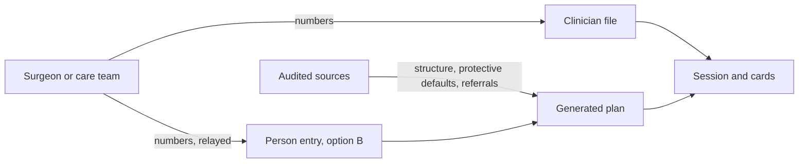

# Design reconciliation after the knowledge base audit

Date: 2026-11-08. Status: design only. No code, test, plan, research or skill file changed. No clinician and no regulatory expert approved anything here.

Scope: this file reconciles `docs/protocol-generator-design.md` and `docs/adaptation-and-live-form-design.md` with the audited knowledge base. The inputs were `research/source-audit.md`, `search-log.md`, `rehab-rules.md`, `form-evidence.md`, `specialists-brief.md`, `INDEX-v2.md` and the independent `research/citation-audit.md`. Quoted source text stays exact, so a style hit inside a quote is allowed.

Skills loaded with the Skill tool: `simple-english:simple-english`, `owasp-security`, `anti-slop-code:anti-slop-code`, `adr-skill`, `mermaid-diagrams`.

Sources that I read myself on 2026-11-08: P1 (HSS PDF), P2 (Cincinnati Guideline 46 PDF), P3 (NHS Lothian PDF) and S1 (PMC12222034 full text). Every other source is UNVERIFIED by me. Section 10 lists them.

## 1. Change list

Grade rule: `rehab-rules.md` marks P2 and P3 CONSENSUS (low). `citation-audit.md` section 3 grades them OPINION in substance. P2 items are level 5, all use "It is recommended" (weak strength), and P2 dates from 2015. The files disagree, so both designs now take OPINION.

| # | Design, item | Before | After | Reason and source |
|---|---|---|---|---|
| D1 | Generator G6 range cap | Week cap 30 to 105 degrees, lowest of S1, P4, P11 | Removed | Ceilings are OPINION only. P1 states no 90 degree cap (citation-audit V14). The w6 cap of 105 sat below 120 by 6 weeks (P2, P1). N3 gives "Passive knee flexion of >125°" in weeks 0 to 6. Two-sided ROM risk, so build nothing |
| D2 | Generator G7 ceiling | `min(I9, cap)` | I9 number only. "No limit" adds the heel slide only from week 6 | KB item 1 (surgeon decision). Protective gate, not a ceiling |
| D3 | Generator G10 dose | NONE, "no source" | Still not generated, but the reason changed. P2 rec 26 exists and is a clinician reference only | Citation-audit 4.3: "SAFE ONLY AS A CLINICIAN-SET VALUE". Option B lets the person enter it (section 2) |
| D4 | Generator G13 review data | Criterion 110 degrees (S1), checkpoint 90 at week 4 | Clinician checks without numbers. No checkpoint | P2 and P1 values are passive range. The camera sees active motion (citation-audit M3, condition 3) |
| D5 | Generator G4 SLR guide line | P4 text "stop this exercise and contact your care team" | "lower the leg. Ask your care team how to do this exercise." | P4 is pediatric. P1 "SLR with brace if lag is present". S8 median of 41 to 44 days to SLR without lag. The old text sent most people to stop SLR for weeks |
| D6 | Generator G5 heel slide | P1 listed as support (old table, V37 pattern) | P1 is a disagreeing source | P1 phase 1 "Sitting knee ROM exercise: AAROM KF to PROM KE", heel slides "once KF >120" in phase 2 (citation-audit V37) |
| D7 | Generator G8 mini squat | P1, P3, P4 | Adds P2 Appendix 1a "Mini squats with hip hinge emphasis" (initial phase) and N3 "0–50°" as disagreeing sources. Choice unchanged | I read P2 Appendix 1a. Latest start (P1, week 12) stays |
| D8 | Generator G9 seated hold | P1 only | P1 and P2 rec 29 against. P3 and N3 for. Protective default | Citation-audit 4.1: safe as a protective default that a clinician can lift. P1 restriction runs to week 11 unless cleared (V47) |
| D9 | Generator I3, R3 | "P2, P4" as reason for adults only | G2 variable practice, KB item 13 | P2 covers ages 8 to 25, so a missing source is not the reason |
| D10 | Generator option B inputs | None | I12 dose and I13 hold clearance with angles, entered by the person | Section 2 |
| D11 | Adaptation C4 grades | GUIDELINE for P1, P2 | OPINION for P1, P2, P3, S1 | Citation-audit section 3 |
| D12 | Adaptation C6 | None | New rule: clinician-set numbers, no passive against active, no action below the own-model error | Citation-audit section 6 |
| D13 | Adaptation seated hold rows | Hold band "flexion at most target + 9", target default 0 | New arc-end check against clinician `minFlexion`. No hold without both angles | P2 rec 29, P1. `form-evidence.md` check 6 |
| D14 | Adaptation B2 | P1 milestone 90 at week 4 | Only a clinician checkpoint stated as an active angle. Suppressed under a lower surgeon ceiling. Card shows the measured number only | Citation-audit 4.5 and M3. Guardrail: no goal number on screen |
| D15 | Adaptation X4 | None | Auto 2 to 3 sets: DO NOT BUILD | P2 rec 26 "as tolerated" needs judgment |
| D16 | Adaptation error facts | 9 degrees as "the" error | 9 is a best case from still photos of healthy adults (C13). Video 9.3 to 21.9 (F3). Some systems lower (M8). The app must measure its own `lite` error | `source-audit.md` C13, C14. Citation-audit M8 |
| D17 | Adaptation valgus | NO BUILD as a cue | Unchanged. Adds X3 "r = 0.127" | Citation-audit M7 |
| D18 | Both, red flags | "GUIDELINE" or UNVERIFIED for MPFL | P2 rec 4, OPINION with two 1b items, VERIFIED by me. Safe as a referral | Citation-audit 4.6 |
| D19 | Both, combined surgery | Block | Unchanged, now rated safe to encode | Citation-audit 4.7 |
| D20 | Both, source tables | Two tables (`protocolGen/sources.ts`, `adapt/sources.ts`), two Dexie version 3 bumps | One shared `src/lib/evidence/` module, one Dexie version 3 | DRY |

Conflicts between agent files, with my choice:
- `rehab-rules.md` (P2 CONSENSUS) against `citation-audit.md` (OPINION): OPINION, the more conservative reading.
- `rehab-rules.md` section 2 heel slide row cites P1 as support: wrong (V37). P1 disagrees.
- `form-evidence.md` check 6 quotes "Do not perform open chain knee extension (KE)" as phase 1: that line is Acute Care, day of surgery. Phase 1 says "Do not perform AROM open chain KE" (V47). The rule is the same.
- `rehab-rules.md` section 3 says frequency NONE. P2 rec 17 gives "approximately 2-3 times per week" for supervised therapy with a home program. I read it. It is not a home-session frequency, so NONE stays for the app.

## 2. What the app can generate, and the user choice

The citation audit gives the condition (section 6). The knowledge base is fit only if every number is a clinician-set field. The app enforces only protective defaults and referrals. This limits the user decision that the app defines the protocol.

What the app can generate on this evidence:
- The structure: phase 1 for weeks 0 to 6, phase 2 from week 7 after a reported clearance, no plan from week 12. Exercise names per phase: straight leg raise, and the heel slide with a surgeon number.
- Protective defaults: no seated hold in weeks 0 to 11, no mini squat before week 12, no ceiling and no dose without a surgeon value.
- Referrals and blocks: combined surgery, under 18, both knees, repeat surgery, special rules, red flags, the FR12 floor, week 12 or later.
- "Ask your surgeon" and "Ask your care team" for every missing number.

What must stay a clinician value or a value that the person enters from the surgeon:
- knee-bend limit, sets and reps, hold time, hold angle and arc end, rep time,
- pain pause value, ROM checkpoints, review criteria,
- phase clearance, brace and weight-bearing.



The choice for the user:

| Option | What the person sees | Consequence |
|---|---|---|
| A. Sourced and protective only | Phases, exercise names, the heel slide with the surgeon limit (I9), referrals. "How many: ask your care team." No seated hold | No count target, so a session counts reps with no set end. Least risk of a wrong number. The plan is thin, and the person needs the care team for every dose |
| B. Person enters the surgeon values (adds I12 dose and I13 hold clearance with angles) | As A, plus "2 sets of 10, as entered by you" and, from week 7, the seated hold with the entered angles | Sets and the hold work as prescribed. The app checks only schema limits. A typing or memory error goes into the plan. Every screen says "as entered by you". The app records a surgeon prescription and does not choose one, which can matter for the class (UNVERIFIED) |
| C. Generate the P2 dose as a default (refused) | "2 sets of 10" with no entry | Refused. Citation-audit 4.3 allows the dose only as a clinician-set value. P2 is OPINION, 2015, ages 8 to 25 |

Recommendation: option B, with A as the behavior when the person answers "No" or "I do not know". I9 already is a person-entered surgeon value, so B extends a pattern that the design already uses.

## 3. Seated hold decision and the other three exercises

Decision for the seated knee extension hold:
- Generated plans: never in weeks 0 to 11 (option A). In option B, only from week 7 after I13, with both entered angles. Never in phase 1.
- Clinician file: a new field `minFlexion` (the straightest knee angle allowed, the arc end) on `seated-extension-hold` only. `targetFlexion` is the hold angle. Neither has a default. Without both, the app shows "Ask your surgeon how far you can straighten your knee in this exercise." and runs no hold.
- `minFlexion: 0` means that the clinician allows full extension. Then the arc-end cue is off. For `minFlexion` above 0, the schema requires `targetFlexion` more than `minFlexion` plus the margin. This mirrors the existing `maxFlexion` rule.
- Counter: flexion below `minFlexion` minus the margin gives "Stop at your limit, do not push." and the hold does not count. Within the margin of `minFlexion` gives "Close to your limit, stop." This mirrors FR8.
- Sources: P2 rec 29 avoids "knee extension from 30° to 0°" in the initial phase. P1 "Do not perform AROM open chain KE" in weeks 0 to 6, and "unless cleared by surgeon" in weeks 7 to 11. Later arcs: P2 "90°-30°" in a note (V46), P1 "(90-40 degrees)" under surgeon preference (V47). Against: P3, N3, S1. All OPINION.
- Example protocol: the hold stays in phase 2. It gets `minFlexion: 40` and `targetFlexion: 60`. Its source text: "minFlexion 40: example clinician value, P1 phase 2 arc 90-40 under surgeon preference (OPINION). targetFlexion 60, holdSeconds, sets: example values, a clinician sets them. Phase 2 needs surgeon clearance (P1)."
- Example strengthening exercises change from 3 sets to 2 sets of 10, marked "example clinician value, P2 rec 26 reference (OPINION, ages 8 to 25)".

The other three exercises against the guidelines:

| Exercise | Phase in sources | Range in sources | Verdict |
|---|---|---|---|
| Straight leg raise | Day 0: S1 "started immediately", P2 Appendix 1a, P1 | Knee at 0 (the exercise). Lag "less than or equal to 10 degrees" by the end of the initial phase (P2), "without extension lag" (S1) | Phase 1 and 2. The lag of 10 is a clinician-only logged number. Reasons: best-case error 9 (F1), video 9.3 to 21.9 (F3), `lite` unknown. P1 uses "SLR without a lag" to unlock the brace. Lift height "about the height of your other knee" has no source: a clinician item |
| Heel slide | Phase 1: S1, P3. P1: phase 2 "once KF >120" | P2 "≥ 90°" by 4 weeks and "≥ 120º" by 6 weeks are passive floors, not ceilings | Generated only with the surgeon number before week 6. P1 disagreement stays a clinician item |
| Mini squat | P2 Appendix 1a initial, P3 2 to 12 weeks, N3 early, P1 week 12 | S16 "0 degrees and 50 degrees" (healthy, BORROWED), N3 "0–50°", P2 90 as an advanced goal | Not generated in weeks 0 to 11. Depth is a clinician value. Example keeps phase 2 with 50 |

Patient-facing texts that change:

| # | Place | Old | New |
|---|---|---|---|
| T1 | `guides.ts`, seated hold `range` | "Straighten your knee. Hold it for the time that your care team sets. Then lower your foot." | "Lift your foot until your knee reaches the angle that your care team sets. Do not straighten your knee past that angle. Hold for the time that your care team sets. Then lower your foot." |
| T2 | `guides.ts`, seated hold `speed` | "Move slowly up and down. The hold time starts when your leg is straight. It restarts if your knee bends." | "Move slowly up and down. The hold time starts when your knee reaches the angle that your care team sets. It restarts if your knee bends more." |
| T3 | `figure.ts`, seated hold drawing | End frame at 0 degrees ("straighten the knee") | End frame at the protocol hold angle. Without one, the start frame only |
| T4 | New, hold not set | None | "Ask your surgeon how far you can straighten your knee in this exercise." |
| T5 | Cue, hold restart (adaptation 4.1) | Draft "Keep the knee straight. The hold timer starts again." | "The knee left the hold angle. The hold timer starts again." |
| T6 | Cue, arc end | None | Reuses "Close to your limit, stop." and "Stop at your limit, do not push." |
| T7 | Generator SLR extra line | "If your knee does not stay straight when you lift the leg, stop this exercise and contact your care team." | "If your knee bends when you lift your leg, lower the leg. Ask your care team how to do this exercise." |
| T8 | Generator Why this plan, cap line | "Knee-bend limit: the lowest value of the published plans for week 2 (S1, P4, P11)." | "Knee-bend limit: the limit from your surgeon. The app adds no limit of its own (G7)." |
| T9 | Generator Why this plan, new lines | None | "How many: published guidelines leave the number to your care team." and "Seated knee hold: two guidelines avoid straightening the knee against the weight of the leg in the first weeks (P1, P2)." |
| T10 | Generator Update my plan example | "Reason: week 3 of your plan (G6: P4, P11)." | "Reason: the new limit from your surgeon that you entered (G7)." |
| T11 | Generator I9 help, "No limit" before week 6 | None | "Before week 6, the app needs the number from your surgeon to add the heel slide." |
| T12 | Generator plan preview, option B | None | "2 sets of 10, as entered by you." |
| T13 | Adaptation B2 card | "Same card, with both numbers" | "Contact your care team about your knee bend. Week 6 after surgery. Median knee bend in the heel slide: 98 degrees (estimated angle, not a medical measurement)." No guideline number |
| T14 | `example-protocol.json` source strings | Hold "targetFlexion" 0, 3 sets | As in the decision above |

## 4. The honest maximum

This table is the most that the evidence allows. It does not soften the limits.

| What the app will do | Source id | Grade |
|---|---|---|
| Live: stop cue at the clinician knee-bend ceiling, with the margin (heel slide, mini squat) | P1 "Avoid KF ROM beyond surgeon guidelines". Error M2, M4 | OPINION for the rule, REVIEW for the side-view error |
| Live: "Depth below your target" when the miss is larger than the margin, for a clinician target set as an active angle | Clinician value. `form-evidence.md` check 2 | Clinician value |
| Live: arc-end cue for the seated hold, clinician `minFlexion` only | P2 rec 29, P1 | OPINION, protective default |
| Live: "Slow down." for a rep faster than the clinician rep time | Clinician value. Tempo NONE | Clinician value |
| Live: hold timer at the clinician hold angle | Clinician value. Hold time NONE | Clinician value |
| Live: "Show your whole leg.", detection gate, cue rate limit | Engineering | ENGINEERING |
| Live: end the session on "knee gave way or hurts", or pain at the clinician threshold | P2 rec 4 | OPINION, referral |
| Between sessions: "Contact your care team" card after a safety event | P2 rec 4 | OPINION, referral |
| Between sessions: ROM card at a clinician checkpoint (active angle) | P1 pattern, P2 rec 4 | OPINION, referral |
| Between sessions: phase review card on the review date. The person or clinician decides | S1 weeks, P2 rec 18 | OPINION |
| Plan: structure, protective defaults and referrals of section 2 | P1, P2, P3, S1, S10, R5, G2 | OPINION, REVIEW of practice |
| Plan: surgeon values entered by the person (option B) | The surgeon | Not graded: a relayed prescription |
| Clinician view: SLR top angle median, movement symmetry, trunk lean and knee-inward change (after T13), event counts | `form-evidence.md` checks 5, 8, 10 | LOG only |

What the evidence does not allow (not built):
- A live change of reps, sets, targets or ceilings. No source (NONE).
- A lag cue for the straight leg raise. The limit of 10 degrees sits inside the 2D error.
- Any frontal-plane cue: valgus, pelvic drop, trunk side lean. M2, F4, X3.
- Steadiness, hip rise, peak spread, any form score. Noise or framing (replay R2, R3, R6).
- A deload, an automatic move from 2 to 3 sets, a trend window, a lower ROM target. NONE, and P2 rec 26 Note 2 leaves a change "per clinical judgment".
- An automatic phase change. P2 rec 18 asks for functional criteria that the app cannot measure.
- A generated dose, ceiling, ROM checkpoint or review number. Citation-audit section 6.
- Any comparison of a camera angle with a passive-range value.
- Any claim of benefit. No trial of camera feedback after MPFLR exists. Smart-device rehab after TKA did not beat usual care (T3, REVIEW, BORROWED).

## 5. Re-answers with the new evidence

Phases and weeks: the generator covers weeks 0 to 11 in two phases (S1, P1, OPINION). The week bounds only delay or refer, so they are protective defaults. P3 bands differ (0 to 2, 2 to 12 weeks). Week 12 and later get a referral.

Range: P2 gives "≥ 90°" by 4 weeks and "≥ 120º" by 6 weeks. P1 gives "KF ROM >90° by 4 weeks and progressing to 120 by 6 weeks". These are passive floors. They become neither a ceiling nor a camera check. A clinician can turn them into an active-angle checkpoint.

Sets and reps: a source exists (P2 rec 26, "2 sets of 10-15", progression to 3 "as tolerated"). It is OPINION, from 2015, ages 8 to 25, and indirect evidence (Rhea 2002 [2b], Faigenbaum 1996 [4b]). The app cannot generate it. A clinician sets it, or the person enters it (option B).

Pain: P2 "≤ 2out of 10 on NRS" is a walking and daily-task goal (citation-audit 4.4). It is not a stop rule. The FR12 floor of 7 stays an app rule with no source.

Red flags: P2 rec 4 is safe as a referral. P2 does not list infection, nerve or circulation signs, or a new dislocation. `redflags.ts` adds these from other sources.

Stays NONE:
- weight-bearing default and brace default (N1 "no consensus"),
- home-session frequency, tempo, hold time, heel slide dose,
- numeric pain or swelling stop, valgus threshold,
- revision surgery rule, graft strain value, squat depth in early weeks.

## 6. Combined build list (tests first)

Rules live in one typed data file. Each rule names its kind, so a test can stop a reference value from entering a generated plan.

```ts
// app/src/lib/evidence/sources.ts
export const SOURCES = {
  P2: { ref: 'Cincinnati Children\'s Guideline 46, 2015', url: '...', audit: 'VERIFIED-FULL', kbFile: 'research/rehab-rules.md' },
  // ...
} as const satisfies Record<string, Source>;
export type SourceId = keyof typeof SOURCES;

// app/src/lib/evidence/rules.ts
type Kind = 'structure' | 'protective' | 'referral' | 'clinicianReference' | 'engineering';
type Grade = 'CONSENSUS' | 'REVIEW' | 'STUDY' | 'OPINION' | 'NONE' | 'ENGINEERING';
interface Rule { id: string; kind: Kind; grade: Grade; sourceIds: SourceId[]; quotes: string[]; reason?: string }
```

Tests of the evidence module:
- Every `sourceIds` entry has a `SOURCES` entry. The test fails for an unknown id, also when the type check is bypassed with a cast.
- Every quote of a rule appears in the `kbFile` of one of its sources (read with `fs`).
- A clinical rule with no source, or only sources whose `audit` is UNVERIFIED or NOT READABLE, fails.
- An engineering rule without `reason` fails.
- A property test of the generator: no value of a `clinicianReference` rule ever appears in a generated protocol.

Ordered tasks:

| # | Task | Files | Tests first |
|---|---|---|---|
| 0.1 | Seated hold field | `app/src/lib/protocol/schema.ts` | `minFlexion` only on the seated hold. `targetFlexion` more than `minFlexion` + margin when `minFlexion` > 0 |
| 0.2 | Remove the hold default of 0, add the arc end | `app/src/lib/exercises.ts`, `app/src/lib/counters.ts` | Missing angle gives `ask-your-surgeon`. Cases at `minFlexion` - margin, at the limit, + margin. Mutation: restoring `?? 0` fails a test |
| 0.3 | Cue texts T4, T5, T6 | `app/src/lib/cues.ts`, `app/src/ui/Session.tsx` | `tests/cues.test.ts`, `allCueTexts()` |
| 0.4 | Guide texts T1, T2 | `app/src/lib/guides.ts` | The seated hold guide has no "Straighten your knee" and no "leg is straight" |
| 0.5 | Drawing T3 | `app/src/lib/figure.ts`, `app/src/ui/GuideFigure.tsx` | No end frame at 0 for the seated hold without data |
| 0.6 | Example protocol T14 | `app/src/lib/protocol/example-protocol.json` | No seated hold in phase 1. The hold has both angles. FR3 tests pass |
| 0.7 | Claims check | `app/scripts/claims-check.sh` | Run on `app/src` |
| 1 | Evidence module | `app/src/lib/evidence/sources.ts`, `rules.ts` | Tests above |
| 2 | Storage version 3 for both designs | `app/src/lib/storage/db.ts`, export schema | `generatorInputs`, `planCards`, session fields. Old files import. Unknown keys fail |
| 3 | Per-rep data | `app/src/lib/exercises.ts` | Rep peak median, lift median, rep time, detection count |
| 4 | Generator inputs and core | `app/src/lib/protocolGen/inputs.ts`, `generate.ts` | Each referral. Weeks 0 to 12. I9 before and after week 6. Option B entries |
| 5 | Generator property tests | `tests/protocolGen/` | Section 8 of the generator design |
| 6 | `generated` field, `romCheckpoints`, banner, loader | `schema.ts`, `mode.ts`, `loader.ts` | Patient mode refuses a generated plan |
| 7 | Save path | `app/src/lib/protocol/accept.ts`, `app/scripts/phase-check.sh` | Brand type test, pattern fixtures |
| 8 | Live cues | `app/src/lib/liveCues.ts` | Priority, rate, gate, arc end, L1 to L3. Property test: no target change |
| 9 | Cards | `app/src/lib/adapt/propose.ts` | B1, B2 with a clinician checkpoint, B2 suppression, B3, X1 to X4 never |
| 10 | UI | `LoadProtocol.tsx`, `Onboarding.tsx`, `ConfirmPlan.tsx`, `UpdatePlan.tsx`, `WhyThisPlan.tsx`, `Session.tsx`, `Summary.tsx`, `Home.tsx`, `DataScreen.tsx`, `ClinicianView.tsx` | Component tests for texts and banned words |
| 11 | Banned words | `app/scripts/claims-check.sh` | `met`, `passed`, `streak`, `badge`, `improved`, `worse`, `on track` |
| 12 | E2E | `e2e/` | Make a plan, referrals, Update with Confirm and Keep, pain stop, contact card |

Step 0 is done before anything is generated, because the seated hold conflict exists in the app today.

## 7. Regulation and the plan lines to change

Regulatory facts. All come from `research/progression.md` section 2.4. The main session and I did NOT read the primary texts (UNVERIFIED):
- MDCG 2019-11 rev.1 lists software that recommends "personalised rehabilitation exercises" from range of motion data as medical device software.
- Rule 11: class IIa for information used in therapy decisions, IIb or III for serious or irreversible harm. Rule 22: software that adapts therapy by itself is the class III example. A specialist decision gives class IIa.
- FDA CDS guidance (January 2026): recommendations "to patients or caregivers - not HCPs" are device functions.
- Unknown: whether a patient confirmation closes the loop of Rule 22, and whether a person-entered surgeon value (option B) counts as a specialist decision.

Plan lines, ready to paste. Each item names the place, then gives the old text and the new text in a block.

1. `MPFL_APP_PLAN.md` section 1.5 revision 2, a bullet of the safeguards list.
```text
OLD: A restriction from the surgeon can only lower a generated value. A generated limit can only lower a surgeon value.
NEW: The app generates no knee-bend limit. The limit comes only from the surgeon, as a care-team file or as a number that the person enters. Before week 6 the heel slide needs that number.
```
2. Section 1.5 revision 2, a new bullet after the bullet "Every clinical rule has a named source ...".
```text
NEW: The sources are expert opinion at evidence level 5. No trial compares rehab protocols after MPFL reconstruction. The app generates only the structure, protective defaults and referrals. Every number is a clinician value or a value that the person enters from the surgeon (research/citation-audit.md section 6).
```
3. FR2, new sentences at the end of the requirement.
```text
NEW: Added 2026-11-08: optional minFlexion for seated-extension-hold only. It is the straightest knee angle allowed, with no default. A phase can hold optional romCheckpoints (week, active flexion, rule id). Only clinician files fill them.
```
4. FR3, new sentences at the end of the requirement.
```text
NEW: Changed 2026-11-08: the example seated hold is in phase 2 with minFlexion 40 and targetFlexion 60, marked as example clinician values. No example exercise asks for full extension.
```
5. FR9, a phrase in the list of the four exercises.
```text
OLD: seated knee extension hold (hold time)
NEW: seated knee extension hold (hold time at the clinician hold angle, never straighter than minFlexion)
```
6. FR30, option A. The sentences from "It generates the straight leg raise." to "The surgeon limit can only lower it."
```text
NEW: It generates the straight leg raise. It generates the heel slide only with a knee-bend limit from the surgeon, or with "No limit" from week 6. It generates no mini squat and no seated hold. It generates no sets, reps, hold time, rep tempo, ceiling, review number or ROM checkpoint. Cincinnati Guideline 46 gives a start dose only as a clinician reference value.
```
7. FR30, option B. The text of option A, then these sentences.
```text
NEW: The person can enter the sets and reps that the care team gave. From week 7, the person can enter a surgeon clearance with the two angles of the seated hold. The app checks only schema limits and shows "as entered by you".
```
8. FR31, a phrase.
```text
OLD: (phase 2, a higher cap)
NEW: (phase 2, or a higher surgeon limit that the person enters)
```
9. FR32, two sentences.
```text
OLD: Live checks are only those with a stated error: side-view knee angle against a limit that a clinician set (with the margin), rep time, hold time and leg visibility.
NEW: Live checks are only those with a stated error and a clinician value. They are the side-view knee angle with the margin, the arc end of the seated hold, rep time, hold time and leg visibility.
OLD: Not live, and not built: the straight leg raise lag (the camera error of about 9 degrees equals the 10 degree limit), valgus, trunk lean, hip drop, steadiness and hip rise.
NEW: Not live, and not built: the straight leg raise lag, valgus, trunk lean, hip drop, steadiness and hip rise. The best-case camera error of about 9 degrees is as large as the 10 degree lag limit. Video error is 9.3 to 21.9 degrees.
```
10. FR34, one sentence.
```text
OLD: B2: a ROM card, only when the protocol milestone carries a source id.
NEW: B2: a ROM card, only for a checkpoint that a clinician set as an active camera angle. It does not fire when the surgeon ceiling is lower. The card shows the measured number only.
```
11. NFR3, two sentences.
```text
OLD: Reported errors range from about 3 to 15 degrees. The 15 degree figure is UNVERIFIED.
NEW: Exercise video gave a 2D knee flexion error of 9.3 to 21.9 degrees (Rode 2025). Some systems show less. The 9 degree start margin is a best case from still photos of healthy adults, not a typical webcam error.
```
12. Section 11, the margin bullet.
```text
OLD: One opened study shows limits of agreement of about 9 degrees (DOI 10.3390/s26185890). Other reports are UNVERIFIED.
NEW: Limits of agreement of about 9 degrees come from still photos of healthy adults (Okuno 2026). Exercise video gives 9.3 to 21.9 degrees (Rode 2025). The app must measure the error of its own lite model (T13).
```
13. Section 11.2, rank 2, item 3.
```text
OLD: The range cap by week (G6) and
NEW: The removal of the range cap by week (G6), and
```
14. Section 11.2, rank 2, item 4, the whole item.
```text
NEW: The seated extension hold stays out of weeks 0 to 11 of a generated plan (P1, P2). For a clinician file, confirm the arc-end field minFlexion and the example value 40. Also confirm the week when mini squat can enter.
```
15. `docs/clinical-limits.md`, the paragraph "The red-flag list".
```text
OLD: It is UNVERIFIED for MPFL surgery.
NEW: The care-team items for DVT signs, effusion, loss of range and catching or locking match Cincinnati Guideline 46 rec 4. That source is expert opinion for ages 8 to 25. The other items come from general sources.
```

FR4 and FR21 stay true. FR4 already has the new text of the generator design. FR21 already moves generation to FR30 and FR31. Revision 1 of section 1.5, with "never recommends a phase change", is already marked superseded.

## 8. Adversarial review of this result

| Role | Strongest objection (steelman) | Answer | Residual risk |
|---|---|---|---|
| Surgeon | "Option B lets a patient type 0 as the arc end and do a full-extension hold in week 7. You moved my decision into a text field." | The hold needs a Yes to my clearance and both numbers. Phase 1 never gets it. The screen says "as entered by you" | A wrong entry is not detected. A care-team file avoids it |
| Surgeon | "Without a cap, a patient who says No limit in week 6 can force flexion." | The heel slide counts only active motion, and P2, P1 and the S10 Delphi expect 120 degrees or full range by week 6 | A wrong "No limit" answer before a restricted case, for example an unreported bone procedure |
| Physiotherapist | "Option A gives no numbers. The patient does random volumes." | True. The audit allows no generated dose. Option B or a care-team file fixes it | Under-dosing or over-dosing in option A |
| Physiotherapist | "An isometric hold at 60 degrees is not terminal extension." | P1 forbids all active open-chain extension in weeks 0 to 6. The hold reaches 60 from 90 against gravity | The default can be stricter than needed. Low harm (citation-audit 4.1) |
| Regulator | "A generated exercise list and a phase proposal to a patient are device functions. Level 5 opinion is not clinical evidence." | No benefit claim. Banner, no approval, patient mode refuses it, flag off. The class needs an expert | The prototype cannot reach patients until the class is set |
| Patient with arthrofibrosis | "Nobody told me that 70 degrees at week 6 was a problem." | The red-flag item "loss or no progress of knee bend" and a clinician checkpoint can refer | A generated plan has no ROM checkpoint. Stiffness can go unflagged until the care-team visit |
| Patient with an unreported TTO | "I said MPFL only." | I2 offers "I do not know", I1 refers anyone with a written plan | An isolated plan after a bone procedure |
| Patient with a brace or swelling | "The camera reads my knee wrong." | Gate, margin, angle label, no clinical claim | No study after knee surgery. Brace occlusion error is unknown |

Strongest objection left: the user wanted the app to define the protocol, and the evidence lets it define almost no number. My answer: under the citation audit conditions, the honest product is a structure with protective defaults and referrals. The numbers are surgeon values that the person or the clinician enters. Anything more is an invented number.

## 9. Decisions

For the user:
1. Option A or option B (section 2). Recommendation: B, with A as the fallback.
2. Accept that live adjustment is limited to safety stops, and plan adjustment to referral and review cards.
3. Keep referral R1 for a person with a written plan (recommended), the flag `VITE_SELF_PROGRESSION` off (recommended), and decide on the export of the surgery date.
4. Accept the FR12 value 7 as an app rule with no source, or ask a clinician.

For a clinician:
1. The seated hold rule, the field `minFlexion`, the example values 40 and 60, and the texts T1, T2, T4, T5.
2. The removal of the range cap, and the "No limit from week 6" rule.
3. The SLR guide line T7 and the unsourced lift height.
4. The heel slide in phase 1 against P1 (seated AAROM first).
5. Active-angle ROM checkpoints, the pain pause value, and whether adolescent data (P2) fit adults.

For a regulatory expert:
1. The class of the generator in option A and in option B.
2. Whether a patient confirmation or a person-entered surgeon value counts as a specialist decision under Rule 22.
3. The GDPR basis for the stored surgery date, and the wording "from published guidelines, expert opinion".

## 10. What stays UNVERIFIED

- MDCG 2019-11 rev.1, the Rule 11 and Rule 22 readings, and the FDA CDS guidance: not read by me or the main session.
- G1 BASK 2021 consensus, N1 Hurley 2023 full statements, AWMF S2e 012-024: not readable (paywall or blocked). They can hold rehab rules that this design does not know.
- The ISAKOS 2013 primary document: not found.
- Every source except P1, P2, P3 and S1: not read by me. The audits read most of them (see the source lists of both designs).
- The error of the MediaPipe `lite` model on a home webcam, and any 2D error after knee surgery.
- Whether option B lowers the device class.
