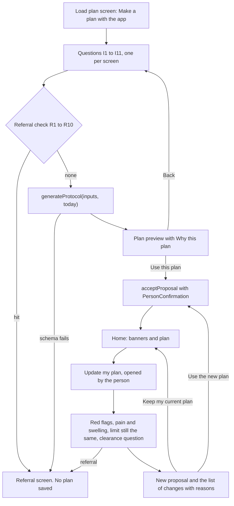

# Protocol generator: design

Date: 2026-11-08. Status: design only, proposed. No code changed. Author role: the knowledge agent (`.claude/agents/mpfl-rehab-knowledge.md`, read as a file).
Skills loaded with the Skill tool: `simple-english:simple-english`, `owasp-security`, `anti-slop-code:anti-slop-code`, `adr-skill`, `mermaid-diagrams`. Project skills read as files: `mpfl-rehab-knowledge`, `mpfl-clinical-guardrails`.
Marks: V (read in the source), INFERRED, UNVERIFIED. Evidence classes follow `research/rehab-rules.md`: CONSENSUS, REVIEW, STUDY, OPINION, NONE. ENGINEERING marks a value that is not clinical.

Changed 2026-11-08 after the knowledge base audit: this file was written before `research/rehab-rules.md`, `research/form-evidence.md` and `research/source-audit.md` existed. Every rule is re-graded against them. The full change list, the refused items and the combined build list are in `docs/design-reconciliation.md`. Quoted source text stays exact, so a style hit inside a quote is allowed.

Grade rule used here: `research/rehab-rules.md` marks P2 (Cincinnati Guideline 46) and P3 (NHS Lothian) as CONSENSUS (low). The independent `research/citation-audit.md` section 3 grades them OPINION in substance. P2 items are level 5, all use the weak form "It is recommended", and P2 dates from 2015 (ages 8 to 25). The two files disagree, so this design takes the more conservative grade: OPINION for P1, P2, P3, S1, P4 and P11. A clinical number from these sources is a reference value for a clinician, never a generated value (citation-audit section 6).

## 1. Short answer

- User decision (2026-11-08): the app makes the rehab plan from the knowledge base and the answers of the person. Today it only loads a care-team file (plan FR1 to FR4).
- Hard rule (user, 2026-11-08): every clinical rule and number cites a named source with a quote. A clinical value with no source is not generated. Where sources disagree, the generator takes the more conservative value or refuses.
- Result of that rule: the plan is small. It covers an adult after a first, isolated MPFL reconstruction, in weeks 0 to 11. It holds the straight leg raise. With a knee-bend limit from the surgeon, it also holds the heel slide. Mini squat and seated hold are not generated. In option B, the person can add the seated hold from week 7 with the surgeon values.
- Changed 2026-11-08 after the knowledge base audit: the generator still makes no dose. P2 rec 26 gives "2 sets of 10-15", but the citation audit rates it "SAFE ONLY AS A CLINICIAN-SET VALUE" (section 4.3). Heel slide dose, hold time and rep tempo are NONE.
- Changed 2026-11-08 after the knowledge base audit: the range cap by week (old G6) is removed. Reason: its ceilings are OPINION only. P1 states no 90 degree cap (citation-audit V14). The w6 cap of 105 sat below the 120 by 6 weeks of P2 and P1. The knee-bend limit now comes only from the surgeon.
- Changed 2026-11-08 after the knowledge base audit: what the app can generate on this evidence is the structure, the protective defaults and the referrals. Every number is a clinician value or a value that the person enters from the surgeon. The user chooses between option A (sourced and protective only) and option B (person-entered surgeon values). The options and their consequences are in `docs/design-reconciliation.md` section 2.
- Every other case gets "contact your care team" and no plan.
- The plan uses the same schema and storage as a care-team file. It is marked generated, it has no `approvedOn`, and the patient-mode build refuses it. A clinician can replace it with a file, or approve it.
- The phase never changes silently. "Update my plan" proposes, shows the reason and the source ids, and the person confirms or keeps the current plan.
- No trial compares rehab protocols after MPFL reconstruction (`research/search-log.md` section b). The plan rests on guideline consensus at evidence level 5. Screens must not call it evidence-based or validated.

## 2. Inputs

One question per screen. Referral questions come first, so the app collects the least data before a refusal.

| # | Question | Needed | Answers | Effect | If "I do not know" | Source of the rule |
|---|---|---|---|---|---|---|
| I1 | Did your care team give you a written rehab plan? | Yes | Yes, No, I do not know | Yes or I do not know: referral R1 | Referral R1 | S1, P1 (section 3) |
| I2 | Which operation did you have? | Yes | MPFL reconstruction only. MPFL with: bone cut below the kneecap (tibial tubercle osteotomy), groove reshaping (trochleoplasty), cartilage repair, lateral release or lengthening, other. I do not know | Only "MPFL reconstruction only" continues | Referral R2 | S10, S1, P1, P2 exclusions (section 4) |
| I3 | How old are you? | Yes | 18 or older, under 18 | Under 18: referral R3 | Not offered | G2, KB item 13. Changed 2026-11-08 after the knowledge base audit: P2 covers ages 8 to 25, so the reason is variable practice (G2), not a missing source |
| I4 | Did you have surgery on both knees? | Yes | Yes, No | Yes: referral R4 | Not offered | S13, KB item 13 |
| I5 | Is this your first MPFL surgery on this knee? | Yes | Yes, No, I do not know | No or I do not know: referral R5 | Referral R5 | KB item 13. Revision rehab is NONE (`rehab-rules.md` section 8) |
| I6 | Did your surgeon give special rules, for example about the graft, the fixation or the shape of your knee? | Yes | Yes, No, I do not know | Yes or I do not know: referral R6 | Referral R6 | KB items 5 and 13, N10 |
| I7 | Date of surgery | Yes | A date, not in the future | Weeks since surgery, phase | Referral R7 | S1, P1 |
| I8 | Operated knee | Yes | Left, Right | Protocol `side`. Preselects the leg in Setup (`docs/leg-and-baseline-design.md`) | Not offered | Schema |
| I9 | Did your surgeon give a limit for how far you can bend your knee, also with a brace? | Yes | A number of degrees, No limit, I do not know | `maxFlexion` of the heel slide. Changed 2026-11-08 after the knowledge base audit: before week 6, only a number adds the heel slide. "No limit" adds it from week 6 | Heel slide not generated. "Ask your surgeon" | KB item 1, P1, G7 |
| I10 | Red-flag check (the list in `app/src/lib/redflags.ts`) | Yes | Tick list | Any tick: the existing block message, no plan (R8) | Not offered | P2 rec 4, `redflags.ts` |
| I11 | Pain now (0 to 10) and swelling (none, some, more than before) | Yes | Existing controls | FR12 floor: pause message, no plan (R9) | Not offered | FR12 (app rule, NONE) |

Not asked, with the reason:
- Weight-bearing and brace type. No generated exercise depends on them. N1: "There was also no consensus on postoperative immobilization or weightbearing". The surgeon fields stay "Ask your surgeon". A brace lock enters through I9.
- Starting range. A person cannot state degrees. The app measures the peak in each session. A lower count target changes no limit.
- Name, birth date, free text. Never (FR14). I3 stores an age band only.

Changed 2026-11-08 after the knowledge base audit. Option B inputs, only if the user picks option B (`docs/design-reconciliation.md` section 2):
- I12 asks: "Did your care team give you a number of sets and reps for this exercise?"
  Answers: sets (1 to 20) and reps (1 to 100), or "No". Stored as `sets` and `reps` with the source "entered by the person".
- I13 asks, from week 7 only: "Did your surgeon clear knee straightening exercises in a chair, and give the angles?"
  Answers: Yes with two numbers, or No. The two numbers are the hold angle and the straightest angle allowed. Yes adds the seated hold with `targetFlexion` and `minFlexion`. No keeps it out.
- The app checks only the schema limits. It does not judge the numbers. Each screen that shows them adds "as entered by you".

Privacy (for the main session): the plan marks the surgery date as Never (`research/ux-flow.md` section 4). Replace that row with the two rows below.

```text
| Date of surgery | Yes, only when the person asks the app to make a plan | Onboarding, and Update my plan | Computes the weeks since surgery and the phase proposal (docs/protocol-generator-design.md) | IndexedDB, with the other generator answers. In the JSON export, with the health-data warning. Erase (FR16) clears it | Generated plan only |
| Generator answers I1 to I9 | Same | Same | Same | Same | Same |
```
 OWASP note: answers are enums or one ISO date, checked by a strict Zod schema (A05). The export of a date raises the chance to identify a person. The decision for the user is in section 9.

## 3. Generation rules

Weeks since surgery: `w = floor(days / 7)`, days counted between two calendar dates (ENGINEERING, no time zone effect). Week 0 is the first week. A source phrase "by week N" applies from `w = N` (the later reading, INFERRED, conservative). `M` is `MARGIN_DEG` (`app/src/lib/margin.ts`). Changed 2026-11-08 after the knowledge base audit: `M` is a best-case lower bound of the 2D error, from still photos of healthy adults (`source-audit.md` C13). It is not a typical webcam error.

| Rule | What the generator does | Sources and quoted numbers (section 10) | Disagreement and choice | Class |
|---|---|---|---|---|
| G1 Window | Plans only for `w` from 0 to 11. From `w = 12`: no new plan (R10) | S1: "Advanced strengthening and functional phase" at "12-16 weeks". P1: "Phase 3: ( Weeks 12- 20 )". Phase 3 content is not in the app | None on the start of week 12 | OPINION |
| G2 Phase 1 | Phase 1 "Protection" for `w` 0 to 6 | S1 Table 1: "0 to 6 weeks". P1: "Post-Operative Phase 1 (Weeks 0-6)". P3: "Immediate post-op to 2 weeks", then "2 weeks to 12 weeks approximately" | P3 splits it at week 2. The app keeps one phase | OPINION (weeks) |
| G3 Phase 2 | Phase 2 "Strengthening" only if `w` is 7 or more and the person answers Yes to the clearance question | S1: "6-12 weeks". P1: "Post-Operative Phase 2 (Weeks 7-11)". P2 rec 18: "a functional-based goal progression model of advancement through the phases of rehabilitation be followed rather than a time-based progression model". KB item 6 | S1 week 6 against P1 week 7. Choice: week 7. Changed 2026-11-08 after the knowledge base audit: P2 rec 18 makes the clearance answer the gate. Time alone never changes the phase. Week 7 is a protective delay, not a target | OPINION |
| G4 Straight leg raise | In phases 1 and 2. Guide line in section 7 | S1: "quadriceps setting and straight leg raise should be started immediately after the surgery". P2 Appendix 1a (initial phase): "Straight leg raises for hip flexion, abduction, adduction and extension". P1: "SLR with brace if lag is present". P4: "Do not perform straight leg raise if you have a knee extension lag" | Changed 2026-11-08 after the knowledge base audit: P4 is pediatric and conflicts with P1 and P2. S8 gives a median of 41 to 44 days to SLR without lag. Choice: lower the leg and ask the care team (section 7) | OPINION |
| G5 Heel slide in or out | Only if I9 allows it (G7). Otherwise out, "Ask your surgeon" | S1 Table 1 phase 1: "Heel slides, supine wall slides". P3 phase 1: "Commence heel slides". P2 Appendix 1a: "supine wall slide with feet on wall". P1 phase 2: "heel slides once KF >120" | P1 against S1 and P3. P1 phase 1 uses "Sitting knee ROM exercise: AAROM KF to PROM KE" (citation-audit V37). Choice: refuse unless the surgeon gave a range answer. Changed 2026-11-08 after the knowledge base audit: P1 is a disagreeing source, not a supporting one | OPINION |
| G6 Range cap by week | Removed. Changed 2026-11-08 after the knowledge base audit | Old ceilings came from S1 ("Typically ..."), P4 and P11, all OPINION. P2 Table 2: "Achieve ≥ 90° knee flexion PROM by 4 weeks post-operation", "Achieve ≥ 120º by 6 weeks post- operation". P1: "KF ROM >90° by 4 weeks and progressing to 120 by 6 weeks" | The old w6 cap of 105 sat below the 120 of P2 and P1. N3 (2024) gives "Passive knee flexion of >125°" in weeks 0 to 6. ROM has two risks: graft strain and stiffness (N22, S13). No source settles which side is conservative. Build nothing. P2 and P1 values are passive range and cannot be compared with an active camera angle (citation-audit 4.5) | NONE (removed) |
| G7 Ceiling | `maxFlexion = I9 number`. "No limit" before `w = 6`: heel slide out. "No limit" from `w = 6`: heel slide with no `maxFlexion` | KB item 1: weeks 0 to 6 flexion limit is a surgeon decision. P1: "Avoid KF ROM beyond surgeon guidelines". From week 6: P2 "≥ 120º by 6 weeks", S10 Delphi "full ROM should be achieved by 6 weeks" | Changed 2026-11-08 after the knowledge base audit: the app adds no ceiling of its own. Before week 6 it needs the surgeon number. This is a protective gate, not a ceiling | OPINION |
| G8 Mini squat | Not generated in weeks 0 to 11 | P1 phase 3 (weeks 12 to 20): "Squat progression: chair squats to free squats". P3 phase 2: "mini squats". P2 Appendix 1a (initial phase): "Mini squats with hip hinge emphasis". Depth is KB item 7. No depth consensus for early weeks | P1 is the latest start. Choice: P1. Changed 2026-11-08 after the knowledge base audit: P2 Appendix 1a added as a disagreeing source | OPINION (start), NONE (depth) |
| G9 Seated extension hold | Not generated in weeks 0 to 11. Option B only: from week 7, with the surgeon clearance and both angles entered by the person (I13) | P2 rec 29: "short arc quadriceps exercises (knee extension from 30° to 0°) and long arc quadriceps exercises in the terminal range of 30° to 0° are avoided". P1 phase 1: "Do not perform AROM open chain KE". P1 phase 2: "Do not perform AROM open chain KE, unless cleared by surgeon". S1 phase 1 allows "Knee extensor/flexor: isometric/concentric" | Changed 2026-11-08 after the knowledge base audit: P2 and P1 are against it. P3 phase 2 (from 2 weeks) says "OKC quadriceps exercises should be progressed as able". N3 restricts open chain only after bony procedures. The P1 restriction lasts through week 11 unless the surgeon clears it (citation-audit V47). Hold time is NONE. Choice: the protective default, none in weeks 0 to 11 | OPINION. Protective default (citation-audit 4.1) |
| G10 Dose | No `sets`, `reps`, `holdSeconds`, `minRepSeconds`. Home shows "How many: ask your care team". Option B: the person enters the dose of the care team | P2 rec 26: "strengthening exercises are initiated in2 sets of 10-15 repetitions of exercises as appropriate, with progression to 3 sets of each exercise as tolerated". Note 2: "the intensity of the exercise can be modified per clinical judgment". P1, P3, S1 give no dose | Changed 2026-11-08 after the knowledge base audit: P2 is the only dose source, OPINION, ages 8 to 25. The citation audit allows it only as a clinician-set value (4.3). The clinician view can show it as a reference range | OPINION (clinician reference only). NONE for heel slide, hold, tempo |
| G11 Pain pause | No `painPauseThreshold`. FR12 floor applies | `rehab-rules.md` section 4: no MPFLR source gives a numeric stop. P2 pain "≤ 2out of 10" is a phase goal. The 5 of 10 model is BORROWED (PM1) | The FR12 value 7 is an app rule with no source (section 9) | NONE |
| G12 Surgeon fields | `brace`, `weightBearing`, `depthLimit`, `phaseClearance` absent: "Ask your surgeon". `concurrentProcedures`: "None, as entered by you" | KB section 9. N1: "There was also no consensus on postoperative immobilization or weightbearing". S10 practice counts | Changed 2026-11-08 after the knowledge base audit: N1 confirms no consensus. Practice counts are REVIEW only | NONE (consensus), REVIEW (practice) |
| G13 Review data | Phase 1 `reviewCriteria`: clinician checks `extensionFull`, `slrNoLag`, `gait` only, with no number. `reviewDate`: surgery plus 6 weeks. No numeric criterion and no `romCheckpoints` | P2 Table 2 "≥ 90° knee flexion PROM by 4 weeks", "≥ 120º by 6 weeks". P1: "Contact surgeon if ROM not trending towards 90° by 4 weeks". S1: "Knee flexion greater than 110°" | Changed 2026-11-08 after the knowledge base audit: the old numeric criterion of 110 is removed. These are passive-range values. The app must not compare them with an active camera angle (citation-audit section 6, condition 3) | OPINION. Clinician-set only |
| E1 Count target | Heel slide `targetFlexion = 2 × M` (18) | ENGINEERING. It is the smallest bend that the camera tells from rest. It is not a range goal | Needs `maxFlexion` of at least `3 × M + 1` (schema). Else heel slide out | ENGINEERING |
| E2 Return | Heel slide `returnWithinDeg = M` | ENGINEERING. The tolerance is the camera error. A clinician must confirm that this is not a clinical value | If a reviewer calls it clinical, remove it. Then no rep counts and the angle still shows | ENGINEERING |
| E3 Review window | `lastSessions: 3` | ENGINEERING, the schema minimum (`research/progression.md` section 5.2) | None | ENGINEERING |

Each exercise `source` string lists the rule ids, for example "G5 G7 E1 E2". The "Why this plan" screen turns ids into text from the rule table. Every numeric field maps to one rule id. A test enforces it. Changed 2026-11-08 after the knowledge base audit: the rule table and the source table are one shared typed module for both designs (`docs/design-reconciliation.md` section 6).

## 4. Referral cases

Order of checks: R8, R9, then R1 to R7, then R10. The first hit wins. Each text is neutral and gives no advice beyond contact. The app saves no plan and keeps no answer after a referral, except an existing care-team protocol.

| Id | Condition | Text after the line "The app cannot make a plan for you." | Source |
|---|---|---|---|
| R1 | I1 is Yes or I do not know | "Your care team plan comes first. Ask your care team for a plan file to load." | S1 "progressed per surgeons' protocol". P1 "Avoid KF ROM beyond surgeon guidelines" |
| R2 | I2 is not "MPFL reconstruction only" | "The app makes plans only after MPFL reconstruction with no other procedure. Contact your care team for your plan." | Changed 2026-11-08 after the knowledge base audit, a block that the citation audit rates safe to encode (4.7): P1 "Follow most conservative guideline". P2 excludes "lateral retinacular release, tibial tubercle re-alignment". S10: TTO "delayed or non weight bearing (56%)". R5: "100% of papers evaluated lacked adequate return-to-play guidelines" |
| R3 | Under 18 | "The app makes plans only for adults. Contact your care team for your plan." | G2: "highly variable agreement among guideline parameters at each treatment stage". KB item 13: skeletal immaturity |
| R4 | Both knees | "The app makes plans only for one knee. Contact your care team for your plan." | KB item 13. S13: "Female sex and bilateral MPFL reconstructions were risk factors" (STUDY) |
| R5 | Repeat surgery or unknown | "The app makes plans only after a first MPFL surgery on this knee. Contact your care team for your plan." | KB item 13. NONE: no rehab source for revision surgery |
| R6 | Special rules or unknown | "Your surgeon gave rules that the app cannot use. Contact your care team for your plan." | KB items 5 and 13. N10 (REVIEW): trochlear dysplasia and patella alta raise recurrence |
| R7 | No date, a future date | "The app needs the date of your surgery. Ask your care team." | ENGINEERING |
| R8 | Any red flag | The existing message of its group in `redflags.ts`. No plan | P2 rec 4 (OPINION with two 1b items, VERIFIED by me, safe as a referral per citation-audit 4.6): DVT signs, "Persistent or recurrent effusion", "Unexpected loss or minimal progression of ROM", "Catching, locking" |
| R9 | FR12 floor hit | "Pause and contact your care team." No plan | FR12 (app rule, NONE). P3: progress "guided by pain, minimal swelling" |
| R10 | `w` is 12 or more | "The app has no plan after week 11. Contact your care team for your next plan." | G1 |

The generator also refuses when its output fails `protocolSchema`, or on any exception: "The app cannot make a plan. Contact your care team." This is fail closed (OWASP A10).

## 5. Flow



## 6. Update my plan and FR4

The person opens "Update my plan" from Home. The app never opens it by itself and never changes a plan on start, on a timer or on a date.

Steps:
1. Red-flag check and pain and swelling (R8, R9).
2. "Is the knee-bend limit of your surgeon still 60 degrees?" Yes, it changed (enter it), I do not know. "I do not know" removes the heel slide.
3. This step runs only if `w` is 7 or more and the plan is in phase 1. Question: "Has your surgeon or physiotherapist said that you can start the next stage?" Answers: Yes, No, I do not know. Only Yes allows phase 2 (G3).
4. Events since the last plan change: an FR12 pause, a red-flag block or a "knee gave way" press. Any event blocks an upward change and shows "Contact your care team". Source: P2 rec 4, "Unchanging or increased irritability in the knee", "Persistent or recurrent effusion".
5. The app runs `generateProtocol(inputs, today, { phase })` and lists each change with its reason and rule ids. Changed 2026-11-08 after the knowledge base audit, because G6 is removed. Example: "Knee-bend limit in your plan: 50 to 60 degrees. Reason: the new limit from your surgeon that you entered (G7)."
6. Buttons: "Use the new plan" and "Keep my current plan". If nothing changes: "No change to your plan today."

Upward changes (phase 2, a higher surgeon limit) sit behind the flag `VITE_SELF_PROGRESSION` of `docs/adaptation-and-live-form-design.md` section 5.5. The flag is off by default. With it off, the screen shows "Ask your care team about the next stage" and changes nothing. A more conservative change (a lower surgeon limit, a removed exercise) needs only Confirm. A new referral case sets the generated plan aside after "I understand", so sessions need a care-team file. The app never changes a dose in Update my plan. P2 rec 26 Note 2 leaves a change "per clinical judgment". In option B, the person can enter a new dose from the care team.

Superseded 2026-11-13: the flag is on by default (MPFL_APP_PLAN.md FR31).

Proposed FR4 text: "The active phase comes only from the protocol field `activePhase`. The store is read-only and has no setter. A protocol changes only after an action of the person: a loaded file (FR1, FR29), or Confirm on a generated proposal (FR30, FR31). The generator in `src/lib/protocolGen/` is pure and never saves. Only `acceptProposal` in `src/lib/protocol/` saves a generated protocol. It needs a `PersonConfirmation` value that only the Confirm handler creates." AC: a type test shows that `PersonConfirmation` cannot be built outside `src/ui/ConfirmPlan.tsx`. An e2e test moves the clock forward and reloads, and the phase stays until Confirm. "Keep my current plan" leaves the stored bytes unchanged.

Proposed additions to `app/scripts/phase-check.sh` (the existing patterns stay):
- Fail on an object key `activePhase` with a value (`activePhase[[:space:]]*:[^;]*[,}]`) outside `src/lib/protocol/` and `src/lib/protocolGen/generate.ts`. Type lines such as `activePhase: number;` in `Home.tsx` still pass.
- Fail if a file in `src/lib/protocolGen/` imports `storage`, `dexie` or `localStorage`.
- Fail if `acceptProposal(` appears outside `src/lib/protocol/` and `src/ui/ConfirmPlan.tsx`, or `confirmedByPerson(` outside `ConfirmPlan.tsx`.
Re-test: `tests/scripts.test.ts`, with one failing and one passing fixture for each new pattern. Also re-test the FR4 type test and `e2e/app-flow.spec.ts`, and the B3 path of the adaptation design.

## 7. Provenance, screens and texts

Saved form: the generated protocol is a normal protocol JSON in `db.protocol` key `current` (`saveProtocol` path), checked again on each load (`loadStoredProtocol`). Schema change: an optional `generated: { on: date, rules: string(20) }`. A refine rejects `generated` together with `example`. The generator never writes `approvedOn`. `authoredBy` is "Generated by the app from published protocols". The answers sit in a new table `generatorInputs`, cleared by erase. Changed 2026-11-08 after the knowledge base audit: one Dexie version 3 holds the tables of both designs. A phase gets an optional `romCheckpoints` array (week, active flexion, rule id) for card B2. Only a clinician file fills it. The generator never does (G13).

Banners (`app/src/lib/mode.ts`): add `GENERATED_BANNER = "Generated by the app from published protocols. Not approved by a clinician."` when `generated` is set and `approvedOn` is not. The prototype banner stays. A new generated version never keeps an approval.

Screens reuse `Shell`, `Notice`, `Icon`, cards and segmented controls (`docs/ui-design.md` sections 4 and 7). One question per screen on a phone, with Back and Next, and a step count "Question 3 of 11".

| Screen | Texts |
|---|---|
| Load plan | Two buttons: "Load a plan file from my care team" and "Make a plan with the app". Under the second: "The app uses published protocols. No clinician checks this plan." In patient mode the second button is absent |
| Questions | The texts of section 2. Help line on I2: "Your discharge letter names the operation. If you are not sure, choose I do not know." Help on I9: "Use the limit from your surgeon or physiotherapist, also a brace limit." Changed 2026-11-08 after the knowledge base audit, new line for "No limit" before week 6: "Before week 6, the app needs the number from your surgeon to add the heel slide." |
| Summary | "Check your answers." A list of answers, each with "Change". Button "Make my plan" |
| Plan preview | Each exercise as a card with the knee-bend limit or "Ask your surgeon". "How many: ask your care team." In option B: "2 sets of 10, as entered by you." Notice: "Generated by the app from published protocols. Not approved by a clinician." Buttons "Use this plan" and "Back" |
| Why this plan (a `details` element) | "Your answers: surgery on [date], left knee, MPFL reconstruction only, surgeon limit 60 degrees." Changed 2026-11-08 after the knowledge base audit, new lines: "Knee-bend limit: the limit from your surgeon. The app adds no limit of its own (G7)." "How many: published guidelines leave the number to your care team." "Not in your plan, and why": "Mini squat: published plans start it at different times. The latest start is week 12 (P1)." "Seated knee hold: two guidelines avoid straightening the knee against the weight of the leg in the first weeks (P1, P2)." |
| Straight leg raise guide, extra line | Changed 2026-11-08 after the knowledge base audit (G4). Old: "If your knee does not stay straight when you lift the leg, stop this exercise and contact your care team." New: "If your knee bends when you lift your leg, lower the leg. Ask your care team how to do this exercise." |
| Referral | Title "No plan from the app". The texts of section 4. Buttons "Load a plan file" and "Back to the start" |
| Update my plan | Section 6 texts |

Guardrail check: no goal, pass, score, safe, correct or good. Run `claims-check.sh` on the new files.

## 8. Build list (tests first)

Changed 2026-11-08 after the knowledge base audit: the ordered build list for both designs is in `docs/design-reconciliation.md` section 6. Its first step fixes the seated hold in existing code before anything is generated. The generator items keep this order:
1. Shared `src/lib/evidence/sources.ts` and `rules.ts`, with the test that fails when a source id has no entry.
2. `src/lib/protocolGen/inputs.ts`: strict Zod schema of I1 to I11. Tests: unknown key, future date, a free-text value, a range value outside 0 to 180.
3. `src/lib/protocolGen/generate.ts`: `generateProtocol(inputs, today, opts)` returns `{ kind: 'plan', protocol, changes, ruleIds }` or `{ kind: 'refer', id, text }`. Pure, `today` is an argument. Example tests: each referral, each week 0 to 12, each I9 answer before and after week 6.
4. Property tests (seeded helper in `tests/helpers`, no new package): `maxFlexion` equals the I9 number or is absent. No `maxFlexion` before week 6 without a number. No output has `approvedOn`. Every output has `generated`. A later `today` never gives phase 2 without `{ phase: 2 }`. No output holds a mini squat. No output holds a seated hold, except option B from week 7 with I13. No output holds `sets`, `reps`, `holdSeconds`, `minRepSeconds`, a numeric review criterion or `romCheckpoints`, except a value that the person entered (option B). Every number maps to a rule id or to a person entry.
5. Mutation ideas: accept "No limit" before week 6. Remove the clearance check. Accept "I do not know" in I2. Shift `w` by one. Add a default of 2 sets. Drop the margin from E1.
6. `schema.ts`, `mode.ts`, `loader.ts`: the `generated` field, `romCheckpoints` and the banner. Tests: patient mode refuses a generated plan. `generated` with `example` fails.
7. `src/lib/protocol/accept.ts` with `acceptProposal` and the brand type. `phase-check.sh` patterns of section 6 with tests.
8. UI: `LoadProtocol.tsx`, `Onboarding.tsx`, `ConfirmPlan.tsx`, `UpdatePlan.tsx`, `WhyThisPlan.tsx`. Component tests for the texts and the banned words.
9. E2E: make a plan, each referral path, Why this plan, Update at a mocked later date with Confirm and with Keep. Patient mode shows no button. Erase clears the answers.

## 9. Risks, regulation, adversarial review, decisions

Regulation (facts read in `research/progression.md` section 2.4, which marks them V there, UNVERIFIED by me):
- MDCG 2019-11 rev.1 lists, as medical device software, software that uses range of motion data and recommends "personalised rehabilitation exercises". The generator does this.
- Rule 11: class IIa for information used in therapy decisions, IIb or III when a wrong decision can cause serious or irreversible harm. Software that adapts therapy by itself is the class III example (Rule 22). When "a specialist determines" the therapy, class IIa.
- FDA CDS guidance (January 2026): software that gives recommendations "to patients or caregivers - not HCPs" is a device function.
- UNVERIFIED: the class of this generator. Also whether a patient confirmation is a closed loop under Rule 22, and the GDPR basis for the stored surgery date.

Adversarial review. Changed 2026-11-08 after the knowledge base audit: rows re-run against the new evidence.

| Who | Strongest objection | Fix or residual risk |
|---|---|---|
| Surgeon | "Weeks 0 to 6 flexion is my decision (KB item 1)." | The app now adds no ceiling. Before week 6 it needs my number. Residual: a person who answers "No limit" by mistake from week 6 gets no ceiling. P2 and the S10 Delphi expect 120 degrees or full ROM by week 6 |
| Surgeon | "A dose from a 2015 guideline for ages 8 to 25 does not fit my 45-year-old." | Accepted. The generator sets no dose. In option B the person enters my dose. Residual: a typing error by the person |
| Physiotherapist | "No heel slide dose, no squat, no hold. This is not a rehab plan." | True. G8, G9 and G10 explain why. P2 rec 17 expects supervised therapy "approximately 2-3 times per week". The app does not replace it |
| Regulator | "A patient confirm is not a specialist decision. A generated exercise list is a recommendation of personalised exercises." | Accepted as residual. Demo only, banner, no approval, patient mode refuses it, upward changes behind a flag. Release needs the expert |
| Patient with stiffness | "The app told me to stop at my limit." | The app limit is now the surgeon number only. Card B2 refers only with a clinician checkpoint (adaptation design 5.4). Residual: in a generated plan no ROM referral exists. The P2 red flag "Unexpected loss or minimal progression of ROM" stays in the red-flag check |
| Patient with a new instability or effusion | "The app shows a plan, so I wait." | Red flags at each session and each update, R9, step 4 of section 6, card B1. Residual: a sign outside the list is not detected |
| Patient who misreports | "I did not know a bone cut was done." | Plain words and "I do not know" in I2, I1 first, a summary screen. Residual: a wrong answer gives an isolated plan |
| Security engineer | "A device clock or a date entry moves the phase." | Phase 2 needs the clearance answer and Confirm. Residual: the file is unsigned (plan 1.4) |

Decisions: see `docs/design-reconciliation.md` section 9. The old U1 to U4 stay open there.

## 10. Source list

Changed 2026-11-08 after the knowledge base audit: VERIFIED now means that I, the author of this revision, read the text on 2026-11-08. I read P1, P2 and P3 as PDF text (`pypdf`, scratch folder) and S1 as PMC full text (NCBI efetch). Every other source is UNVERIFIED by me. Its audit verdict is shown.

| Id | Reference | Claim and quote used | My access | Audit verdict |
|---|---|---|---|---|
| P2 | Cincinnati Children's Hospital Medical Center. Evidence-Based Care Guideline 46, Post-Operative Management of Lateral Patellar Dislocations and Instability, ages 8 to 25, January 2015. URL in `research/clinical-update.md` 3.1 | Rec. 4 red flags. Rec. 18 functional progression. Rec. 26 dose with Note 1 and Note 2. Rec. 29 terminal 30 to 0. Table 2 "≥ 90°" by 4 weeks, "≥ 120º by 6 weeks". Appendix 1a SLR, wall slide, mini squats. Rec. 17 "approximately 2-3 times per week" (supervised therapy). Excludes "tibial tubercle re-alignment" | VERIFIED | VERIFIED-FULL |
| P1 | Hospital for Special Surgery. MPFL reconstruction post-operative guideline, 2020 to 2024. URL in `research/rehab-rules.md` | "Do not perform AROM open chain KE". "unless cleared by surgeon". "Avoid KF ROM beyond surgeon guidelines". "Follow most conservative guideline". "SLR with brace if lag is present". "Contact surgeon if ROM not trending towards 90° by 4 weeks". "heel slides once KF >120". "limited arc of motion (90-40 degrees)". Phase weeks 0-6, 7-11, 12-20. No sets or reps | VERIFIED | VERIFIED-FULL |
| P3 | NHS Lothian. MPFL reconstruction guidelines, May 2022. URL in `research/rehab-rules.md` | "Commence heel slides". "2 weeks to 12 weeks approximately". "mini squats". "timescales are approximate". No sets or reps | VERIFIED | VERIFIED-FULL |
| S1 | Hsu CJ et al. IJSPT 2025;20(7):1074-1090. PMC12222034 | Table 1 "0 to 6 weeks", "6-12 weeks", "Knee flexion greater than 110°", "Heel slides", "Knee extensor/flexor: isometric/concentric". "should be started immediately". "progressed per surgeons’ protocol". No dose | VERIFIED | DIFFERS in part (C1, C2, C3, C11) |
| N1 | Hurley ET et al. Bone Joint J 2023;105-B(12):1265-1270 | "There was also no consensus on postoperative immobilization or weightbearing" | UNVERIFIED | VERIFIED-ABSTRACT |
| S10 | Vidra M et al. Curr Rev Musculoskelet Med 2026;19(1):45 | Delphi "full ROM should be achieved by 6 weeks". TTO practice counts | UNVERIFIED | DIFFERS in part (C4, C5) |
| S8 | Schaver AL et al. J Knee Surg 2024;37(9):631-637 | Median "41 days" and "44 days" to SLR without lag | UNVERIFIED | VERIFIED-ABSTRACT |
| S13 | Parikh SN et al. Am J Sports Med 2013;41(5):1030-1038 | Bilateral surgery a complication risk factor | UNVERIFIED | VERIFIED-ABSTRACT |
| G2 | Greenberg E et al. HSS J 2024;20(3):365- | "highly variable agreement among guideline parameters" | UNVERIFIED | VERIFIED (abstract) |
| R5 | Chatterji R et al. Orthop J Sports Med 2020 | "100% of papers evaluated lacked adequate return-to-play guidelines" | UNVERIFIED | VERIFIED (full text) |
| N10 | Dandu N et al. Am J Sports Med 2025 | CDI and dysplasia odds ratios | UNVERIFIED | VERIFIED-ABSTRACT |
| N22 | Marquez-Lara A et al. Orthop J Sports Med 2024 | ROM at 6 weeks predicted manipulation | UNVERIFIED | VERIFIED-ABSTRACT |
| P4 | Mass General Brigham pediatric MPFL protocol, 2024 | "Do not perform straight leg raise if you have a knee extension lag". No longer drives a rule | UNVERIFIED | Not rechecked |
| P11 | Stone Clinic web page, undated | Old cap values. No longer drives a rule | UNVERIFIED | Not rechecked |
| F1 | Okuno H et al. Sensors 2026;26(18):5890 | LoA "±8.73" and "±8.80", still photos, healthy | UNVERIFIED | VERIFIED-FULL, context narrower (C13) |
| N3 | Hysing-Dahl T, Inderhaug E. J Exp Orthop 2024;11(3):e12062, PMC11180699 | "Passive knee flexion of >125°" in weeks 0 to 6. Open chain restricted only after bony procedures. Disagreeing source, drives no rule | UNVERIFIED | Read in full by `research/citation-audit.md` (M1) |
| CA | `research/citation-audit.md`, 2026-11-08 | Grade in substance (section 3), rule verdicts (section 4), fitness conditions (section 6), V14, V37, V46, V47 | Project file, read | Not applicable |
| KB9 | `research/clinical.md` section 9 | Surgeon decision list, items 1 to 14 | Project file, read | Not applicable |
| MDCG | MDCG 2019-11 rev.1, June 2025 | Rule 11, Rule 22, "personalised rehabilitation exercises" | UNVERIFIED | Not audited |
| FDA | FDA CDS guidance, January 2026 | Patient recommendations are device functions | UNVERIFIED | Not audited |
| G1 | BASK Patellofemoral Working Group, Knee 2021;29:305-312 | Covers "appropriate post operative physiotherapy". Content not read. Drives no rule | UNVERIFIED | Abstract only, paywall |

Not found in any source that I or the audit read:
- a dose for the heel slide, a hold time or a rep tempo,
- a home-session frequency,
- a numeric pain or swelling stop,
- a valgus threshold, a revision-surgery rule or a graft strain value.

## 11. ADR: generate the plan in the app from sourced rules, with person confirmation

- Status: proposed. The adr-skill interview (phase 1) did not run, because a subagent cannot ask the user.
- Context: the app loads only care-team files. The user wants the app to make the plan. No validated protocol exists (S1). No meta-analysis compares rehab protocols after MPFLR (`research/search-log.md`).
- Decision: a pure `generateProtocol(inputs, today, opts)` in `src/lib/protocolGen/` makes a protocol in the existing schema from typed rules. Every clinical rule cites a source with a quote and a grade. A value with no source is not generated. Disagreement gives the more conservative value or a refusal. The person confirms each plan and each change. Only `acceptProposal` saves.
- Options rejected: (a) load-only, the user decided against it. (b) PROPOSAL clinical values, the user forbids them. (c) automatic weekly updates, FR4 rejects silent change. (d) a rules engine package, a typed data file covers about 20 rules. (e) Changed 2026-11-08 after the knowledge base audit: a range cap by week from OPINION sources, because it can sit below the CONSENSUS floor.
- Consequences: a small plan and many referrals. A schema field, one Dexie version 3, a new FR4 text, new FR30 and FR31, three phase-check patterns, an intended-purpose rewrite.
- Non-goals: phase 3 and later, a generated dose, mini squat, a seated hold in phase 1, adolescents, combined surgery, any approval by the app.
- Verification:
  - [ ] Every clinical rule id has an entry in `sources.ts`, and its quote exists in the named `research/` file.
  - [ ] Property tests of section 8 pass. Patient mode refuses a generated plan.
  - [ ] `phase-check.sh` and `claims-check.sh` pass. An e2e test shows no phase change without Confirm.
  - [ ] A clinician reviewed G7, G10, E1, E2 and every text. The expert ruled on the class.
- Revisit when a CONSENSUS source gives a heel slide dose or an early ceiling, when G1 (BASK) is read, or when the expert rules.

## 12. Update of 2026-11-09: version 2

Version 2 is built from `docs/generator-v2-design.md`. This file keeps the rules that it does not name.

- The plan holds five home exercises that the camera does not count (rules HOME, ANKLE). Each has 2 sets of 10, except the ankle pump (rule DOSE).
- The heel slide is in phase 2 also for an unknown limit (HEEL_P2_UNKNOWN). It stays refused in weeks 0 to 6 with no surgeon number (HEEL).
- Every plan has two text lines (ROM_CHECK in weeks 0 to 6, PT_VISITS).
- From week 7 the mini squat has a ceiling of 50 degrees (SQUAT_DEPTH, N3). It needs the clearance answer and two answers of the person (SQUAT_GATE). A knee gave way press since the plan removes it.
- The seated hold needs the report that the surgeon cleared it. It has the arc end of 40 degrees (HOLD_P2, P1) and no hold time.
- Three new inputs: `walksWithoutCrutches`, `legRaiseStraight` and `seatedHoldCleared`. They are asked only after the answer yes to the clearance question. A fourth input, `kneeGaveWay`, comes from saved sessions. None is stored with the answers I1 to I9.
- The rule that a clinician sets every number has one narrow exception (guardrails skill). The number must be an EXACT audited quote. The plan shows the source, the grade, the population and the line "Not approved by a clinician".
