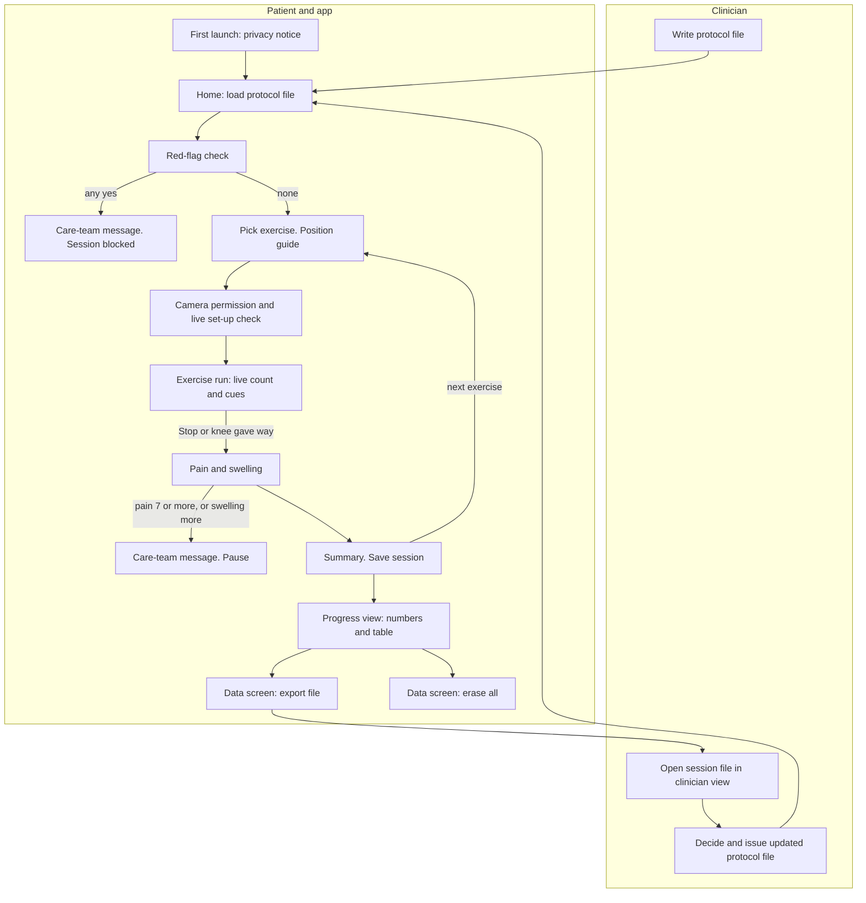

# User flow and UX of the MPFL rehabilitation app

Date: 2026-11-08. Read-only design. No code was written. This file follows `INDEX.md`: every item cites a section, or it is marked PROPOSAL or UNVERIFIED.

Marks: VERIFIED means that the source was opened and states the fact. PROPOSAL means a design suggestion without evidence. UNVERIFIED means that no opened source supports it. Plan means `MPFL_APP_PLAN.md`. Every patient text follows the guardrail skill (`.claude/skills/mpfl-clinical-guardrails/SKILL.md`).

## 1. Overview

On 2026-11-08 the user asked for five things: flow of use, inputs, camera setup, body position in each exercise, and UI. This file answers each point.

Main decisions:
- The app asks for almost nothing. The protocol file of the clinician carries the side, the active phase and the limits. The patient enters no date of surgery, no name and no body size.
- One path for every session: red-flag check, position guide, live camera check, exercise, pain and swelling. Each step maps to a requirement of the plan.
- The camera check uses the pose pipeline of the app. It shows plain text that reacts to the live result.
- The app draws each exercise position as a stick figure from code, and also gives text. No photo and no video of a person.
- Progress shows as measured numbers with a table. The app never judges them and never changes the plan. The clinician reads the exported file and issues a new protocol file (section 3.3).
- The second camera stays an open slot (section 6.4).

What the code supports today: the protocol is held in memory only, and the database holds sessions only (`src/lib/storage/db.ts`). So the patient must load the protocol file at each launch. Section 11 proposes a fix.

## 2. Evidence for the UX choices

The evidence for UX is thin and mostly from knee osteoarthritis and arthroplasty. No study of MPFL patients was found. Each design choice below is a PROPOSAL unless a cited section decides it.

| Source (opened) | Finding | Use in this design |
|---|---|---|
| Lang 2022, Arch Physiother, https://doi.org/10.1186/s40945-022-00148-z (PMC9527092) | 10 randomised trials, 1117 people. 7 trials found that a digital addition raised adherence. Quality low to moderate. Adherence was self-reported. Many people reported technology problems. | Keep the app simple. Use reminders and a diary. Do not claim an adherence effect for this app. |
| Qualitative study, knee osteoarthritis app with sensors, 14 people, https://pmc.ncbi.nlm.nih.gov/articles/PMC12314823/ | People valued instructions from several angles plus text, and sound and visual cues. Repeated error messages annoyed them. Several set-up attempts were demotivating. Small phone screens and positioning while lying down were problems. Some people wanted a human for pain or doubt. | Drawing plus text. Few and rate-limited cues. A set-up check that guides. A clear route to the care team. Start by timer, not by touch. |
| Qualitative study, knee osteoarthritis, 26 people, https://pmc.ncbi.nlm.nih.gov/articles/PMC13314908/ | Motivation was fragile. Progress tracking was valued. People missed human feedback. Endorsement by a professional was a precondition. People without app experience feared technical complexity. | Progress as plain numbers. The clinician gives the protocol file. Few set-up steps. |
| Pose study, six healthy adults, https://pmc.ncbi.nlm.nih.gov/articles/PMC12749503/ | The authors state that pose accuracy depends on camera angle, lighting and distance. They did not test these. | The live check covers view, light and distance. The values stay PROPOSAL. |
| W3C, WCAG 2.2, https://www.w3.org/WAI/WCAG22/Understanding/target-size-minimum.html | 2.5.8: a pointer target is at least 24 by 24 CSS pixels, with five exceptions. | Section 9. |
| W3C, WCAG 2.2, https://www.w3.org/WAI/WCAG22/Understanding/status-messages.html | 4.1.3: a status message must reach assistive technology without a focus change. | Live region for cues. |
| Okuno 2026, `form-opus.md` section 2.3 (VERIFIED there) | Tablet on a tripod, side view, 2.0 to 2.5 m. Limits of agreement about 9 degrees. | Distance and error margin. |
| Iizuka 2026, `form-opus.md` section 2.3 (abstract only) | A geometry correction for a fixed camera cut the error from 10.9 to 3.9 degrees RMSE. | Use the same place each day (PROPOSAL). |

Not opened, so UNVERIFIED:
- the AHRQ Health Literacy Universal Precautions Toolkit (403 error),
- a stroke trial on pictorial exercise sheets,
- the Scientific Reports virtual coach trial (redirect),
- the JOSPT 2022 meta-analysis on digital adherence (403 error),
- any study that measures onboarding burden.

The claim that simple drawings help comprehension is therefore a PROPOSAL.

## 3. The flow

### 3.1 Path

| # | Step | Purpose | Trace |
|---|---|---|---|
| F1 | First launch: privacy notice, one button "I understand" | Say that no video leaves the device and that the export holds health data | FR18, NFR1 |
| F2 | Home: if no protocol is loaded, one button "Load protocol file" | Get side, phase, limits | FR1, FR2, FR4 |
| F3 | Home shows side, active phase, approval fields, last export, banners | Show who set the plan | Plan 1.5, FR3, FR17 |
| S1 | Red-flag check | Block the session on a red flag | FR5 |
| S2 | Pick an exercise from the active phase | Run what the protocol sets | FR2, FR9 |
| S3 | Position guide: drawing and text | Show the right body position | User request 2026-11-08, `clinical.md` section 4 |
| S4 | Camera permission, then live set-up check | Make sure that the leg is measurable | FR6, FR7, FR10, NFR9 |
| S5 | Exercise run: live count and cues | Count and estimate | FR7 to FR11, FR23 |
| S6 | Stop, or "knee gave way or hurts" | Always allow an exit | FR11 |
| S7 | Pain and swelling, then the safety floor | Log symptoms. Route to the care team | FR11, FR12 |
| S8 | Save the session | Keep the record | FR11, FR17 |
| R1 | Return visit: Home, then S1 to S8 again | Same path every time | FR5 |
| R2 | Progress view: numbers and table | Show the trend | FR13 |
| X1 | Data screen: export JSON or CSV. Reminder after 7 days | Give the file to the care team | FR14, FR17 |
| E1 | Data screen: erase all, with a confirmation | Remove local data | FR16 |

Rules of the path:
- A direct route to the session screen redirects to S1 (FR5).
- The camera starts only after a button press in S4. It stops on every exit (NFR9).
- One run saves one session record. The run for one exercise lasts until the patient presses Stop. The code has no set logic. Prescribed sets and reps show as text only. The app does not stop at the prescribed count, because "set finished" reads as a goal (guardrail skill).
- Rest between sets: when the leg leaves the view, counting pauses (FR7). The cue "leg not visible" shows once and the voice cue repeats at most every 10 seconds (PROPOSAL, from PMC12314823).

### 3.2 Diagram

### 3.3 Update loop

The app records. The clinician decides. The app never changes the phase (FR4). The evidence for any change rule is in `research/progression.md` (written by another agent, not copied here).

| Step | Who | Action | What the screen shows |
|---|---|---|---|
| U1 | Patient | Does sessions. The app records them | Summary after each run |
| U2 | Patient | Exports the JSON file. The app reminds after 7 days | Data screen, health-data warning, last export date |
| U3 | Patient | Sends the file by own channel, for example email. The app does not send it | Text: "Send this file to your care team." |
| U4 | Clinician | Opens the file in the clinician view. The file stays in memory (FR15) | Section 3.5 |
| U5 | Clinician | Decides. Edits and approves a new protocol JSON file (the authoring form is future work, FR21). Sends it back | Not in the app |
| U6 | Patient | Loads the new file on Home (FR1). Old sessions stay | Home: approval date, author, active phase, "set by your care team" |

Limits: the file is unsigned and the patient can edit it (plan 1.4). The patient can load an old protocol file again. Home shows the approval date, so the care team can see which file ran. A session record holds `protocolId` and `phase`.

### 3.4 What the patient sees about progress

The Progress view (FR13) holds three charts, each with a data table:
- "Estimated knee bend, highest in each session (degrees)". Label: "estimated angle, not a medical measurement".
- "Reps each day".
- "Pain after each session (0 to 10)", and the swelling answers in the table.

Wording and form rules:
- Lines and tables only. No trend arrow, no colour for better or worse, no goal line, no streak, no badge.
- No word of progress, goal, milestone or score. Text under the charts: "These numbers are a webcam estimate. Send the file to your care team. They decide any change to your plan."
- The text "your care team will review" is not used. It promises a review that the app cannot make sure of. Section 11 asks.
- The camera error is about 9 degrees (`form-opus.md` section 2.3). A change smaller than that is not shown as a change. The summary says "cannot tell, the camera error is larger than this difference" (`form-opus.md` section 4.3).

### 3.5 What the clinician view must show

Only data that the app records (session fields in `src/lib/storage/db.ts` and the export header):
1. Header: pseudonymous id, export date, `angleMethod`, margin degrees and its source. Warning: "Unsigned file. The patient can edit it."
2. Session list: date, exercise, phase, protocol id, reps, hold seconds, peak knee bend, estimated angle at the top.
3. Per day: number of runs and reps for each exercise. This shows how often the patient exercised. The app does not call it adherence.
4. Chart and table of peak knee bend for each exercise, with the margin as a band.
5. Pain and swelling log by date. A mark on a row when the app floor rule applied (pain 7 or more, or swelling "more than before"). The mark says "app rule".
6. The change of protocol id and phase over time.

Gaps. The app does not record these facts, and a decision needs them (PROPOSAL, section 11):
- red-flag blocks and "knee gave way or hurts" presses,
- counts of the events near-limit, over-limit and too-fast,
- the protocol limits that applied (only `protocolId` is saved).

### 3.6 Adaptive suggestions (undecided)

This slot is empty by decision. If the user chooses suggestions later:
- They appear in the clinician view only, in a closed panel named "Suggestions for review".
- Text states measured data against the limit, for example "Peak bend above the limit in 3 of 5 runs". It never says to change phase or load.
- The clinician applies a change only by issuing a new file (U5).
- A patient-facing suggestion is FR22. It needs the regulatory review in plan 1.5 and `tech.md` section 6.1 first.

## 4. Data inputs

| Item | Ask? | When | Why | Where stored | MVP |
|---|---|---|---|---|---|
| Operated side | No | Never. It comes from the protocol field `side` | Schema has `side`. A second source can disagree | Protocol (memory), session record | Yes |
| Phase and week | No | Never. `activePhase` comes from the protocol | The app never sets the phase (FR4). Week ranges in the literature are not targets (`clinical.md` section 2) | Protocol, session `phase` | Yes |
| Date of surgery | No | Never | No requirement uses it. A week number can read as a milestone. Data minimisation | Not stored | No |
| Concurrent procedures | No | The clinician sets them in the file | A combined-surgery patient needs another protocol (S23, `clinical.md` section 7, section 9 item 4). The patient is not asked | Protocol field (PROPOSAL: add `surgeon.concurrentProcedures`) | Field proposed |
| Clinic and surgeon | No | In the protocol (`authoredBy`, `approvedOn`) | Home shows who approved (plan 1.5) | Protocol | Yes |
| Height, leg length | No | Never | The angle does not need a body size (`angle.ts` uses vectors and aspect ratio) | Not stored | No |
| Red-flag answers | Yes | Each session | FR5 | Not stored. Only the block result matters (PROPOSAL: count blocks) | Yes |
| Pain 0 to 10 | Yes | After each run | FR11, FR12 | Session record | Yes |
| Swelling none, some, more | Yes | After each run | FR11, FR12 | Session record | Yes |
| Pseudonymous id | No | Made at the first export | FR14 | `localStorage` | Yes |
| Privacy acknowledgement | Yes | First launch | FR18. The flag is new (PROPOSAL) | `localStorage` | Yes |
| Language | No | English only | Every string needs clinical review. A fixed list in `src/lib/cues.ts` makes translation possible later | Not stored | Later |
| KOOS, Kujala, IKDC, MPFL-RSI | No | Not in the MVP | See below | Not stored | Later |
| Name, birth date, free text | Never | Never | FR14 | Not stored | No |

Patient-reported outcome measures. `clinical.md` section 2 names Kujala, IKDC, KOOS and MPFL-RSI above 56 as return-to-sport criteria of S1 (level 5). `clinical.md` section 8 rates the MPFL-RSI cutoff "very low" and says its primary source was not opened. Whether each tool is validated for MPFL patients, and how long each takes, is not in the knowledge base (UNVERIFIED). Each tool gives a score. The guardrail skill bans scores on screen, and FR13 shows none. So no tool is in the MVP. Later, the clinician can give the tool in the clinic and record it outside the app.

## 5. Measuring

| Measure | How | Shown | Limit |
|---|---|---|---|
| Knee flexion, live | Hip, knee, ankle of the operated side, filtered (FR7) | Large number in degrees. Label "estimated angle, not a medical measurement" | About 9 degrees (Okuno 2026). Reports up to 15 degrees are UNVERIFIED. `lite` model not tested (T13) |
| Peak flexion per run | Maximum of the filtered angle | Summary, Progress | Same |
| Reps | Counter with margin (FR8) | Live count | Start margin 9 degrees, UNVERIFIED for `lite` |
| Hold time | Timer (FR9) | Seconds, live | Frame rate only (UNVERIFIED) |
| Estimated angle at the top of the leg raise | Worst angle during the raise (FR9) | A number. The word "lag" only if the limit is larger than the margin | Same as flexion |
| Rep time | Time stamps | Only when a minimum is set (FR23) | UNVERIFIED |

No baseline range-of-motion test in the MVP (PROPOSAL):
- A separate test is not an exercise of the protocol. Its result reads as a clinical range measure, and the error is about 9 degrees.
- The first heel-slide run gives a first peak. It uses the same screen and the same label.
- The clinician measures range with a goniometer in the clinic. The app does not replace this.

What the patient must do for a measurement:
- Use the same place, the same device position and similar clothes each day. The trend then compares like with like (`tech.md` section 2.3, Iizuka 2026).
- Move through the range in the speed of section 7.
- Keep the leg in the view for the whole run.

## 6. Camera set-up, one camera

### 6.1 Parameters

| Parameter | Guidance | Mark |
|---|---|---|
| Side of view | Camera at the side of the operated leg. The operated leg is the near leg. The other leg is behind it and cannot hide it | PROPOSAL, from `tech.md` section 2.3 (occlusion) and `dual-camera.md` section 1 |
| Distance | 2.0 to 2.5 m from the camera to the patient. Whole leg in the frame | VERIFIED for one study (Okuno 2026). 3 to 3.5 m in Rode 2025 |
| Height | Camera at about knee height | PROPOSAL, from `tech.md` section 2.3. The height of Okuno 2026 was not read |
| Level | Device upright and not tilted. The leg raise check reads the up direction of the image | PROPOSAL, from `exercises.ts` (`isLegRaised`) |
| View | Side-on. The leg moves in the plane of the image. A front view hides the bend | VERIFIED as a rule of the knowledge base (`tech.md` section 2.3) |
| Light | Even light on the leg. No window behind the patient | The effect is stated in PMC12749503. The rule is a PROPOSAL |
| Background | Plain wall. No other person in the frame | PROPOSAL. Other people are in the video (NFR9) |
| Clothing | Shorts or close trousers. No blanket, no loose cloth over the knee | PROPOSAL, from `tech.md` section 2.3 (occlusion) |
| Floor space | About 2.5 m deep. The patient can lie or stand with room at the head and foot | PROPOSAL |
| Stand | A tripod, or a stable shelf, chair or table. A laptop on a chair with books. No hand-held device | PROPOSAL. The check tests stillness |
| Camera | The front camera and screen face the patient (`camera.ts` uses `facingMode: user`) | VERIFIED in the code |
| Permission | A text before the browser prompt. Button "Start camera". Video only | VERIFIED rule (NFR9) |
| Privacy | "The app does not record or send video." One line | NFR1, FR6 |
| Battery | Connect the charger for a long session. The screen stays on (Wake Lock, PROPOSAL) | PROPOSAL |
| Preview | The preview is not mirrored. Mirroring swaps near and far legs on the screen | PROPOSAL |

### 6.2 Live set-up check

The check uses the pose loop (`src/pose/loop.ts`). It runs in the Setup screen after the camera starts. It shows the first failed rule, in this order. A failed rule hides the Start state.

| # | Rule | Text on screen and spoken |
|---|---|---|
| 1 | No pose found | "Step into the view." |
| 2 | Hip, knee or ankle of the operated side has visibility below 0.5 (the gate of FR7), and the other side is clearer | "Turn so your operated leg faces the camera." |
| 3 | Same as 2, and the other side is not clearer | "Your hip, knee and ankle must show. Remove anything that covers your leg." |
| 4 | A leg landmark or the foot is within 5 percent of a frame edge (PROPOSAL) | "Move back. Show your whole leg." |
| 5 | Leg length is less than 30 percent of the frame extent along the direction of the leg, which is the width for a lying leg and the height for a standing leg (PROPOSAL, changed on 2026-11-09, the old base was the long frame side) | "Move closer." |
| 6 | Hips are not one above the other in the image: not side-on (PROPOSAL, needs T13) | "Turn side-on to the camera." |
| 7 | Hip, knee and ankle move more than 2 percent of frame height in 2 seconds (PROPOSAL) | "Hold still for 2 seconds." |
| 8 | All rules pass | "The camera sees your hip, knee and ankle." Then a timer of 5 seconds starts. |

All numbers in this table are PROPOSAL start values. T13 must tune them on real video. A rule that fails for under 1 second does not change the text (no flicker).

Screen:
- The preview with three dots and two lines on the operated leg: hip, knee, ankle. A dashed frame at 5 percent from the edge.
- One large text line with the current instruction. A small list of the rules with a tick or a cross and a word ("seen", "not seen"). Colour is never the only sign.
- Buttons: "Cancel" and "More time". The timer of 5 seconds is a time limit (WCAG 2.2.1), so "More time" adds 30 seconds. The patient can lie down before the start. The run starts by timer, not by touch.
- The rules stay active during the run. A failed visibility gate pauses counting and shows "Show your whole leg" (FR10).

Screen reader:
- The instruction line is a polite live region (`role="status"`, WCAG 4.1.3). It announces a change at most once every 3 seconds.
- Each rule has text, for example "Rule 4, leg inside the frame: not met."
- "Cancel" and "More time" keep focus. The timer announces "Starting in 5 seconds" once, then "Started".
- A patient who is blind cannot judge the preview. The spoken instructions carry the check. A helper can place the camera (UNVERIFIED that this is enough).

### 6.3 Return visits

On a return visit the rules pass again. The text "Use the same place as last time" shows on the Setup screen. The app stores no photo of the place (FR6).

### 6.4 Second camera (undecided)

The decision about a phone as a second camera is not made (`dual-camera.md` section 1: not in the MVP). The single-camera flow above is complete. A second device plugs in at one point only. After rule 8 passes, an optional line "Add a second camera" opens a pairing step. The run then joins the reps of two views. Nothing else in the flow changes. The privacy text changes from one device to two (`dual-camera.md` section 8.3). Do not build the step before the decision.

## 7. Position guidance per exercise

Common rules: camera on the side of the operated leg (section 6.1). The operated leg is the near leg. Range words state the limit of the care team. The protocol example values are PROPOSAL, not evidence (`example-protocol.json`). If the protocol sets no value, the screen shows "Ask your surgeon". Hands and support never stand between the camera and the leg.

### 7.1 Heel slide (phase 1)
- Start: lie on the back on a bed or a mat. Both legs straight. Head at either end.
- Body and camera: the operated leg is the near leg. The camera sees hip, knee, ankle and the foot.
- Hands and foot: hands at the sides. The heel stays on the surface. Wear a sock on a smooth surface (PROPOSAL).
- Movement: slide the heel toward the buttock. Bend the knee up to the limit set by the care team. Then slide back. S1 gives a start range of 0 to 30 degrees in weeks 1 to 2. It adds 20 to 30 degrees a week (`clinical.md` section 4). The example target is 60 degrees and the limit is 90 degrees (PROPOSAL).
- Speed: at least 2 seconds for one rep (PROPOSAL start value, plan T9b).
- The camera must see: the whole leg. The blanket stays off the leg.

### 7.2 Straight leg raise (phase 1)
- Start: lie on the back. The other knee bent with the foot flat (PROPOSAL, common practice, not in the knowledge base). The operated leg straight.
- Body and camera: the operated leg is the near leg and the straight leg. Keep the other leg low and behind.
- Hands: at the sides or on the floor.
- Movement: keep the knee straight. Lift the leg to about the height of the other knee. Hold. Lower with control. The hip angle of about 30 to 45 degrees is a PROPOSAL (`clinical.md` section 4). The app does not measure it.
- What the app shows: the estimated knee angle at the top, as a number. It does not say "lag" unless the limit is larger than the margin (FR9).
- Speed: slow, at least 2 seconds up and 2 seconds down (PROPOSAL).
- The camera must see: hip, knee and ankle during the whole lift. The device is level (section 6.1).

### 7.3 Mini squat (phase 2)
- Start: stand side-on to the camera, feet at hip width, operated leg near the camera.
- Body and camera: the patient stands with the side toward the camera. This is the position for a side view. The patient cannot read the screen well in this position, so sound cues carry the message (section 9).
- Hands and support: one hand on a counter or a chair back. The support stands in front of the body, away from the camera (PROPOSAL). The hand never covers the hip.
- Movement: bend both knees slowly. The example limit is 50 degrees of knee bend, from S16 in healthy people (`clinical.md` section 4). The link to graft safety is UNVERIFIED. The care team sets the real limit. The app does not pick a depth.
- Speed: at least 2 seconds for one rep (PROPOSAL, T9b).
- The camera must see: hip, knee, ankle and foot. No chair or counter between the leg and the camera.

### 7.4 Seated knee extension hold (phase 2)
- Start: sit on a chair with no arm rest on the camera side. The thigh rests on the seat. The foot is off the floor or on a low stool (PROPOSAL).
- Body and camera: side-on. The operated leg is the near leg.
- Hands: on the seat beside the hips.
- Movement: straighten the knee. Hold for the time that the care team set. The example hold is 5 seconds (PROPOSAL). The code counts "extended" when the estimated flexion is within 10 degrees of the target (`exercises.ts`, a start value). Then lower the foot.
- Speed: slow up and down. The timer starts when the leg is extended and resets when the knee bends.
- The camera must see: the thigh, the knee and the foot.

### 7.5 How the position is shown

One function draws each position from code, with an angle table (PROPOSAL):
- Data: for each exercise, two key frames (start and end). Each frame holds the trunk angle, the hip angle and the knee angle. The function turns them into points with fixed segment lengths. One table is the source for all four drawings (DRY).
- Shapes: a floor line. A circle for the head. A line for the trunk. A thick polyline with round dots for the operated leg: hip, knee, ankle, foot. A thin dashed polyline for the other leg. A rectangle for the chair, mat or counter. A camera icon at the side with a dashed arrow and the label "about 2 m". An arrow for the movement direction. A faint copy of the end frame behind the start frame.
- Labels: "operated leg", "camera", "support", "start", "end". An arc at the knee with the number of the protocol limit, for example "limit set by your care team: 90 degrees". If the protocol sets no limit, the label reads "Ask your surgeon".
- Style: one dark stroke colour and one accent colour. No green or red. Meaning also comes from line style and text (WCAG 1.4.1).
- Accessibility: the drawing has a `title` and `desc` with the same sentences as the text steps. The text is the main instruction. The drawing helps.
- Evidence: patients valued pictures from several angles plus text (PMC12314823). No study of stick figures was opened. This is a PROPOSAL.

## 8. Screen list and layout rules

### 8.1 Screens

| Screen | Purpose | Main action | Content |
|---|---|---|---|
| Privacy (FR18) | State the data rules | "I understand" | No video leaves the device. A shared device means shared data. The export holds health data. Linked from Home |
| Home | Start, load, status | "Start session" or "Load protocol file" | Side, active phase, approval fields, today list, last export, reminder, banners ("EXAMPLE, NOT APPROVED" or "Prototype. Not for patient use.") |
| Red-flag check | Block on red flag | "None of these apply. Continue" | List from `redflags.ts`, note "general guidance, not verified for MPFL surgery" |
| Set-up | Position guide, then live check | "Start camera", then timer | Drawing, text, preview, live instruction (section 6.2) |
| Session | Run | "Stop" (large) | Live number, rep count, cues, second button "Knee gave way or hurts" |
| Summary | Pain, swelling, result | "Save" | Two questions, reps, peak, hold, label of the angle, safety floor message |
| Progress | Show the trend | "Export" | Charts with tables (section 3.4) |
| Data | Export, import, erase, clinician file | "Export file" | Health-data warning, last export date, erase with a confirmation, button "Open a session file (care team)" |
| Clinician view | Read a file | "Open file" | Section 3.5. Read-only. Banner "Memory only" |

Shared part, not a screen: the care-team message. It shows in the red-flag block, after "knee gave way or hurts" and after the safety floor. The text comes from `MESSAGES` in `redflags.ts`.

Nine screens. The protocol load is part of Home. The position guide and the live check are one screen with two states. The privacy notice is the only first-launch screen.

### 8.2 Layout rules
- One primary action on each screen. Large buttons. Secondary actions are smaller and apart.
- Plain words, short sentences, active voice. Units next to each number: "62 degrees", "5 seconds". A leading zero: "0.5".
- No blinking and no moving banners. No streak and no badge.
- During a run: the live angle number and the rep count in very large type, readable from 2 metres. Use about 72 CSS pixels or more (PROPOSAL). The Stop button fills at least the bottom third of the screen width (PROPOSAL). A sound plays with each cue.
- The label "estimated angle, not a medical measurement" shows next to every angle.
- No verdict words and no verdict colours (guardrail skill). An in-range rep shows nothing.
- The cue text comes only from `src/lib/cues.ts`.
- The safety side warns early. A cue near the limit shows as text and as sound.

### 8.3 Example copy

| Place | Text |
|---|---|
| Red-flag, title | "Check before you exercise." |
| Red-flag, body | "Tick each sentence that is true today. General guidance, not verified for MPFL surgery." |
| Red-flag, block | "Stop. Do not exercise. Contact your care team." Or, for the emergency group: "Stop. Do not exercise. Call emergency services now." |
| Camera, before the prompt | "The app uses the camera to find your leg. It does not record or send video. Other people in the view are also seen by the camera." |
| Set-up | "Put the camera at the side of your operated leg. Step back until your whole leg shows. Hold still for 2 seconds." |
| Set-up, ready | "The camera sees your hip, knee and ankle. Starting in 5 seconds." |
| Rep counted | "Rep 4. Estimated knee bend 62 degrees (estimated angle, not a medical measurement)." A short tone. |
| Below target | "Below your target." |
| Close to limit | "Close to your limit. Stop." |
| Above limit | "Stop at your limit. Do not push. This rep did not count." |
| Leg not visible | "Show your whole leg." |
| Pain question | "How much pain do you have now? 0 is no pain. 10 is the worst pain." No value is pre-selected. |
| Swelling question | "Is your knee swollen? No swelling. Some swelling. More than before." |
| Pause and contact | "Pause and contact your care team. You reported pain 8 out of 10. This is a rule of the app. It is not a diagnosis." |
| Progress | "These numbers are a webcam estimate. Send the file to your care team. They decide any change to your plan." |

Check by hand: no banned word of the guardrail skill appears in this table. `claims-check.sh` must run on the real strings.

## 9. Accessibility

Targets of NFR5 and `tech.md` section 6.4.

| Point | Rule |
|---|---|
| 1.4.3 contrast | At least 4.5 to 1 for text and 3 to 1 for large text (`tech.md` section 6.4) |
| 2.5.8 target size | At least 24 by 24 CSS pixels (opened). Buttons use 48 pixels or more (PROPOSAL). The Stop button is much larger |
| 2.2.1 timing | The 5-second start timer has "Cancel" and "More time". No time limit on the red-flag, pain or swelling screens |
| 4.1.3 status | Cues and set-up text use a polite live region. "Stop at your limit" uses an alert region, because it is a safety cue |
| 1.4.1 colour | Colour is never the only sign. No verdict colour at all |
| Keyboard | Every control by Tab. Visible focus. Stop is reachable by keyboard. Escape closes dialogs (plan T12) |
| Sound | Cues have text and sound. A mute button exists. Sound is never the only cue |
| Reading distance | Large live numbers. The side-on position turns the patient from the screen, so voice and tone cues are needed |
| Charts | A data table next to each chart (`tech.md` section 4.3) |
| Motion | No blinking. No animation that cannot stop |
| Touch while lying | Start by timer. No small target on the Set-up screen |

A screen reader test and a test with a person on a real phone are not done (UNVERIFIED).

## 10. Out of scope

- A second camera and the front-view set (FR24). The slot is in section 6.4.
- A baseline range-of-motion test, patient-reported outcome measures, and any score.
- A clinician authoring form, accounts and cloud data (FR21).
- Suggestions and progression (FR22). Slot in section 3.6.
- Photos, video of a person, voice input, and languages other than English.
- A hip angle, an ankle angle and any valgus value (`form-opus.md` section 3, C9 and C12).

## 11. Decisions for the user or a clinician

| # | Decision | Recommendation |
|---|---|---|
| 1 | Keep the protocol in the browser database, so the patient loads it once | Yes. Add a table and clear it in erase (FR16). This changes the T6 schema |
| 2 | Add `surgeon.concurrentProcedures` to the protocol | Yes. The patient is never asked. Home shows "Ask your surgeon" if the field is empty |
| 3 | Add fixed counters to the session record: blocks, "gave way" presses, near-limit, over-limit, too-fast | Yes. The clinician needs them (section 3.5). Raise `schemaVersion` |
| 4 | Pain and swelling after each run, or once per visit | Once for each run. It fits the schema and loses no data. One screen with two questions |
| 5 | Red-flag format: tick list with "None of these apply", or yes and no for each item | Tick list. The data is the same. The clinician must agree |
| 6 | What "more than before" means for swelling | The clinician decides. The text must name the point of comparison |
| 7 | Text "your care team will review" | Do not use it unless the clinic agrees to review each file |
| 8 | Show the camera image during the run, or only the stick figure | Preview in the Set-up screen only. During the run, the stick figure of the operated leg. Less of the home in view. Needs a test |
| 9 | Patient-reported outcome measures | None in the MVP. The clinician can ask in the clinic |
| 10 | Second camera | Undecided. See `dual-camera.md` and `dual-camera-opus.md` |
| 11 | Adaptive suggestions | Undecided. Needs `progression.md` and the regulatory review |
| 12 | Language | English only until a clinician reviews every string |

## 12. Items not verified

- Every number in the set-up check table (5 percent, 30 percent, 2 percent, 2 seconds, 5 seconds). PROPOSAL until T13.
- Camera height, light, clothing, background and floor space. No opened study tests them.
- Side-on detection from the hip landmarks. It needs a test on real video.
- The drawing method and the claim that simple drawings help comprehension. No opened study.
- Sound cues, the rate limit of 10 seconds and the target sizes above 24 pixels. PROPOSAL.
- The start by timer with a patient lying down. It needs a test with real patients.
- The common-practice positions in section 7 (bent other knee, sock on the surface, low stool). They are not in the knowledge base.
- Time to complete and validation of KOOS, Kujala, IKDC and MPFL-RSI for MPFL patients.
- The sources listed as not opened in section 2.
- No study with MPFL patients supports any UX choice here.
- The patient cannot be sure that the clinician reads the file. This is an open care-process question for the clinic.
